# Smart Hospital — Complete Feature Catalogue

> **Evidence-based product documentation**, generated from a live screen-by-screen exploration of the **Smart Hospital** hospital-management system (by QDOCS) running at `demo.smart-hospital.in`.
>
> Captured on **2026-10-17**: 76 application screens, 96 data-entry dialogs, 2 record/tab views, 9 role dashboards and the public website.

| | |
|---|---|
| Product | Smart Hospital — Hospital Management System |
| Vendor | QDOCS · https://www.smart-hospital.in |
| Explored instance | https://demo.smart-hospital.in (Smart Hospital & Research Center) |
| Sign-in used | `superadmin@gmail.com` / `password` (plus all nine demo roles) |
| Technology (vendor docs) | PHP (CodeIgniter MVC) + MySQL · Bootstrap · jQuery/DataTables · Chart.js (server-rendered views) |
| Navigation | 5 sections → 30 menu items → 76 screens |
| Roles | Super Admin, Admin, Doctor, Nurse, Pharmacist, Pathologist, Radiologist, Accountant, Receptionist + Patient portal |

**Companion documents**

| File | Contents |
|---|---|
| `docs/WIKI.md` | Operator handbook — how to run every module, role by role |
| `docs/Smart-Hospital-Complete-Guide.pdf` | Printable guide: wiki + this catalogue + screenshots + backlog |
| `docs/IMPROVEMENT-BACKLOG.md` | Findings and the prioritised improvement backlog for the next phase |
| `docs/COVERAGE.md` | Exactly what was captured, how, and what is out of scope |
| `docs/HELP-LIBRARY.md` | Offline mirror of the vendor knowledge base (categories + every article) |
| `capture/` | Raw evidence: screenshots, DOM profiles, role menu trees, logs |

## 1. Application map

```
Smart Hospital
├── CORE OPERATIONS
│   ├── Dashboard
│   ├── Patient
│   ├── Billing
│   ├── Appointment
│   ├── OPD - Out Patient
│   ├── IPD - In Patient
├── CLINICAL
│   ├── Pharmacy
│   ├── Pathology
│   ├── Radiology
│   ├── Blood Bank
│   ├── Ambulance
│   ├── Front Office
├── ADMINISTRATION
│   ├── Birth & Death Record › Birth Record
│   ├── Birth & Death Record › Death Record
│   ├── Multi Branch › Overview
│   ├── Multi Branch › Report
│   ├── Multi Branch › Settings
│   ├── Human Resource
│   ├── QR Code Attendance › Attendance
│   ├── QR Code Attendance › Settings
│   ├── Duty Roster
│   ├── Annual Calendar
│   ├── Referral
│   ├── TPA Management
│   ├── Finance › Income
│   ├── Finance › Expenses
├── TOOLS & CONTENT
│   ├── Survey Forms › Survey Forms
│   ├── Survey Forms › My Survey Forms
│   ├── Messaging
│   ├── Inventory
│   ├── Download Center › Upload /Share Content
│   ├── Download Center › Content Share List
│   ├── Download Center › Content Type
│   ├── Certificate › Certificate
│   ├── Certificate › Patient ID Card
│   ├── Certificate › Staff ID Card
│   ├── Front CMS
│   ├── Live Consultation › Live Consultation
│   ├── Live Consultation › Live Meeting
├── REPORTS & SETUP
│   ├── Reports › Finance
│   ├── Reports › Appointment
│   ├── Reports › OPD
│   ├── Reports › IPD
│   ├── Reports › Pharmacy
│   ├── Reports › Pathology
│   ├── Reports › Radiology
│   ├── Reports › Blood Bank
│   ├── Reports › Ambulance
│   ├── Reports › Birth Death
│   ├── Reports › Human Resource
│   ├── Reports › TPA
│   ├── Reports › Inventory
│   ├── Reports › Live Consultation
│   ├── Reports › Log
│   ├── Reports › OT
│   ├── Reports › Patient
│   ├── Setup › Hospital Charges
│   ├── Setup › Bed
│   ├── Setup › Print Header Footer
│   ├── Setup › Front Office
│   ├── Setup › Operations
│   ├── Setup › Pharmacy
│   ├── Setup › Pathology
│   ├── Setup › Radiology
│   ├── Setup › Blood Bank
│   ├── Setup › Symptoms
│   ├── Setup › ICD-10
│   ├── Setup › Findings
│   ├── Setup › Vitals
│   ├── Setup › Zoom Setting
│   ├── Setup › Finance
│   ├── Setup › Human Resource
│   ├── Setup › Referral
│   ├── Setup › Appointment
│   ├── Setup › Inventory
│   ├── Setup › Custom Fields
└── Public website (Front CMS) + Patient portal
```

### 1.1 The application shell

Every screen sits inside the same shell:

- **Sidebar** with a live *Filter Menu* box, grouped into the five sections above, collapsible sub-menus and per-item icons.
- **Header**: *Search By Patient Name* (global patient index search), the **Quick Add** launcher (Add Patient · New OPD Patient · New IPD Patient · New Appointment · New Bill), **Bed Status** board, language switcher, calendar, chat, the notification bell (module alerts) and the user menu (profile, password, sign out).
- **Work area** with breadcrumb/page title, DataTables grids (search, sort, paginate, export/print), Bootstrap modals for every add/edit form, and print/PDF output for documents.

### 1.2 Screen inventory at a glance

| Section | Screens | Modules |
|---|---|---|
| Core Operations | 6 | Appointment, Billing, Dashboard, IPD - In Patient, OPD - Out Patient, Patient |
| Clinical | 6 | Ambulance, Blood Bank, Front Office, Pathology, Pharmacy, Radiology |
| Administration | 14 | Annual Calendar, Birth & Death Record, Duty Roster, Finance, Human Resource, Multi Branch, QR Code Attendance, Referral, TPA Management |
| Tools & Content | 13 | Certificate, Download Center, Front CMS, Inventory, Live Consultation, Messaging, Survey Forms |
| Reports & Setup | 37 | Reports, Setup |

## 2. Modules, screens and forms

### 2.1 Core Operations

Day-to-day desk work: the dashboard, the master patient index, billing, appointments and the OPD/IPD clinical desks.

**Key capabilities**

- One dashboard aggregating revenue, bed occupancy, appointments, stock, blood bank and per-module income share.
- A single patient master index shared by OPD, IPD, billing, pharmacy, pathology and radiology.
- Appointment desk with doctor-wise slots, a queue/token view and online-appointment intake.
- OPD/IPD desks expose the whole clinical record: vitals, symptoms, ICD-10 diagnosis, prescription, lab and radiology orders and a timeline.

| # | Screen | What it covers | Path |
|---|---|---|---|
| 1 | **Dashboard** | Role-aware landing page: KPI tiles (revenue MTD, bed occupancy, appointments, outstanding bills, medicine stock, blood-bank stock), a 12-month income-vs-expense trend, a module-wise income donut, the latest activity feed, staff attendance and module income table. | `/admin/admin/dashboard` |
| 2 | **Patient List** | Master patient index. Search, add or import patients, view disabled patients, open the full patient profile and jump straight into a bill. | `/admin/admin/search` |
| 3 | **Single Module Billing** | Billing workbench: single-module billing and OPD/IPD billing through a case ID, part payments, payment modes, discounting and printable receipts. | `/admin/bill/dashboard` |
| 4 | **Appointment** | Appointment desk with Today / Upcoming / Old tabs, doctor-wise and queue views, slot validation and online-appointment handling. | `/admin/appointment/index` |
| 5 | **OPD - Out Patient** | OPD desk: Today / Upcoming / Old visit lists plus the "New Visit" workflow (symptoms, ICD-10, prescription, investigations, charges) and the patient view. | `/admin/patient/search` |
| 6 | **IPD Patient** | IPD desk: admission, bed/ward allocation, consultant assignment, daily notes, medication, investigations, charges and discharge. | `/admin/patient/ipdsearch` |

#### Screen 1.1 — Dashboard

- **Menu path:** Core Operations → Dashboard · **URL:** `/admin/admin/dashboard`
- **Purpose:** Role-aware landing page: KPI tiles (revenue MTD, bed occupancy, appointments, outstanding bills, medicine stock, blood-bank stock), a 12-month income-vs-expense trend, a module-wise income donut, the latest activity feed, staff attendance and module income table.
- **Grid (11 rows):** User | Action | Detail | Module | Amount | Time
- **Grid (10 rows):** Role | Total | Present | Attendance
- **Grid (10 rows):** Module | Income | Share | Last Month
- **Actions:** 2, Save, Update
- **Search / filters:** envato_market_purchase_code, email, app-envato_market_purchase_code, app-email

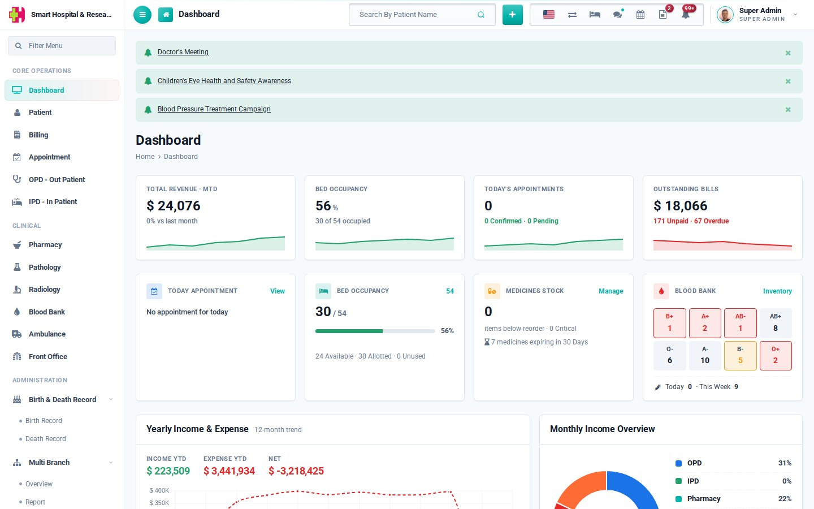

#### Screen 1.2 — Patient List

- **Menu path:** Core Operations → Patient · **URL:** `/admin/admin/search`
- **Purpose:** Master patient index. Search, add or import patients, view disabled patients, open the full patient profile and jump straight into a bill.
- **Grid (101 rows):** # | Patient Name | Age | Gender | Phone | Guardian Name | Address | Dead | Action
- **Panels on screen:** Patient List Add New Patient Import Patient Disabled Patient List
- **Actions:** 2, Add New Patient, Import Patient, Disabled Patient List, Delete Selected, Save, Update
- **Search / filters:** name, guardian_name, contact, gender, dob, Year, Month, Day, blood_group, marital_status
- **Form 1**: `Name *` (text); `Guardian Name` (text); `Phone` (text); `Gender` (select) — Male, Female; `Date Of Birth` (text); `Year` (text); `Month` (text); `Day` (text); `Blood Group` (select) — B+, A+, AB-, AB+, O-, A-; `Marital Status` (select) — Single, Married, Widowed, Separated, Not Specified; `Email` (text); `Address` (input); `National Identification Number` (input); `file` (file); `Remarks` (textarea); `Any Known Allergies` (textarea); `TPA` (select) — Medi life2, Medicare TPA Services (India), Family Health Plan (FHPL), Raksha Health Insurance, Paramount Health Services, LIFE MEDICAL INSURANCE; `TPA ID` (input); `TPA Validity` (input)
- **Form 2**: `Name *` (text); `Guardian Name` (text); `Phone` (text); `Gender` (select) — Male, Female; `Date Of Birth` (text); `Year` (text); `Month` (text); `Day` (text); `Blood Group` (select) — B+, A+, AB-, AB+, O-, A-; `Marital Status` (select) — Single, Married, Widowed, Separated, Not Specified; `Email` (text); `Address` (input); `National Identification Number` (input); `file` (file); `Remarks` (textarea); `Any Known Allergies` (textarea); `TPA` (select) — Medi life2, Medicare TPA Services (India), Family Health Plan (FHPL), Raksha Health Insurance, Paramount Health Services, LIFE MEDICAL INSURANCE; `TPA ID` (input); `TPA Validity` (input); `Alternate Number` (text)

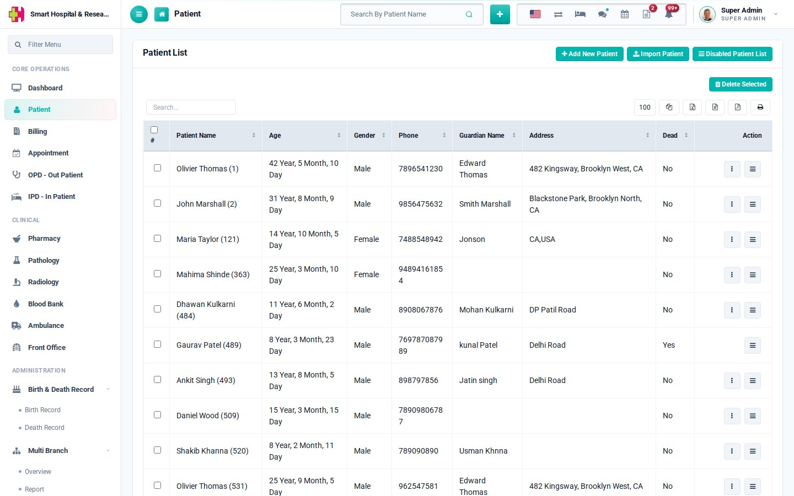

#### Screen 1.3 — Single Module Billing

- **Menu path:** Core Operations → Billing · **URL:** `/admin/bill/dashboard`
- **Purpose:** Billing workbench: single-module billing and OPD/IPD billing through a case ID, part payments, payment modes, discounting and printable receipts.
- **Panels on screen:** Single Module Billing · OPD/IPD Billing Through Case Id
- **Actions:** 2, Search, Save, Update
- **Search / filters:** Enter Case ID, envato_market_purchase_code, email, app-envato_market_purchase_code, app-email
- **Form 1** (posts to `/admin/bill/dashboard`): `Case ID` (text)

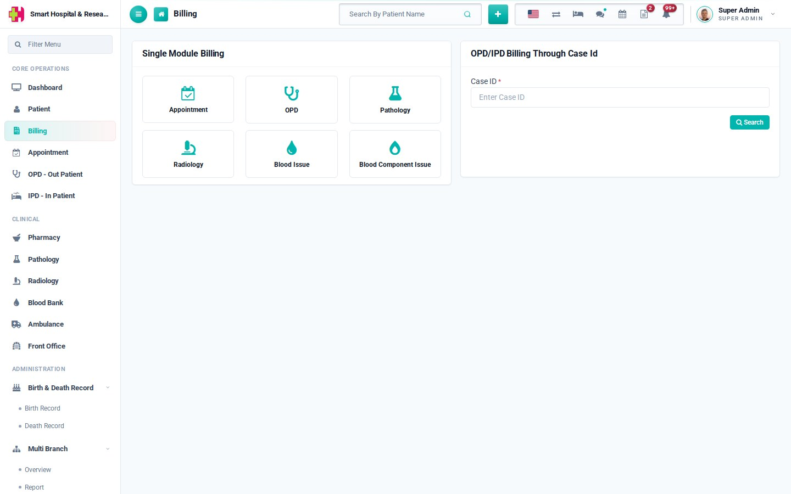

#### Screen 1.4 — Appointment

- **Menu path:** Core Operations → Appointment · **URL:** `/admin/appointment/index`
- **Purpose:** Appointment desk with Today / Upcoming / Old tabs, doctor-wise and queue views, slot validation and online-appointment handling.
- **Tabs:** Today Appointment · Upcoming Appointment · Old Appointment
- **Grid (2 rows):** Patient Name | Appointment No | Date | Phone | Gender | Doctor | Source | Priority | Live Consultant | Alternate Address | Created By | Status
- **Grid (25 rows):** Patient Name | Appointment No | Date | Phone | Gender | Doctor | Source | Priority | Live Consultant | Alternate Address | Created By | Status
- **Grid (101 rows):** Patient Name | Appointment No | Date | Phone | Gender | Doctor | Source | Priority | Live Consultant | Alternate Address | Created By | Status
- **Panels on screen:** Today Appointment Upcoming Appointment Old Appointment Add Appointment Doctor Wise Queue
- **Actions:** 2, Today Appointment, Upcoming Appointment, Old Appointment, Add Appointment, Doctor Wise, Queue, New Patient, Save & Print, Save, Update
- **Search / filters:** patient_id, doctorid, amount, global_shift, date, slot, priority, appointment_status, discount_percentage, live_consult
- **Form 1**: `patient_id` (select); `Doctor` (select) — Amit Singh (9009), Reyan Jain (9011), Sansa Gomez (9008), Sonia Bush (9002); `Doctor Fees ($)` (text); `Shift` (select); `Appointment Date` (text); `Slot` (select); `Appointment Priority` (select) — Normal, Urgent, Very Urgent, Low; `Status *` (select) — Pending, Approved, Cancel; `Discount Percentage` (text); `Live Consultant (On Video Conference)` (select) — No, Yes; `Payment Mode` (select) — Cash, Cheque, Transfer to Bank Account, UPI, Online, Other; `Message` (textarea); `Cheque No` (text); `Cheque Date` (text); `document` (file); `Alternate Address` (textarea)
- **Form 2**: `Doctor` (select) — Amit Singh (9009), Reyan Jain (9011), Sansa Gomez (9008), Sonia Bush (9002); `Doctor Fees ($)` (text); `Shift` (select); `Appointment Date` (text); `Slot` (select); `Appointment Priority` (select) — Normal, Urgent, Very Urgent, Low; `Discount Percentage` (text); `Status *` (select) — Pending, Approved, Cancel; `Live Consultant (On Video Conference)` (select) — No, Yes; `Message` (textarea)
- **Form 3**: `Name *` (text); `Guardian Name` (text); `Phone` (text); `Gender` (select) — Male, Female; `Date Of Birth` (text); `Year` (text); `Month` (text); `Day` (text); `Blood Group` (select) — B+, A+, AB-, AB+, O-, A-; `Marital Status` (select) — Single, Married, Widowed, Separated, Not Specified; `Email` (text); `Address` (input); `National Identification Number` (input); `file` (file); `Remarks` (textarea); `Any Known Allergies` (textarea); `TPA` (select) — Medi life2, Medicare TPA Services (India), Family Health Plan (FHPL), Raksha Health Insurance, Paramount Health Services, LIFE MEDICAL INSURANCE; `TPA ID` (input); `TPA Validity` (input); `Alternate Number` (text)

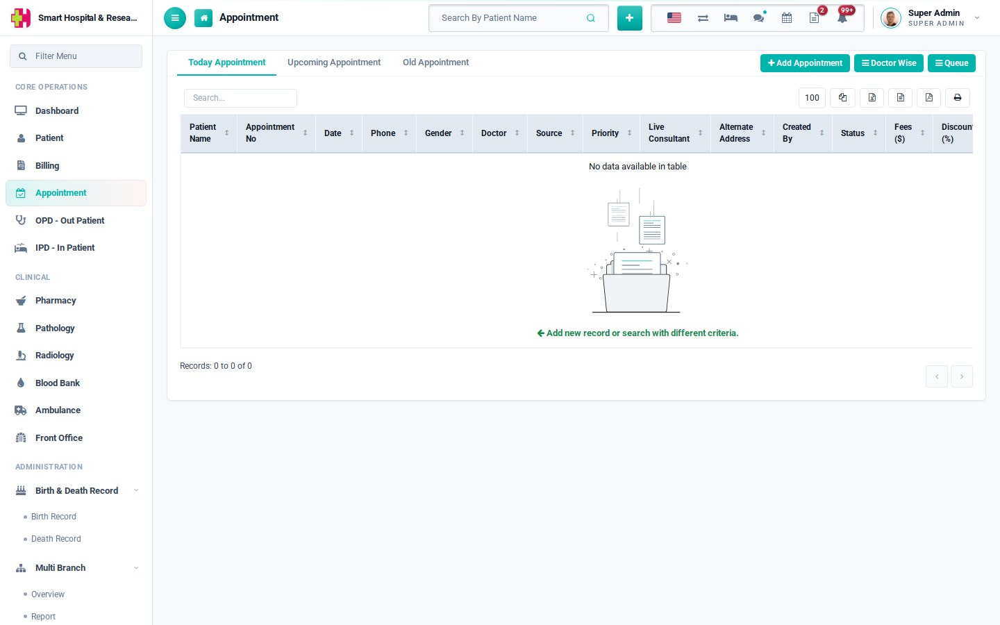

#### Screen 1.5 — OPD - Out Patient

- **Menu path:** Core Operations → OPD - Out Patient · **URL:** `/admin/patient/search`
- **Purpose:** OPD desk: Today / Upcoming / Old visit lists plus the "New Visit" workflow (symptoms, ICD-10, prescription, investigations, charges) and the patient view.
- **Tabs:** Today OPD · Upcoming OPD · Old OPD · Patient View
- **Grid (96 rows):** Name | Patient Id | Guardian Name | Gender | Phone | Generated By | Consultant | Last Visit | Is Antenatal | Total Recheckup
- **Grid (2 rows):** OPD No | Patient Name | Case ID | Appointment Date | Generated By | Consultant | Reference | Symptoms | Is Antenatal | Previous Medical Issue | Action
- **Panels on screen:** Today OPD Upcoming OPD Old OPD Patient View Add Patient
- **Actions:** 2, Today OPD, Upcoming OPD, Old OPD, Patient View, Add Patient, New Patient, Save & Print, Save, Move, Update
- **Search / filters:** symptoms_type, icd_code_ids[], appointment_date, case, casualty, old_patient, refference, consultant_doctor, charge_category, charge_id
- **Form 1** (posts to `/admin/patient`): `field` (select); `symptoms_type` (select) — Eating or weight problems, Emotional problems, Muscle or joint problems, Skin problems, Bladder problems, Stomach problems; `field` (text); `Symptoms Description` (textarea); `ICD Group` (select) — Select Group, Infectious & Parasitic Diseases, Infectious Diseases, Mental & Behavioural Disorders, Neoplasms, Viral Diseases; `ICD-10 Diagnosis` (select) — [A09] Infectious Gastroenteritis, [A15.0] Pulmonary Tuberculosis, [B34.9] Viral Infection, Unspecified, [C50.9] Malignant Neoplasm of Breast, [F41.1] Generalized Anxiety Disorder; `Note` (textarea); `Any Known Allergies` (textarea); `Previous Medical Issue` (textarea); `Appointment Date *` (text); `case` (text); `casualty` (select) — No, Yes; `old_patient` (select) — No, Yes; `refference` (text); `Apply TPA` (checkbox); `consultant_doctor` (select) — Amit Singh (9009), Reyan Jain (9011), Sansa Gomez (9008), Sonia Bush (9002); `Charge Category` (select) — OPD Consultation Fees, OPD Service, OPD Insurance, Blood pressure check, Eye check, Cholesterol level check; `Charge *` (select); `Standard Charge ($)` (text); `Applied Charge ($) *` (text); `discount_percentage` (text); `percentage` (text); … +8 more
- **Form 2**: `Name` (text); `Guardian Name` (text); `Gender` (select) — Male, Female; `Marital Status` (select) — Single, Married, Widowed, Separated, Not Specified; `file` (file); `Any Known Allergies` (text); `Phone` (text); `Blood Group` (select) — B+, A+, AB-, AB+, O-, A-; `Age` (text); `Month` (text)
- **Form 3**: `Symptoms Type` (select) — Eating or weight problems, Emotional problems, Muscle or joint problems, Skin problems, Bladder problems, Stomach problems; `field` (text); `Symptoms Description` (textarea); `Note` (textarea); `Any Known Allergies` (textarea); `Appointment Date` (text); `Case` (text); `Casualty` (select) — No, Yes; `Old Patient` (select) — No, Yes; `Reference` (text); `Consultant Doctor` (select) — Amit Singh (9009), Reyan Jain (9011), Sansa Gomez (9008), Sonia Bush (9002); `Payment Date` (text); `Amount ($)` (text); `Payment Mode` (select) — Cash, Cheque, Transfer to Bank Account, UPI, Online, Other; `Payment Note` (text); `Cheque No` (text); `Cheque Date` (text); `document` (file); `is_for_antenatal` (checkbox)

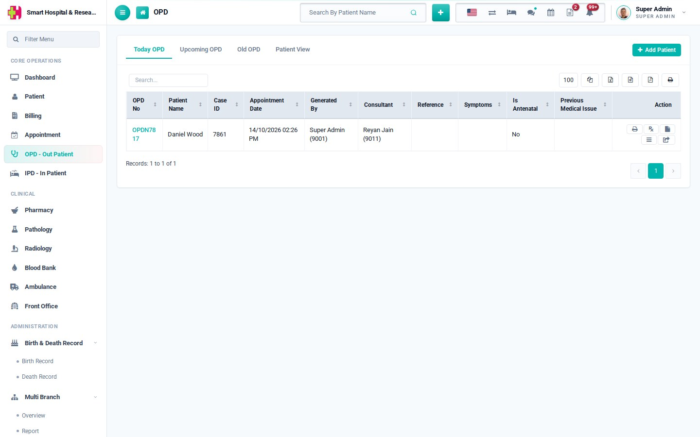

#### Screen 1.6 — IPD Patient

- **Menu path:** Core Operations → IPD - In Patient · **URL:** `/admin/patient/ipdsearch`
- **Purpose:** IPD desk: admission, bed/ward allocation, consultant assignment, daily notes, medication, investigations, charges and discharge.
- **Grid (40 rows):** IPD No | Case ID | Name | Gender | Phone | Generated By | Consultant Doctor | Bed | Is Antenatal | Previous Medical Issue | Credit Limit ($)
- **Panels on screen:** IPD Patient Add Patient Discharged Patient
- **Actions:** 2, Add Patient, Discharged Patient, New Patient, Save, Update
- **Search / filters:** symptoms_type, icd_code_ids[], custom_fields[ipd][6], appointment_date, case, showorganisation_name, casualty, old_patient, credit_limit, refference
- **Form 1** (posts to `/admin/patient/add_inpatient`): `field` (select); `Symptoms Type` (select) — Eating or weight problems, Emotional problems, Muscle or joint problems, Skin problems, Bladder problems, Stomach problems; `Select` (text); `Symptoms Description` (textarea); `ICD-10 Groups` (select) — Select Group, Infectious & Parasitic Diseases, Infectious Diseases, Mental & Behavioural Disorders, Neoplasms, Viral Diseases; `ICD-10 Diagnosis` (select) — [A09] Infectious Gastroenteritis, [A15.0] Pulmonary Tuberculosis, [B34.9] Viral Infection, Unspecified, [C50.9] Malignant Neoplasm of Breast, [F41.1] Generalized Anxiety Disorder; `Note` (textarea); `Previous Medical Issue` (text); `Admission Date *` (text); `Case` (text); `TPA` (text); `Casualty` (select) — Yes, No; `Old Patient` (select) — Yes, No; `Credit Limit ($) *` (text); `Reference` (text); `Consultant Doctor *` (select) — Amit Singh (9009), Reyan Jain (9011), Sansa Gomez (9008), Sonia Bush (9002); `Bed Group` (select) — VIP Ward - Ground Floor, Private Ward - 3rd Floor, General Ward Male - 3rd Floor, ICU - 2nd Floor, NICU - 2nd Floor, AC (Normal) - 1st Floor; `Bed Number *` (select); `Live Consultation` (select) — No, Yes; `Is For Antenatal` (checkbox)
- **Form 2**: `Patient ID` (text); `Name` (text); `Phone` (text); `Appointment Date` (text); `revisit_case` (text); `casualty` (select) — Yes, No; `old_patient` (select) — Yes, No; `Symptoms` (textarea); `Any Known Allergies` (textarea); `Address` (textarea); `Note` (textarea); `refference` (text); `consultant_doctor` (select) — Amit Singh, Reyan Jain, Sansa Gomez, Sonia Bush; `Amount` (text); `Tax` (text); `Payment Mode` (select) — Cash, Cheque, Transfer to Bank Account, UPI, Online, Other
- **Form 3**: `Name` (text); `Guardian Name` (text); `Gender` (select) — Male, Female; `Marital Status` (select) — Single, Married, Widowed, Separated, Not Specified; `Phone` (text); `file` (file); `Symptoms` (text); `Blood Group` (select) — B+, A+, AB-, AB+, O-, A-; `Year` (text); `Month` (text); `Height` (text); `Weight` (text); `organisation` (select) — Medi life2, Medicare TPA Services (India), Family Health Plan (FHPL), Raksha Health Insurance, Paramount Health Services, LIFE MEDICAL INSURANCE; `credit_limit` (text)

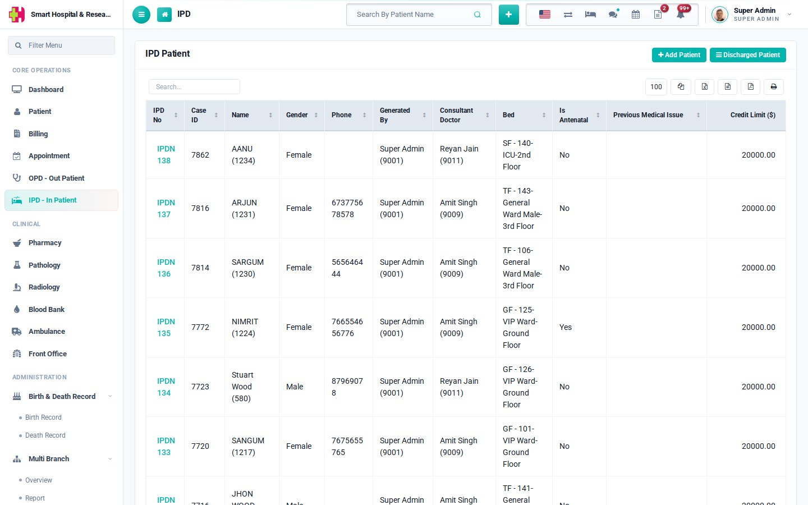

#### Module 1 — data-entry dialogs captured

| Screen | Dialog | Fields | Screenshot |
|---|---|---|---|
| Appointment | **Add Appointment New Patient** | 62 | `004-appointment__add-appointment-new-patient.jpg` |
| OPD - Out Patient | **New Visit New Patient** | 96 | `005-opd-out-patient__new-visit-new-patient.jpg` |
| IPD Patient | **Add Patient New Patient** | 22 | `006-ipd-in-patient__add-patient-new-patient.jpg` |

**Add Appointment New Patient** — opened from *Appointment*

- **Form** *(dialog)*: `patient_id` (select); `Doctor` (select) — Amit Singh (9009), Reyan Jain (9011), Sansa Gomez (9008), Sonia Bush (9002); `Doctor Fees ($)` (text); `Shift` (select); `Appointment Date` (text); `Slot` (select); `Appointment Priority` (select) — Normal, Urgent, Very Urgent, Low; `Status *` (select) — Pending, Approved, Cancel; `Discount Percentage` (text); `Live Consultant (On Video Conference)` (select) — No, Yes; `Payment Mode` (select) — Cash, Cheque, Transfer to Bank Account, UPI, Online, Other; `Message` (textarea); `Cheque No` (text); `Cheque Date` (text); `document` (file); `Alternate Address` (textarea)

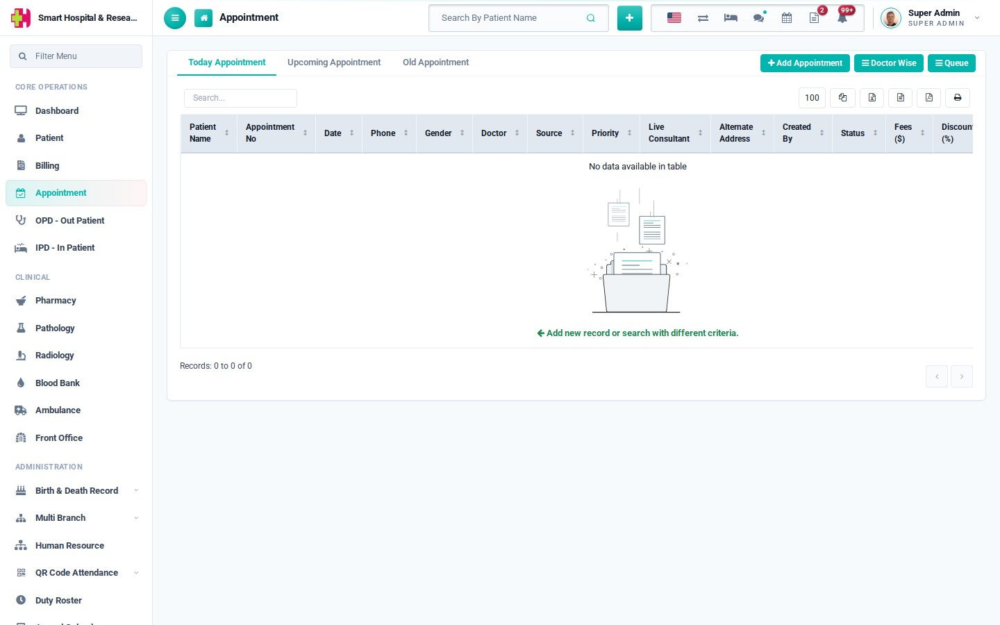

**New Visit New Patient** — opened from *OPD - Out Patient*

- **Form** (posts to `/admin/patient`) *(dialog)*: `field` (select); `symptoms_type` (select) — Eating or weight problems, Emotional problems, Muscle or joint problems, Skin problems, Bladder problems, Stomach problems; `field` (search); `field` (text); `Symptoms Description` (textarea); `ICD Group` (select) — Select Group, Infectious & Parasitic Diseases, Infectious Diseases, Mental & Behavioural Disorders, Neoplasms, Viral Diseases; `ICD-10 Diagnosis` (select) — [A09] Infectious Gastroenteritis, [A15.0] Pulmonary Tuberculosis, [B34.9] Viral Infection, Unspecified, [C50.9] Malignant Neoplasm of Breast, [F41.1] Generalized Anxiety Disorder; `ICD-10 Diagnosis` (search); `Note` (textarea); `Any Known Allergies` (textarea); `Previous Medical Issue` (textarea); `Appointment Date *` (text); `case` (text); `casualty` (select) — No, Yes; `old_patient` (select) — No, Yes; `refference` (text); `Apply TPA` (checkbox); `consultant_doctor` (select) — Amit Singh (9009), Reyan Jain (9011), Sansa Gomez (9008), Sonia Bush (9002); `Charge Category` (select) — OPD Consultation Fees, OPD Service, OPD Insurance, Blood pressure check, Eye check, Cholesterol level check; `Charge *` (select); `Standard Charge ($)` (text); `Applied Charge ($) *` (text); … +10 more

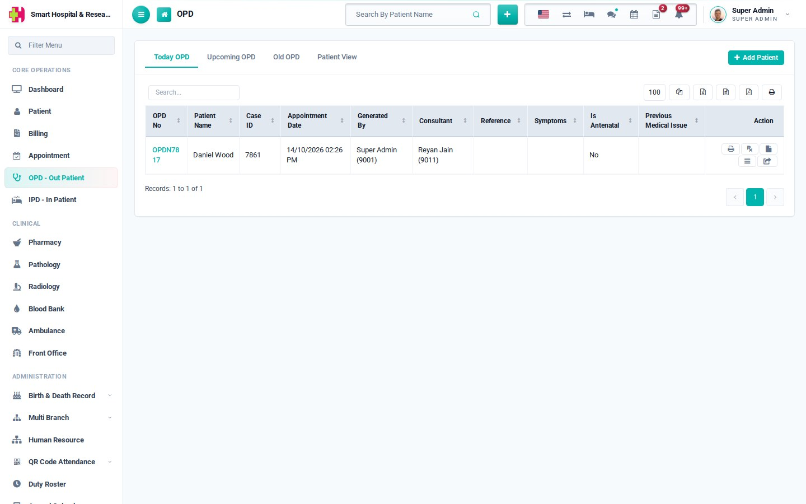

**Add Patient New Patient** — opened from *IPD Patient*

- **Form** (posts to `/admin/patient/add_inpatient`): `field` (select); `Symptoms Type` (select) — Eating or weight problems, Emotional problems, Muscle or joint problems, Skin problems, Bladder problems, Stomach problems; `Symptoms Type` (search); `Select` (text); `Symptoms Description` (textarea); `ICD-10 Groups` (select) — Select Group, Infectious & Parasitic Diseases, Infectious Diseases, Mental & Behavioural Disorders, Neoplasms, Viral Diseases; `ICD-10 Diagnosis` (select) — [A09] Infectious Gastroenteritis, [A15.0] Pulmonary Tuberculosis, [B34.9] Viral Infection, Unspecified, [C50.9] Malignant Neoplasm of Breast, [F41.1] Generalized Anxiety Disorder; `ICD-10 Diagnosis` (search); `Note` (textarea); `Previous Medical Issue` (text); `Admission Date *` (text); `Case` (text); `TPA` (text); `Casualty` (select) — Yes, No; `Old Patient` (select) — Yes, No; `Credit Limit ($) *` (text); `Reference` (text); `Consultant Doctor *` (select) — Amit Singh (9009), Reyan Jain (9011), Sansa Gomez (9008), Sonia Bush (9002); `Bed Group` (select) — VIP Ward - Ground Floor, Private Ward - 3rd Floor, General Ward Male - 3rd Floor, ICU - 2nd Floor, NICU - 2nd Floor, AC (Normal) - 1st Floor; `Bed Number *` (select); `Live Consultation` (select) — No, Yes; `Is For Antenatal` (checkbox)

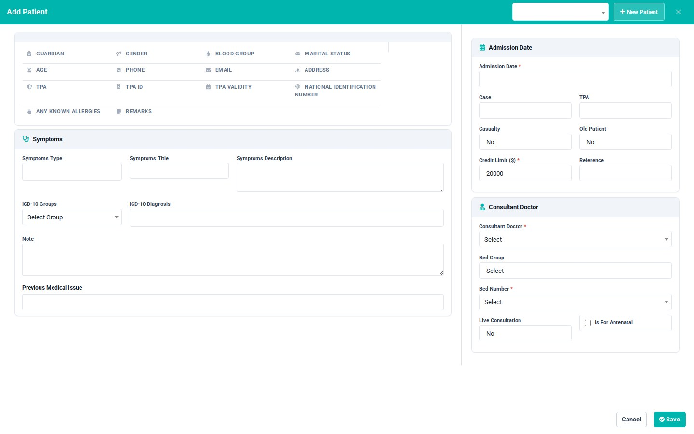


### 2.2 Clinical & Ancillary Services

The departments that raise bills and reports against a patient: pharmacy, laboratory, imaging, blood bank, ambulance and front office.

**Key capabilities**

- Pharmacy store and sale workflow with batch, expiry, GST, discount and stock movement.
- Pathology and radiology: order → sample/procedure → result entry → report generation → print/PDF, single or in batch.
- Blood-bank stock by component and group, donor registry and issue to patient.
- Ambulance call register with vehicle/driver assignment and trip charges.
- Front office covers visitors, phone call logs, postal dispatch and complaints.

| # | Screen | What it covers | Path |
|---|---|---|---|
| 1 | **Pharmacy Bill** | Pharmacy point of sale: batch-wise issue, GST, discounts, stock deduction and printable bill. | `/admin/pharmacy/bill` |
| 2 | **Pathology Bill** | Laboratory worklist: order intake, sample collection, result entry/approval and single or batch report generation. | `/admin/pathology/gettestreportbatch` |
| 3 | **Radiology Bill** | Imaging worklist: order intake, scheduling, findings entry and batch report generation. | `/admin/radio/gettestreportbatch` |
| 4 | **Blood Bank** | Blood bank: component stock by group, donor registry, issue to patient and status board. | `/admin/bloodbankstatus/` |
| 5 | **Ambulance Call List** | Ambulance call register with vehicle/driver, trip details and charges. | `/admin/vehicle/getcallambulance` |
| 6 | **Visitor List** | Reception toolkit: visitor pass, phone call log, postal register and complaints. | `/admin/visitors` |

#### Screen 2.1 — Pharmacy Bill

- **Menu path:** Clinical → Pharmacy · **URL:** `/admin/pharmacy/bill`
- **Purpose:** Pharmacy point of sale: batch-wise issue, GST, discounts, stock deduction and printable bill.
- **Grid (101 rows):** Bill No | Case ID | Date | Patient Name | Generated By | Doctor Name | Amount ($) | Discount ($) | Tax ($) | Net Amount ($) | Paid Amount ($) | Refund Amount ($)
- **Panels on screen:** Pharmacy Bill Generate Bill Sale Return Sale Return Bills Medicines
- **Actions:** 2, Generate Bill, Sale Return, Sale Return Bills, Medicines, New Patient, Save & Print, Save, Update
- **Search / filters:** pharmacyBillTable_length, patient_id, Prescription No, bill_no, case_reference_id, date, sr_patient_id_display, Bill No / Sale Bill No, sr_return_no, sr_date
- **Form 1**: `Apply TPA` (select); `Prescription No` (text); `Apply TPA` (checkbox); `Bill No` (text); `Case ID` (text); `Date` (text)
- **Form 2**: `sr_patient_id_display` (select); `Bill No / Sale Bill No` (text); `Bill No` (text); `Date` (text)
- **Form 3**: `Name *` (text); `Guardian Name` (text); `Phone` (text); `Gender` (select) — Male, Female; `Date Of Birth` (text); `Year` (text); `Month` (text); `Day` (text); `Blood Group` (select) — O+, A+, B+, AB+, O-, A-; `Marital Status` (select) — Single, Married, Widowed, Separated, Not Specified; `Email` (text); `Address` (input); `National Identification Number` (input); `file` (file); `Remarks` (textarea); `Any Known Allergies` (textarea); `TPA` (select) — Medi life2, Medicare TPA Services (India), Family Health Plan (FHPL), Raksha Health Insurance, Paramount Health Services, LIFE MEDICAL INSURANCE; `TPA ID` (input); `TPA Validity` (input); `Alternate Number` (text)

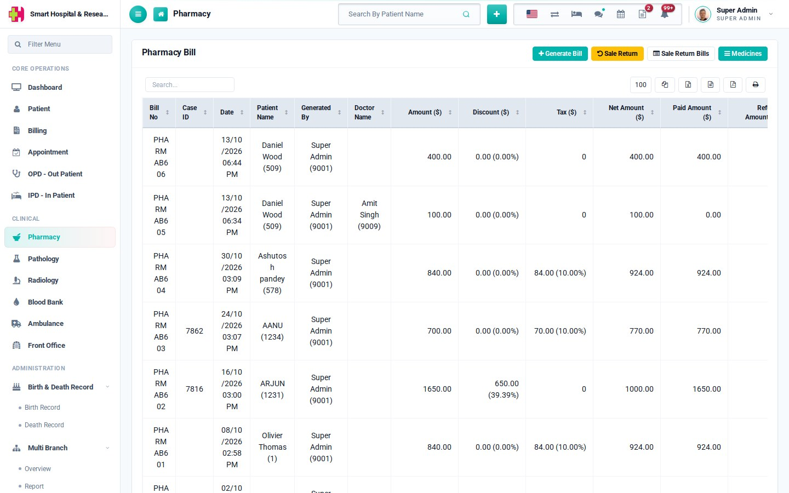

#### Screen 2.2 — Pathology Bill

- **Menu path:** Clinical → Pathology · **URL:** `/admin/pathology/gettestreportbatch`
- **Purpose:** Laboratory worklist: order intake, sample collection, result entry/approval and single or batch report generation.
- **Grid (101 rows):** Bill No | Case ID | Bill Date | Patient Name | Generated By | Reference Doctor | Previous Report Value | Amount ($) | Discount ($) | Tax ($) | Net Amount ($) | Paid Amount ($)
- **Panels on screen:** Pathology Bill Generate Bill Pathology Test
- **Actions:** 2, Generate Bill, Pathology Test, New Patient, Save & Print, Save, Update
- **Search / filters:** testreport_length, patientid, Prescription No, bill_no, case_reference_id, date, collected_by, collected_date, pathology_center, name
- **Form 1**: `Apply TPA` (select); `Prescription No` (text); `Apply TPA` (checkbox); `Bill No` (text); `Case ID` (text); `Date` (text)
- **Form 2** (posts to `/admin/pathology/updatecollection`): `Sample Collected Person Name` (select) — Belina Turner (9005); `Collected Date` (text); `Pathology Center` (text)
- **Form 3**: `Name *` (text); `Guardian Name` (text); `Phone` (text); `Gender` (select) — Male, Female; `Date Of Birth` (text); `Year` (text); `Month` (text); `Day` (text); `Blood Group` (select) — B+, A+, AB-, AB+, O-, A-; `Marital Status` (select) — Single, Married, Widowed, Separated, Not Specified; `Email` (text); `Address` (input); `National Identification Number` (input); `file` (file); `Remarks` (textarea); `Any Known Allergies` (textarea); `TPA` (select) — Medi life2, Medicare TPA Services (India), Family Health Plan (FHPL), Raksha Health Insurance, Paramount Health Services, LIFE MEDICAL INSURANCE; `TPA ID` (input); `TPA Validity` (input); `Alternate Number` (text)

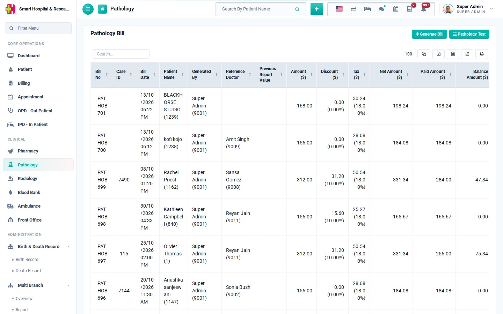

#### Screen 2.3 — Radiology Bill

- **Menu path:** Clinical → Radiology · **URL:** `/admin/radio/gettestreportbatch`
- **Purpose:** Imaging worklist: order intake, scheduling, findings entry and batch report generation.
- **Grid (100 rows):** Bill No | Case ID | Bill Date | Patient Name | Generated By | Reference Doctor | Previous Report Value | Amount ($) | Discount ($) | Tax ($) | Net Amount ($) | Paid Amount ($)
- **Panels on screen:** Radiology Bill Generate Bill Radiology Test
- **Actions:** 2, Generate Bill, Radiology Test, New Patient, Save & Print, Save, Update
- **Search / filters:** testreport_length, patientid, Prescription No, bill_no, case_reference_id, date, collected_by, collected_date, radiology_center, name
- **Form 1**: `Apply TPA` (select); `Prescription No` (text); `Apply TPA` (checkbox); `Bill No` (text); `Case ID` (text); `Date` (text)
- **Form 2**: `Sample Collected Person Name` (select) — John Hook (9006); `Collected Date` (text); `Radiology Center` (text)
- **Form 3**: `Name *` (text); `Guardian Name` (text); `Phone` (text); `Gender` (select) — Male, Female; `Date Of Birth` (text); `Year` (text); `Month` (text); `Day` (text); `Blood Group` (select) — B+, A+, AB-, AB+, O-, A-; `Marital Status` (select) — Single, Married, Widowed, Separated, Not Specified; `Email` (text); `Address` (input); `National Identification Number` (input); `file` (file); `Remarks` (textarea); `Any Known Allergies` (textarea); `TPA` (select) — Medi life2, Medicare TPA Services (India), Family Health Plan (FHPL), Raksha Health Insurance, Paramount Health Services, LIFE MEDICAL INSURANCE; `TPA ID` (input); `TPA Validity` (input); `Alternate Number` (text)

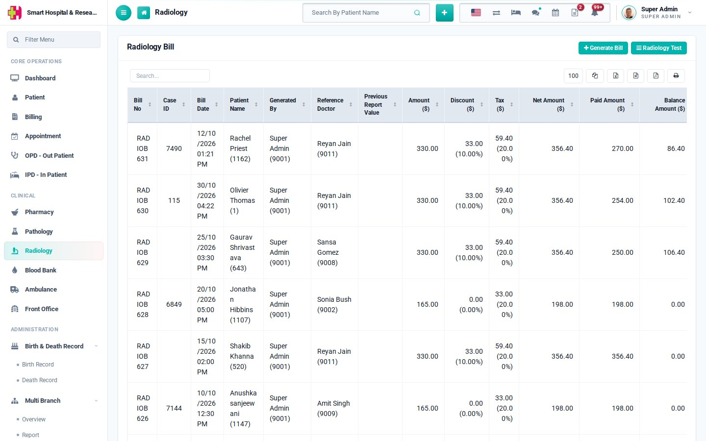

#### Screen 2.4 — Blood Bank

- **Menu path:** Clinical → Blood Bank · **URL:** `/admin/bloodbankstatus/`
- **Purpose:** Blood bank: component stock by group, donor registry, issue to patient and status board.
- **Grid (2 rows):** BAGS | LOT | INSTITUTION | ACTION
- **Grid (10 rows):** BAGS | LOT | COMPONENTS | ACTION
- **Grid (7 rows):** Components Name * | Bag * | Volume | Unit | Lot * | Institution
- **Actions:** 2, Issue, Save, Calculate, New Patient, Save & Print, Update
- **Search / filters:** blood_group, status, blood_donor_id, donate_date, bag_no, volume, unit, lot, charge_category, charge_id
- **Form 1** (posts to `/admin/bloodbankstatus/status`): `Blood Group` (text); `status (in bags) *` (text)
- **Form 2**: `Blood Donor *` (select); `Donate Date *` (text); `Bag *` (text); `Volume` (text); `Unit Type` (select) — (ML), Litter, (nm), per day, Hour, Insurance; `Lot` (text); `Charge Category *` (select); `Charge Name *` (select); `Standard Charge ($) *` (text); `Institution` (text); `note` (textarea); `total` (text); `discount_percent` (text); `discount` (text); `tax_percentage` (text); `tax` (text); `net_amount` (text); `Payment Mode` (select) — Cash, Cheque, Transfer to Bank Account, UPI, Online, Other; `Payment Amount ($) *` (text); `Cheque No *` (text); `Cheque Date *` (text); `document` (file)
- **Form 3**: `Blood Group *` (select) — B+, A+, AB-, AB+, O-, A-; `Bag *` (select); `Platelets` (checkbox); `bag_no_9` (text); `volume_9` (text); `unit_9` (select) — (ML), Litter, (nm), per day, Hour, Insurance; `lot_9` (text); `institution_9` (text); `Plasma` (checkbox); `bag_no_10` (text); `volume_10` (text); `unit_10` (select) — (ML), Litter, (nm), per day, Hour, Insurance; `lot_10` (text); `institution_10` (text); `Cryo.` (checkbox); `bag_no_11` (text); `volume_11` (text); `unit_11` (select) — (ML), Litter, (nm), per day, Hour, Insurance; `lot_11` (text); `institution_11` (text); `White Cells & Granulocytes` (checkbox); `bag_no_12` (text); … +16 more

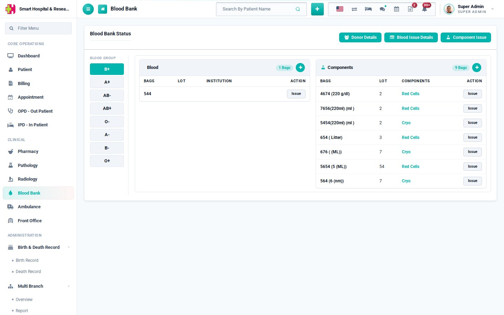

#### Screen 2.5 — Ambulance Call List

- **Menu path:** Clinical → Ambulance · **URL:** `/admin/vehicle/getcallambulance`
- **Purpose:** Ambulance call register with vehicle/driver, trip details and charges.
- **Grid (84 rows):** Bill No | Case ID | Patient Name | Generated By | Vehicle Number | Vehicle Model | Driver Name | Driver Contact No | Patient Address | Date | Emergency Level | Amount ($)
- **Panels on screen:** Ambulance Call List Add Ambulance Call Ambulance List
- **Actions:** 2, Add Ambulance Call, Ambulance List, New Patient, Save & Print, Save, Update
- **Search / filters:** ambulanceCallTable_length, patient_id, Case ID, vehicle_no, driver, date, charge_category_id, code, custom_fields[ambulance_call][11], total
- **Form 1**: `patient_id` (select); `Case ID` (text); `Vehicle Model` (select) — Force Traveller Ambulance - MP04 AB 1234, Tata Winger - MP21 CD 4587, Force Traveller - MP21 AB 1023, BS4 - MP20CD2105, BS4FGD - MP20SD4323, Tata Winge - UP14 AB 1234; `Driver Name` (text); `Date` (text); `Charge Category` (select) — Private Ambulance, ERS/Patient Transport Service, Other Charges, Operation Services, Oxygen cylinder, Fire extinguisher; `Charge Name` (select); `Standard Charge` (input); `Emergency Level` (textarea); `Emergency Level` (text); `total` (text); `discount_percent` (text); `discount` (text); `tax_percentage` (text); `tax` (text); `net_amount` (text); `Payment Mode` (select) — Cash, Cheque, Transfer to Bank Account, UPI, Online, Other; `Payment Amount ($) *` (text); `Cheque No *` (text); `Cheque Date *` (text); `document` (file)
- **Form 2**: `patient_id` (select) — Select Patient; `Case ID` (text); `Vehicle Number` (select) — Force Traveller Ambulance - MP04 AB 1234, Tata Winger - MP21 CD 4587, Force Traveller - MP21 AB 1023, BS4 - MP20CD2105, BS4FGD - MP20SD4323, Tata Winge - UP14 AB 1234; `Driver Name` (text); `Date` (text); `Charge Category` (select) — Private Ambulance, ERS/Patient Transport Service, Other Charges, Operation Services, Oxygen cylinder, Fire extinguisher; `Charge Name` (select); `Standard Charge` (input); `note` (textarea); `total` (text); `discount_percent_edit` (text); `discount_edit` (text); `tax_percentage` (text); `tax` (text); `net_amount` (text); `Payment Mode` (select) — Cash, Cheque, Transfer to Bank Account, UPI, Online, Other; `Payment Amount ($) *` (text); `Cheque No *` (text); `Cheque Date *` (text); `document` (file)
- **Form 3**: `Name *` (text); `Guardian Name` (text); `Phone` (text); `Gender` (select) — Male, Female; `Date Of Birth` (text); `Year` (text); `Month` (text); `Day` (text); `Blood Group` (select) — B+, A+, AB-, AB+, O-, A-; `Marital Status` (select) — Single, Married, Widowed, Separated, Not Specified; `Email` (text); `Address` (input); `National Identification Number` (input); `file` (file); `Remarks` (textarea); `Any Known Allergies` (textarea); `TPA` (select) — Medi life2, Medicare TPA Services (India), Family Health Plan (FHPL), Raksha Health Insurance, Paramount Health Services, LIFE MEDICAL INSURANCE; `TPA ID` (input); `TPA Validity` (input); `Alternate Number` (text)

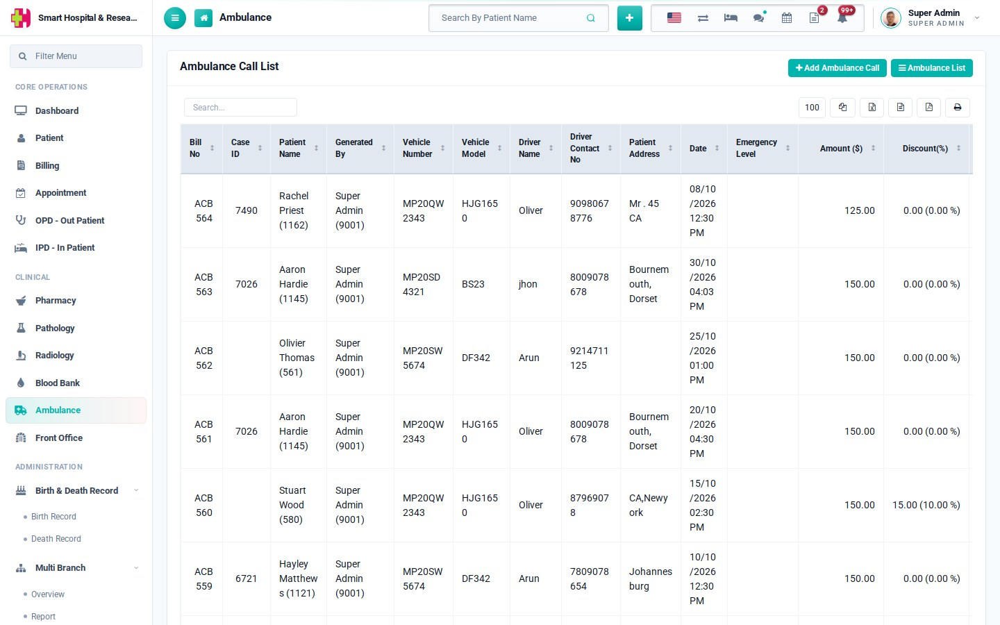

#### Screen 2.6 — Visitor List

- **Menu path:** Clinical → Front Office · **URL:** `/admin/visitors`
- **Purpose:** Reception toolkit: visitor pass, phone call log, postal register and complaints.
- **Grid (73 rows):** Purpose | Name | Visit To | IPD/OPD/Staff | Phone | Date | In Time | Out Time | Action
- **Panels on screen:** Visitor List Add Visitor Phone Call Log Postal Complain
- **Actions:** 2, Add Visitor, Phone Call Log, Postal, Complain, Save, Update
- **Search / filters:** visitorTable_length, purpose, name, contact, id_proof, visit_to, ipd_opd_staff, related_to, pepples, date
- **Form 1** (posts to `/admin/visitors/edit`): `Purpose *` (select) — Visit, Inquiry, Seminar; `Name *` (text); `Phone` (text); `ID Card` (text); `Visit To` (select) — Staff, OPD Patient, IPD Patient; `IPD/OPD/Staff` (select); `Related To` (text); `Number Of Person` (text); `Date *` (text); `time` (text); `out_time` (text); `Note` (textarea); `file` (file)

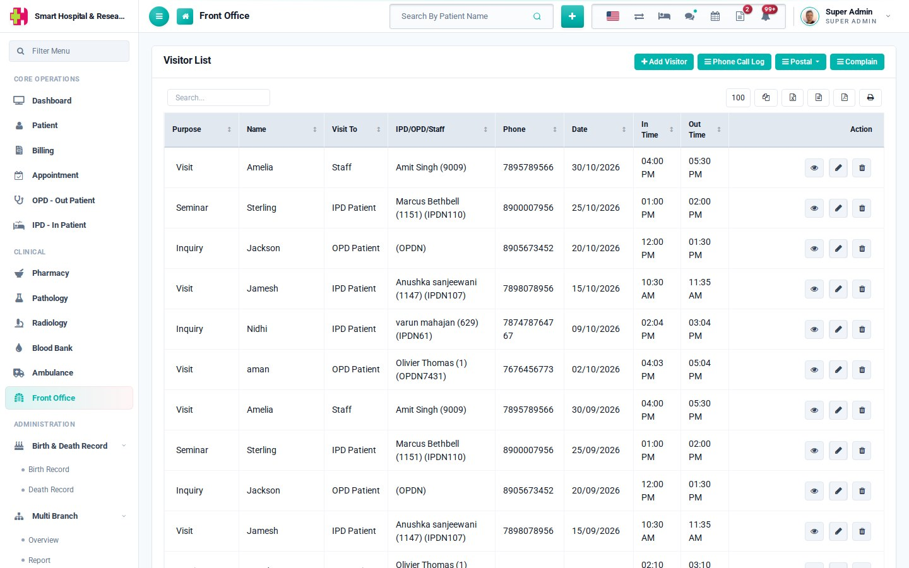

#### Module 2 — data-entry dialogs captured

| Screen | Dialog | Fields | Screenshot |
|---|---|---|---|
| Ambulance Call List | **Add Ambulance Call New Patient** | 21 | `011-ambulance__add-ambulance-call-new-patient.jpg` |
| Visitor List | **Add Visitor** | 13 | `012-front-office__add-visitor.jpg` |

**Add Ambulance Call New Patient** — opened from *Ambulance Call List*

- **Form**: `patient_id` (select); `Case ID` (text); `Vehicle Model` (select) — Force Traveller Ambulance - MP04 AB 1234, Tata Winger - MP21 CD 4587, Force Traveller - MP21 AB 1023, BS4 - MP20CD2105, BS4FGD - MP20SD4323, Tata Winge - UP14 AB 1234; `Driver Name` (text); `Date` (text); `Charge Category` (select) — Private Ambulance, ERS/Patient Transport Service, Other Charges, Operation Services, Oxygen cylinder, Fire extinguisher; `Charge Name` (select); `Standard Charge` (input); `Emergency Level` (textarea); `Emergency Level` (text); `total` (text); `discount_percent` (text); `discount` (text); `tax_percentage` (text); `tax` (text); `net_amount` (text); `Payment Mode` (select) — Cash, Cheque, Transfer to Bank Account, UPI, Online, Other; `Payment Amount ($) *` (text); `Cheque No *` (text); `Cheque Date *` (text); `document` (file)

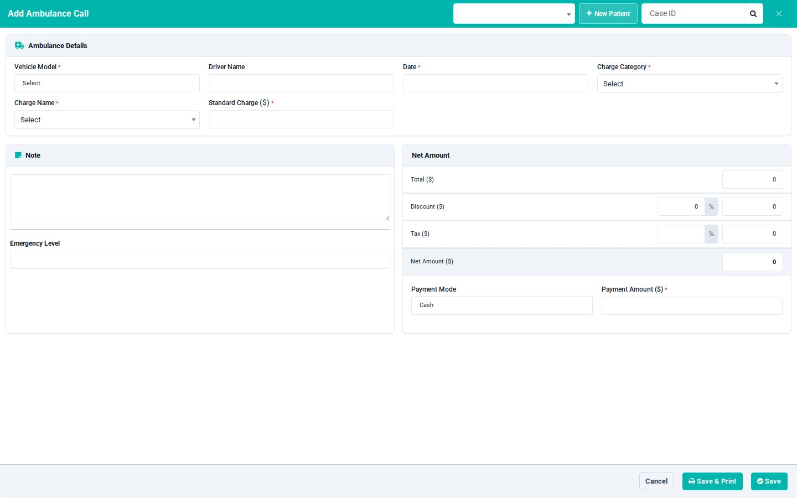

**Add Visitor** — opened from *Visitor List*

- **Form** (posts to `/admin/visitors/edit`) *(dialog)*: `Purpose *` (select) — Visit, Inquiry, Seminar; `Name *` (text); `Phone` (text); `ID Card` (text); `Visit To` (select) — Staff, OPD Patient, IPD Patient; `IPD/OPD/Staff` (select); `Related To` (text); `Number Of Person` (text); `Date *` (text); `time` (text); `out_time` (text); `Note` (textarea); `file` (file)

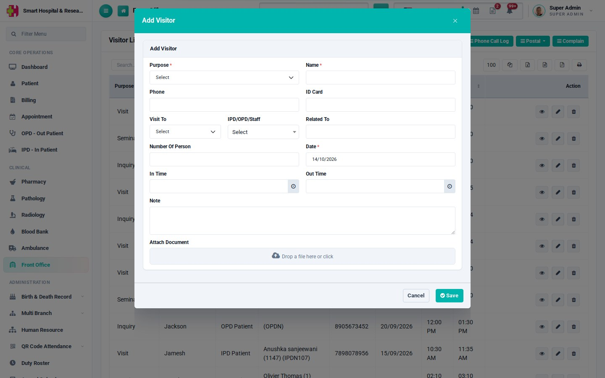


### 2.3 Administration & HR

Back office: legal registers, multi-branch operation, staff HR, attendance, rosters, referrals, insurance/TPA and the finance ledger.

**Key capabilities**

- Birth and death registers with the fields needed for statutory certificates.
- Multi-branch console: consolidated overview, branch comparison report and branch master with header switching.
- HR: staff directory, roles, payroll, leaves, QR-code attendance and duty roster report.
- Referral commission ledger and TPA/insurance register.
- Income and expense ledgers that feed the finance reports and the dashboard.

| # | Screen | What it covers | Path |
|---|---|---|---|
| 1 | **Birth Record** | Birth & Death Record › Birth Record | `/admin/birthordeath` |
| 2 | **Death Record** | Birth & Death Record › Death Record | `/admin/birthordeath/death` |
| 3 | **Overview** | Group console comparing branches on patients, collections and occupancy. | `/admin/multibranch/branch/overview` |
| 4 | **Report** | Cross-branch comparative reporting with date range and module filters. | `/admin/multibranch/branch/report` |
| 5 | **Setting** | Branch master: create/edit branches, assign the branch admin and switch the active branch. | `/admin/multibranch/branch` |
| 6 | **Staff Directory** | Staff directory with role, designation and department, plus entry points to attendance, payroll and leaves. | `/admin/staff` |
| 7 | **QR Code Attendance** | Scan-based staff attendance register with a monthly view and in/out times. | `/admin/qrattendance/attendance/index` |
| 8 | **Settings** | QR attendance rules: check-in window, working hours and device/QR configuration. | `/admin/qrattendance/setting/index` |
| 9 | **Duty Roster** | Shift roster per staff/department with print and export. | `/admin/dutyroster/roster_report` |
| 10 | **Annual Calendar** | Holiday and event calendar, plus to-dos per the vendor help articles. | `/admin/holiday/index` |
| 11 | **Referral Payment List** | Referral commission ledger: payouts against referred cases with filters by referral person and period. | `/admin/referral/payment` |
| 12 | **TPA Management** | Insurance/TPA register: companies, policies and claim status per patient. | `/admin/tpamanagement` |
| 13 | **Income List** | Income ledger: head-wise entries that feed the finance reports and the dashboard trend. | `/admin/income` |
| 14 | **Expense List** | Expense ledger: head-wise entries with reference, invoice and remarks. | `/admin/expense` |

#### Screen 3.1 — Birth Record

- **Menu path:** Administration → Birth & Death Record › Birth Record · **URL:** `/admin/birthordeath`
- **Purpose:** Birth & Death Record › Birth Record
- **Grid (22 rows):** Reference No | Case ID | Generated By | Child Name | Gender | Birth Date | Mother Name | Father Name | Blood Group | Report | Action
- **Panels on screen:** Birth Record Add Birth Record · Birth Record Details · Attachments · Birth Record Details · Attachments
- **Actions:** 2, Add Birth Record, Save, Update
- **Search / filters:** birthTable_length, child_name, gender, weight, birth_date, contact, case_id, mother, father_name, address
- **Form 1**: `Child Name` (text); `Gender` (select) — Male, Female; `Weight` (text); `Birth Date` (text); `Phone` (text); `Case ID` (text); `Mother Name` (text); `Father Name` (text); `Address` (text); `Report` (textarea); `Blood Group` (select) — 1, 2; `child_img` (file); `first_img` (file); `second_img` (file); `document` (file)
- **Form 2**: `Child Name` (text); `Gender` (select) — Male, Female; `Weight` (text); `Birth Date` (text); `Phone` (text); `Case ID` (text); `Mother Name` (text); `Father Name` (text); `Address` (text); `Report` (textarea); `child_img` (file); `mother_pic` (file); `father_pic` (file); `document` (file)

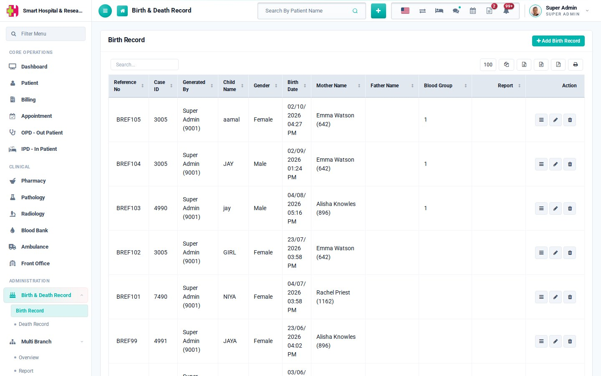

#### Screen 3.2 — Death Record

- **Menu path:** Administration → Birth & Death Record › Death Record · **URL:** `/admin/birthordeath/death`
- **Purpose:** Birth & Death Record › Death Record
- **Grid (14 rows):** Reference No | Case ID | Generated By | Patient Name | Guardian Name | Gender | Death Date | Blood Group | Report | Action
- **Panels on screen:** Death Record Add Death Record
- **Actions:** 2, Add Death Record, Save, Update
- **Search / filters:** deathTable_length, case_id, patient_name, death_date, guardian_name, custom_fields[death_report][14], case_id, epatient_name, death_date, guardian_name
- **Form 1**: `Case ID *` (text); `Patient Name *` (text); `Death Date *` (text); `Guardian Name *` (text); `document` (file); `Report` (textarea); `Blood Group` (select) — 1, 2
- **Form 2**: `Case ID *` (text); `Patient Name *` (text); `Death Date *` (text); `Guardian Name *` (text); `document` (file); `Report` (textarea)

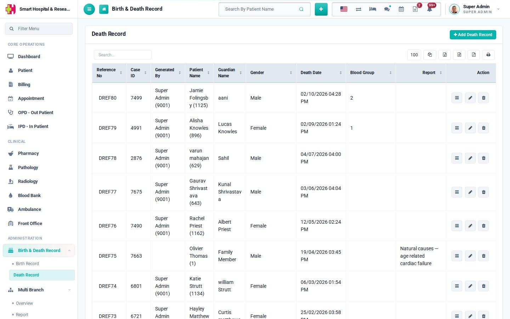

#### Screen 3.3 — Overview

- **Menu path:** Administration → Multi Branch › Overview · **URL:** `/admin/multibranch/branch/overview`
- **Purpose:** Group console comparing branches on patients, collections and occupancy.
- **Grid (4 rows):** Branch | Online Appointment | Online Amount ($) | Offline Appointment | Offline Amount ($) | Total Appointments | Total Amount ($)
- **Grid (4 rows):** Branch | Total OPD | Total Visit | Total Amount ($) | Total Paid ($)
- **Grid (4 rows):** Branch | Patient Count | Total IPD | Total Amount ($) | Total Paid ($)
- **Grid (4 rows):** Branch | Patient Count | Total Operation
- **Panels on screen:** Overview
- **Actions:** 2, Search, Save, Update
- **Search / filters:** search_type, date_from, date_to, envato_market_purchase_code, email, app-envato_market_purchase_code, app-email
- **Form 1** (posts to `/admin/multibranch/branch/overview`): `Time Duration` (select) — Today, This Week, Last Week, This Month, Last Month, Last 3 Months; `Date From` (text); `Date To` (text)

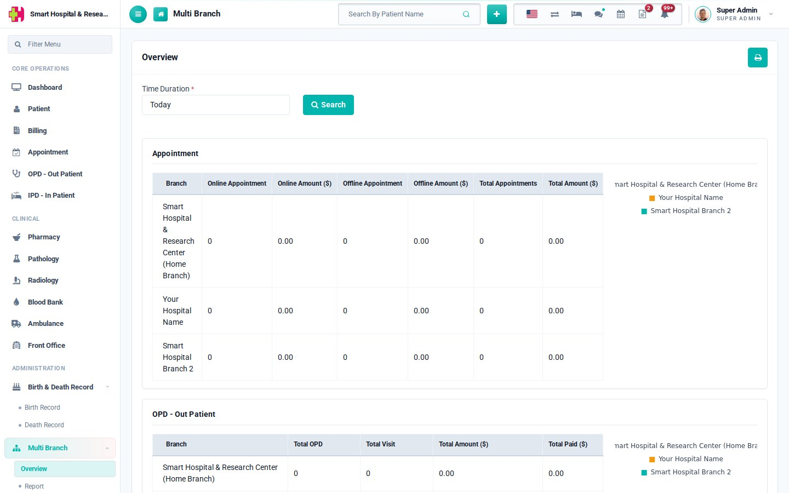

#### Screen 3.4 — Report

- **Menu path:** Administration → Multi Branch › Report · **URL:** `/admin/multibranch/branch/report`
- **Purpose:** Cross-branch comparative reporting with date range and module filters.
- **Panels on screen:** Report
- **Actions:** 2, Save, Update
- **Search / filters:** envato_market_purchase_code, email, app-envato_market_purchase_code, app-email

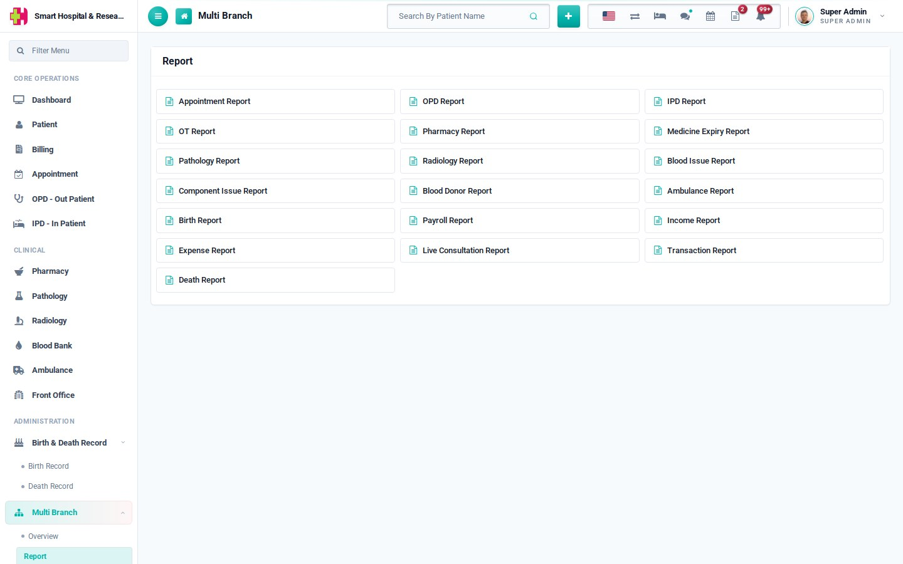

#### Screen 3.5 — Setting

- **Menu path:** Administration → Multi Branch › Settings · **URL:** `/admin/multibranch/branch`
- **Purpose:** Branch master: create/edit branches, assign the branch admin and switch the active branch.
- **Grid (3 rows):** Branch | URL | Action
- **Panels on screen:** Setting Add New Branch
- **Actions:** 2, Add New Branch, Verify & Save, Save, Update
- **Search / filters:** purchase_code, branch_name, host_name, database, username, envato_market_purchase_code, email, app-envato_market_purchase_code, app-email
- **Form 1** (posts to `/admin/multibranch/branch/add`): `Envato Purchase Code *` (text); `Branch name *` (text); `Host Name *` (text); `Database Name *` (text); `Username *` (text); `Password *` (password)

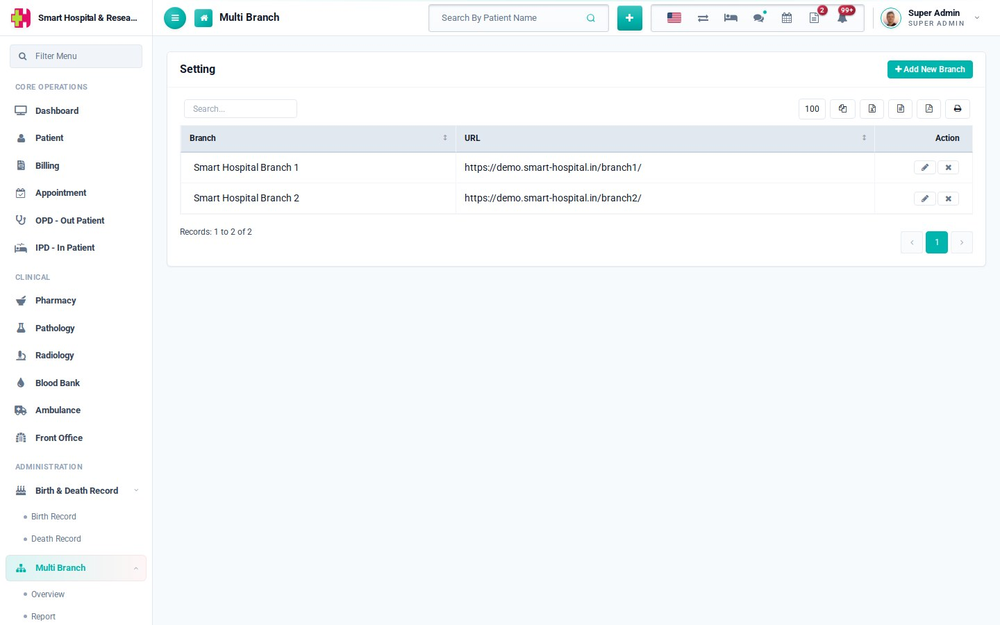

#### Screen 3.6 — Staff Directory

- **Menu path:** Administration → Human Resource · **URL:** `/admin/staff`
- **Purpose:** Staff directory with role, designation and department, plus entry points to attendance, payroll and leaves.
- **Grid (14 rows):** Staff ID | Name | Role | Department | Designation | Mobile Number | Action
- **Panels on screen:** Staff Directory Add Staff Staff Attendance Payroll Leaves
- **Actions:** 2, Add Staff, Staff Attendance, Payroll, Leaves, Search, Card View, List View, Save, Update
- **Search / filters:** role, Search By Staff ID, Name, Role etc..., envato_market_purchase_code, email, app-envato_market_purchase_code, app-email
- **Form 1** (posts to `/admin/staff`): `Role` (select) — Admin, Accountant, Doctor, Pharmacist, Pathologist, Radiologist; `Search By Keyword` (text)

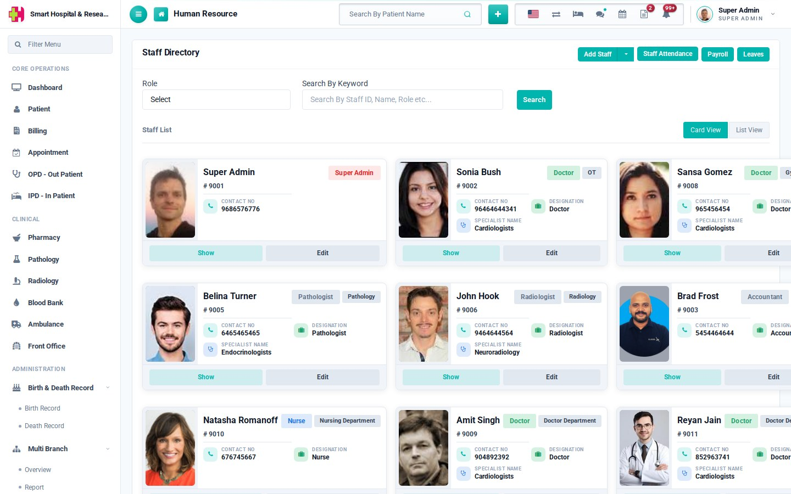

#### Screen 3.7 — QR Code Attendance

- **Menu path:** Administration → QR Code Attendance › Attendance · **URL:** `/admin/qrattendance/attendance/index`
- **Purpose:** Scan-based staff attendance register with a monthly view and in/out times.
- **Panels on screen:** QR Code Attendance SCAN YOUR ID CARD QR CODE / BARCODE Camera-based device Sensor-based de
- **Actions:** 2, Rescan QR Code / Barcode, Save, Update
- **Search / filters:** envato_market_purchase_code, email, app-envato_market_purchase_code, app-email

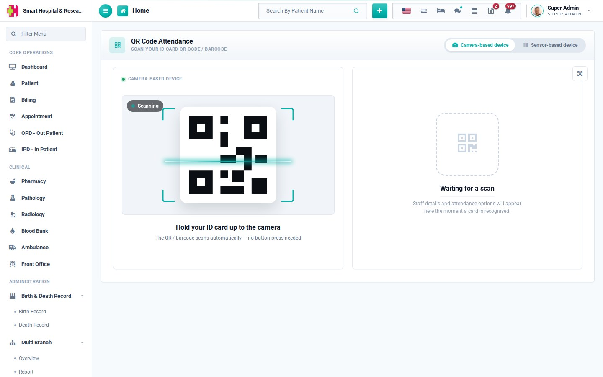

#### Screen 3.8 — Settings

- **Menu path:** Administration → QR Code Attendance › Settings · **URL:** `/admin/qrattendance/setting/index`
- **Purpose:** QR attendance rules: check-in window, working hours and device/QR configuration.
- **Panels on screen:** Settings
- **Actions:** 2, Save, Update
- **Search / filters:** envato_market_purchase_code, email, app-envato_market_purchase_code, app-email
- **Form 1** (posts to `/admin/qrattendance/setting`): `Disabled` (radio); `Auto Attendance *` (radio); `Scanner Device Type *` (checkbox); `Camera-based device, like a mobile phone or webcam` (checkbox); `Select Camera *` (radio); `Secondary (Front)` (radio)

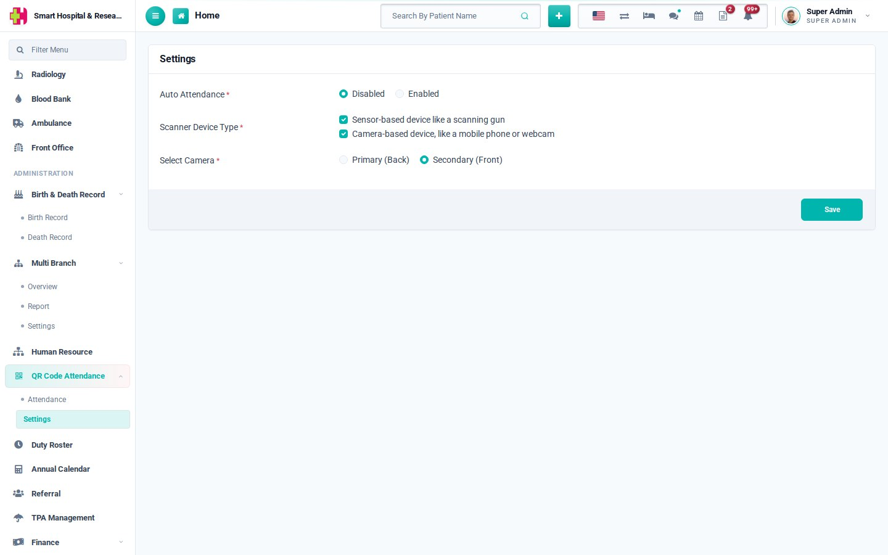

#### Screen 3.9 — Duty Roster

- **Menu path:** Administration → Duty Roster · **URL:** `/admin/dutyroster/roster_report`
- **Purpose:** Shift roster per staff/department with print and export.
- **Grid (2 rows):** Staff | Date | Shift Start | Shift End | Shift Hour | Shift | Department | Floor
- **Panels on screen:** Duty Roster Shift Roster Assign Roster
- **Actions:** 2, Shift, Roster, Assign Roster, Search, Save, Update
- **Search / filters:** search_type, date_from, date_to, staff, envato_market_purchase_code, email, app-envato_market_purchase_code, app-email
- **Form 1** (posts to `/admin/dutyroster/roster_report`): `Time Duration *` (select) — Today, This Week, Last Week, This Month, Last Month, Last 3 Months; `Date From` (text); `Date To` (text); `staff` (select) — Super Admin (9001), Sonia Bush (9002), Sansa Gomez (9008), Belina Turner (9005), John Hook (9006), Brad Frost (9003)

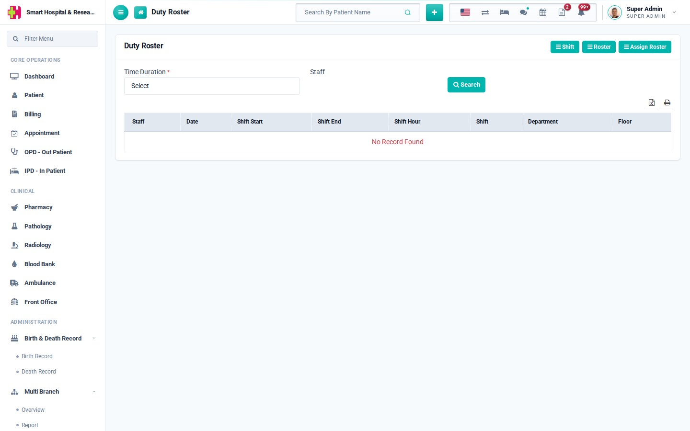

#### Screen 3.10 — Annual Calendar

- **Menu path:** Administration → Annual Calendar · **URL:** `/admin/holiday/index`
- **Purpose:** Holiday and event calendar, plus to-dos per the vendor help articles.
- **Grid (50 rows):** Date | Type | Description | Created By | Front Site | Action
- **Panels on screen:** Annual Calendar Add
- **Actions:** 2, Add, Search, Save, Update
- **Search / filters:** search_holiday_type, from_date, to_date, envato_market_purchase_code, email, app-envato_market_purchase_code, app-email
- **Form 1** (posts to `/admin/holiday`): `Type *` (select) — Holiday, Activity, Vacation
- **Form 2**: `Type *` (radio); `Type *` (radio); `Type *` (radio); `From Date *` (text); `To Date *` (text); `Description *` (textarea); `front_site` (checkbox)

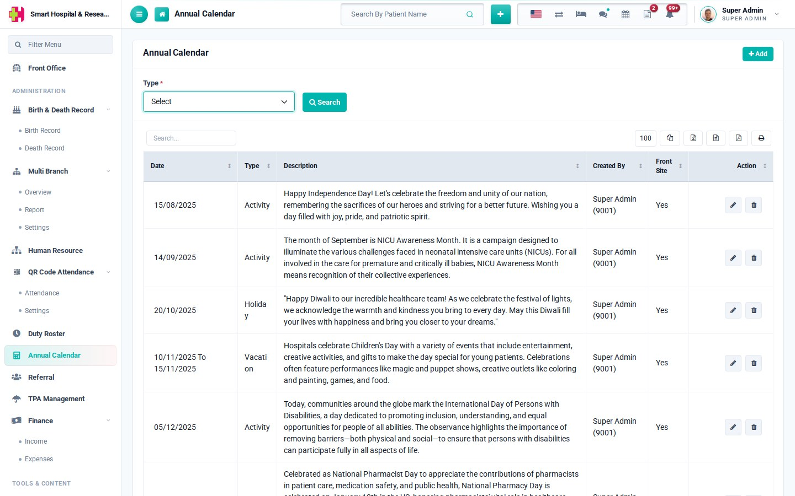

#### Screen 3.11 — Referral Payment List

- **Menu path:** Administration → Referral · **URL:** `/admin/referral/payment`
- **Purpose:** Referral commission ledger: payouts against referred cases with filters by referral person and period.
- **Grid (15 rows):** Payee | Patient Name | Bill No | Bill Amount ($) | Commission Percentage (%) | Commission Amount ($) | Action
- **Panels on screen:** Referral Payment List Add Referral Payment Referral Person
- **Actions:** 2, Add Referral Payment, Referral Person, Save, Update
- **Search / filters:** patient_type, bill_no, bill_amount, payee, percentage, commission_amount, commission_percentage, commission_amount, name, guardian_name
- **Form 1**: `Patient Type *` (select) — Select Type, OPD, IPD, Pharmacy, Pathology, Radiology; `Bill No/Case Id *` (select); `Patient Bill Amount ($) *` (text); `Payee *` (select) — Select Payee, ABHI, Aarav, Laxmi Sahu, Amol, Ankita; `Commission Percentage (%) *` (text); `Commission Amount ($) *` (text)
- **Form 2**: `Commission Percentage (%) *` (text); `Commission Amount ($) *` (text)
- **Form 3**: `Name *` (text); `Guardian Name` (text); `Phone` (text); `Gender` (select) — Male, Female; `Date Of Birth` (text); `Year` (text); `Month` (text); `Day` (text); `Blood Group` (select); `Marital Status` (select); `Email` (text); `Address` (input); `National Identification Number` (input); `file` (file); `Remarks` (textarea); `Any Known Allergies` (textarea); `TPA` (select); `TPA ID` (input); `TPA Validity` (input); `Alternate Number` (text)

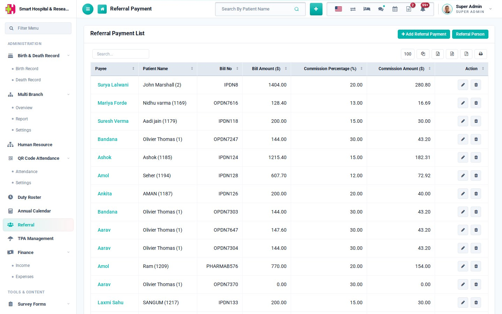

#### Screen 3.12 — TPA Management

- **Menu path:** Administration → TPA Management · **URL:** `/admin/tpamanagement`
- **Purpose:** Insurance/TPA register: companies, policies and claim status per patient.
- **Grid (12 rows):** Name | Code | Phone | Address | Contact Person Name | Contact Person Phone | Action
- **Panels on screen:** TPA Management Add TPA
- **Actions:** 2, Add TPA, Save, Update
- **Search / filters:** name, code, contact_number, contact_person_name, contact_person_phone, ename, ecode, econtact_number, econtact_person_name, econtact_person_phone
- **Form 1**: `Name *` (text); `Code *` (text); `Contact No *` (text); `Address` (textarea); `Contact Person Name` (text); `Contact Person Phone` (text)
- **Form 2**: `Name *` (text); `Code *` (text); `Contact No *` (text); `Address` (textarea); `Contact Person Name` (text); `Contact Person Phone` (text)

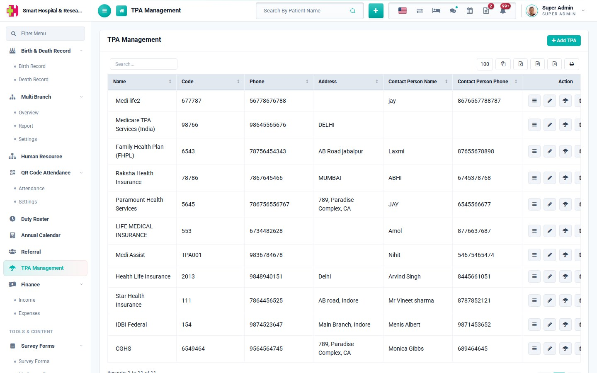

#### Screen 3.13 — Income List

- **Menu path:** Administration → Finance › Income · **URL:** `/admin/income`
- **Purpose:** Income ledger: head-wise entries that feed the finance reports and the dashboard trend.
- **Grid (58 rows):** Name | Invoice Number | Date | Description | Income Head | Generated By | Amount ($) | Action
- **Panels on screen:** Income List Add Income
- **Actions:** 2, Add Income, Save, Update
- **Search / filters:** inc_head_id, name, invoice_no, date, amount, envato_market_purchase_code, email, app-envato_market_purchase_code, app-email
- **Form 1**: `Income Head *` (select) — Hospital charges, Special campaign, Canteen Rent, Vehicle Stand Charges; `Name *` (text); `Invoice Number` (text); `Date *` (text); `Amount ($) *` (text); `documents` (file); `Description` (textarea)

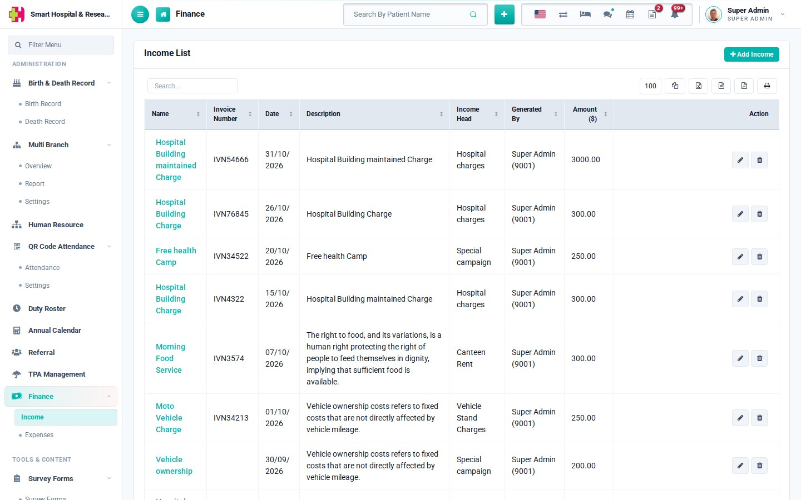

#### Screen 3.14 — Expense List

- **Menu path:** Administration → Finance › Expenses · **URL:** `/admin/expense`
- **Purpose:** Expense ledger: head-wise entries with reference, invoice and remarks.
- **Grid (53 rows):** Name | Invoice Number | Date | Description | Expense Head | Generated By | Amount ($) | Action
- **Panels on screen:** Expense List Add Expense
- **Actions:** 2, Add Expense, Save, Update
- **Search / filters:** exp_head_id, name, invoice_no, exdate, amount, envato_market_purchase_code, email, app-envato_market_purchase_code, app-email
- **Form 1**: `Expense Head *` (select) — Building rent, Equipements, Electricity Bill, Telephone Bill, Power Generator Fuel Charge, Tea Expense; `Name *` (text); `Invoice Number` (text); `Date *` (text); `Amount ($) *` (text); `documents` (file); `Description` (textarea)

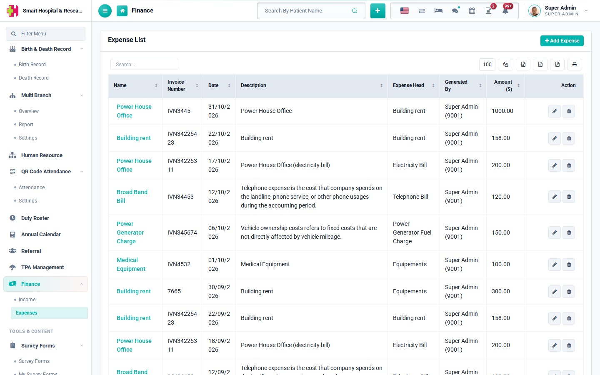

#### Module 3 — data-entry dialogs captured

| Screen | Dialog | Fields | Screenshot |
|---|---|---|---|
| Setting | **Add New Branch** | 6 | `017-multi-branch-settings__add-new-branch.jpg` |
| Referral Payment List | **Add Referral Payment Select Patient** | 7 | `023-referral__add-referral-payment-select-patient.jpg` |
| TPA Management | **Add TPA** | 6 | `024-tpa-management__add-tpa.jpg` |
| Income List | **Add Income** | 7 | `025-finance-income__add-income.jpg` |
| Expense List | **Add Expense** | 7 | `026-finance-expenses__add-expense.jpg` |

**Add New Branch** — opened from *Setting*

- **Form** (posts to `/admin/multibranch/branch/add`): `Envato Purchase Code *` (text); `Branch name *` (text); `Host Name *` (text); `Database Name *` (text); `Username *` (text); `Password *` (password)

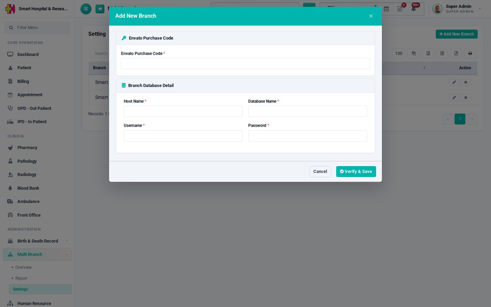

**Add Referral Payment Select Patient** — opened from *Referral Payment List*

- **Form**: `Patient Type *` (select) — Select Type, OPD, IPD, Pharmacy, Pathology, Radiology; `Bill No/Case Id *` (select); `Patient Bill Amount ($) *` (text); `Payee *` (select) — Select Payee, ABHI, Aarav, Laxmi Sahu, Amol, Ankita; `Commission Percentage (%) *` (text); `Commission Amount ($) *` (text)

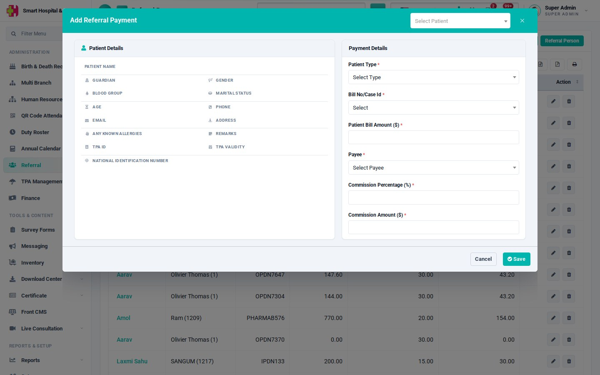

**Add TPA** — opened from *TPA Management*

- **Form**: `Name *` (text); `Code *` (text); `Contact No *` (text); `Address` (textarea); `Contact Person Name` (text); `Contact Person Phone` (text)

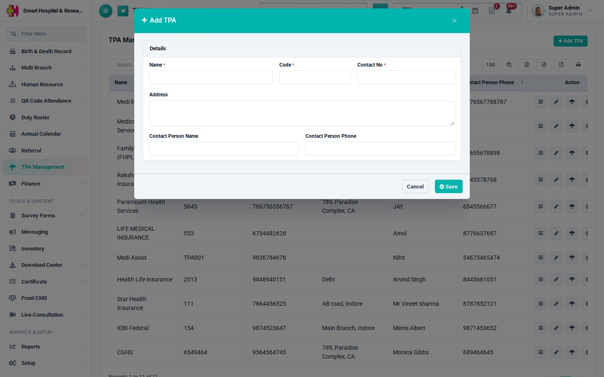

**Add Income** — opened from *Income List*

- **Form**: `Income Head *` (select) — Hospital charges, Special campaign, Canteen Rent, Vehicle Stand Charges; `Name *` (text); `Invoice Number` (text); `Date *` (text); `Amount ($) *` (text); `documents` (file); `Description` (textarea)

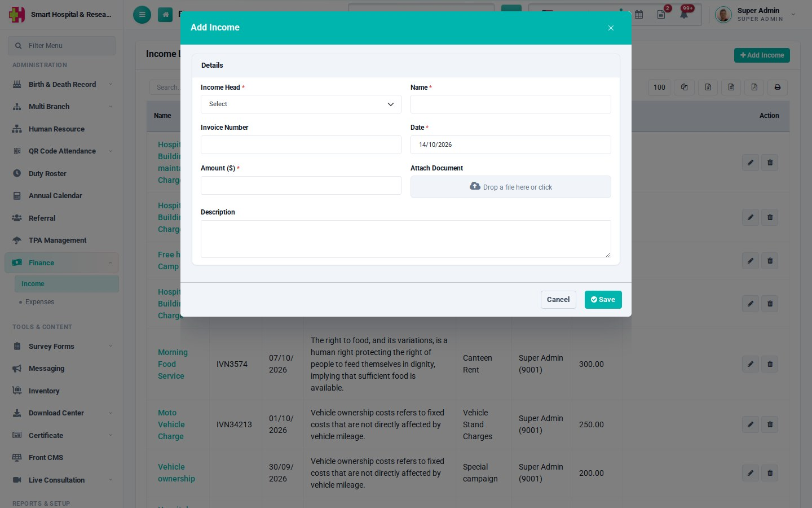

**Add Expense** — opened from *Expense List*

- **Form**: `Expense Head *` (select) — Building rent, Equipements, Electricity Bill, Telephone Bill, Power Generator Fuel Charge, Tea Expense; `Name *` (text); `Invoice Number` (text); `Date *` (text); `Amount ($) *` (text); `documents` (file); `Description` (textarea)

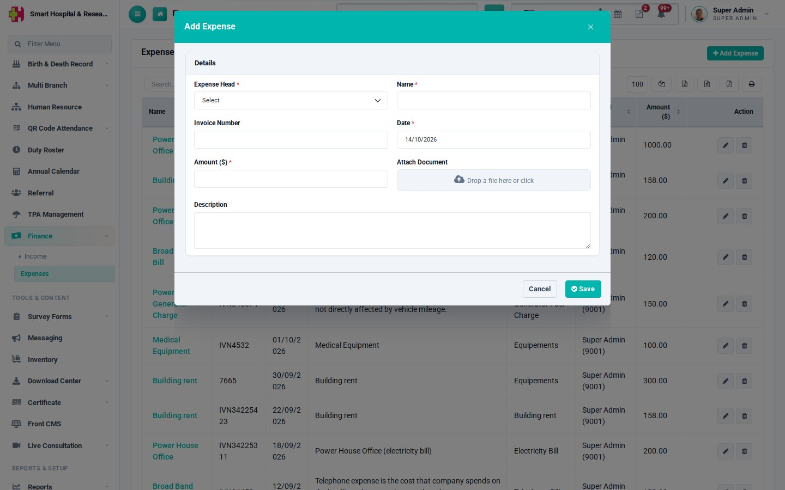


### 2.4 Communication, Content & Certificates

Everything that talks to people or produces a document: surveys, notice board, downloads, inventory, ID cards, certificates, the public website CMS and telemedicine.

**Key capabilities**

- Survey/questionnaire builder with per-role assignment and response collection.
- Notice board / messaging with audience targeting and attachments.
- Download center for sharing documents with staff, patients and the public site.
- Certificate generator plus patient and staff ID cards driven by templates.
- Front CMS that drives the public hospital website (pages, banners, news, gallery, contact).
- Zoom-based live consultation and internal live meetings.

| # | Screen | What it covers | Path |
|---|---|---|---|
| 1 | **Survey Forms** | Survey builder: create questionnaires, assign them to roles/departments and read responses. | `/admin/survey` |
| 2 | **Survey Forms › My Survey Forms** | The signed-in staff member's own survey forms. | `/admin/survey/staff_forms` |
| 3 | **Notice Board** | Notice board for staff/patients with audience targeting and attachments. | `/admin/notification` |
| 4 | **Item Stock List** | Item stock control: categories, suppliers, issue and return, stock ledger and reorder levels. | `/admin/itemstock` |
| 5 | **Upload /Share Content** | Upload/share documents with staff, patients or the public site, with content type and audience. | `/admin/content/upload` |
| 6 | **Content Share List** | Everything shared so far, with filters and download counters. | `/admin/content/list` |
| 7 | **Content Type** | Content type master used when uploading shared content. | `/admin/contenttype/` |
| 8 | **Generate Certificate** | Certificate generator: pick module and discharged patients, choose a template and generate single or bulk certificates. | `/admin/generatecertificate` |
| 9 | **Generate Patient ID Card** | Patient ID-card generation from templates with photo and MR number. | `/admin/generatepatientidcard/` |
| 10 | **Generate Staff ID Card** | Staff ID-card generation from templates. | `/admin/generatestaffidcard/` |
| 11 | **Page List** | Website content management: pages, banners, news, gallery, contact and SEO for the public site. | `/admin/front/page` |
| 12 | **Live Consultation** | Zoom teleconsultation: schedule a session for a patient, share the link, start/end and log the call. | `/admin/zoom_conference/consult` |
| 13 | **Live Meeting** | Internal staff video meetings with scheduling and participants. | `/admin/zoom_conference/meeting` |

#### Screen 4.1 — Survey Forms

- **Menu path:** Tools & Content → Survey Forms › Survey Forms · **URL:** `/admin/survey`
- **Purpose:** Survey builder: create questionnaires, assign them to roles/departments and read responses.
- **Grid (5 rows):** Form Title | Target Audience | Submissions | Start Date – End Date | Action
- **Grid (4 rows):** Form Title | Target Audience | Start Date – End Date | Action
- **Panels on screen:** Survey Forms Create Survey Form
- **Actions:** 2, Save, Update
- **Search / filters:** tbl_published_length, tbl_closed_length, envato_market_purchase_code, email, app-envato_market_purchase_code, app-email

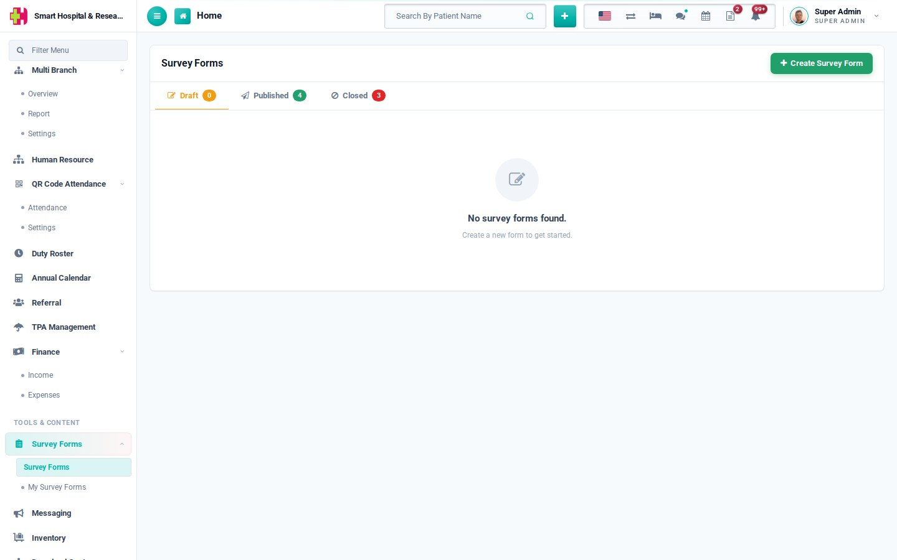

#### Screen 4.2 — Survey Forms › My Survey Forms

- **Menu path:** Tools & Content → Survey Forms › My Survey Forms · **URL:** `/admin/survey/staff_forms`
- **Purpose:** The signed-in staff member's own survey forms.
- **Grid (3 rows):** Form Title | Status | Start Date | End Date | Action
- **Panels on screen:** Assigned Forms Card Table · Assigned Forms
- **Actions:** 2, Card, Table, Save, Update
- **Search / filters:** envato_market_purchase_code, email, app-envato_market_purchase_code, app-email

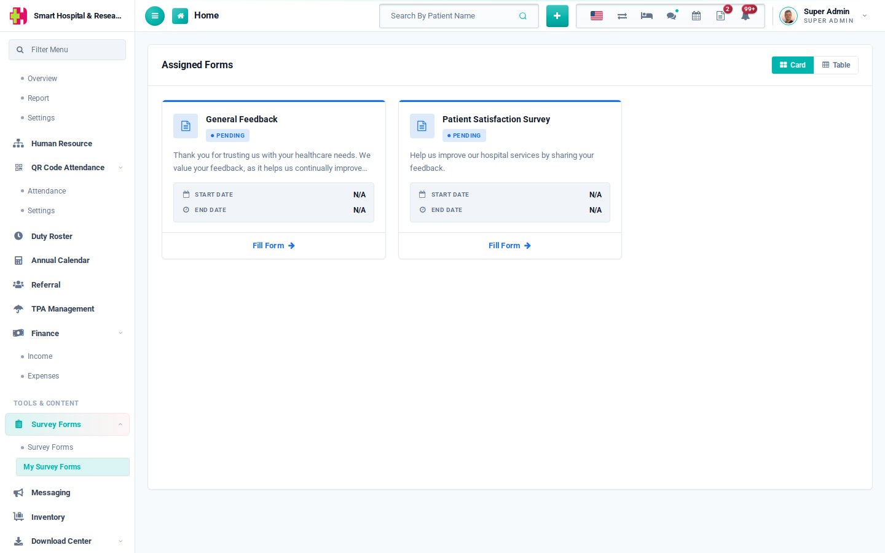

#### Screen 4.3 — Notice Board

- **Menu path:** Tools & Content → Messaging · **URL:** `/admin/notification`
- **Purpose:** Notice board for staff/patients with audience targeting and attachments.
- **Panels on screen:** Notice Board Post New Message Send SMS Send Email Send Credential
- **Actions:** 2, Post New Message, Send SMS, Send Email, Send Credential, Save, Update
- **Search / filters:** envato_market_purchase_code, email, app-envato_market_purchase_code, app-email

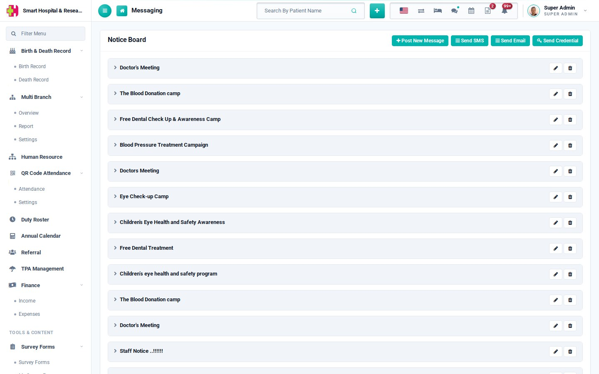

#### Screen 4.4 — Item Stock List

- **Menu path:** Tools & Content → Inventory · **URL:** `/admin/itemstock`
- **Purpose:** Item stock control: categories, suppliers, issue and return, stock ledger and reorder levels.
- **Grid (74 rows):** Name | Category | Supplier | Store | Date | Description | Total Quantity | Generated By | Purchase Price ($) | Action
- **Panels on screen:** Item Stock List Add Item Stock Issue Item Item
- **Actions:** 2, Add Item Stock, Issue Item, Item, +, Save, Update
- **Search / filters:** item_category_id, item_id, supplier_id, store_id, quantity, purchase_price, date, item_category_id, item_id, supplier_id
- **Form 1** (posts to `/admin/itemstock/add`): `Item Category *` (select) — Syringe Packs, Cotton Packs, Medical Equipment, Bed Sheets, Uniforms, Surgical blades; `Item *` (select); `Supplier *` (select) — VK Supplier, Quick Service; `Store` (select) — SK Pharma, Vinay Pharmacy, Vardaan; `quantity` (text); `Purchase Price *` (text); `Date` (text); `Description` (textarea); `item_photo` (file)

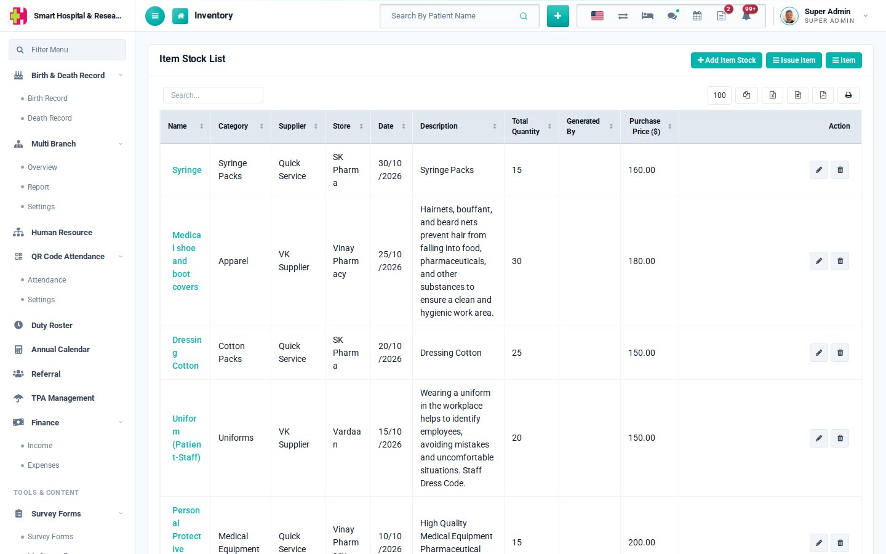

#### Screen 4.5 — Upload /Share Content

- **Menu path:** Tools & Content → Download Center › Upload /Share Content · **URL:** `/admin/content/upload`
- **Purpose:** Upload/share documents with staff, patients or the public site, with content type and audience.
- **Grid (13 rows):** # | Document | Content Type | Size | Upload By | Created On | Action
- **Panels on screen:** Upload /Share Content Upload
- **Actions:** 2, Upload, Share, Save, Generate Url, Select, Add, Send, Delete, Update
- **Search / filters:** Search…, name, content_type, content_type, https://youtube.com/..., title, share_date, valid_upto, title, share_date
- **Form 1** (posts to `/#`): `Search…` (text)
- **Form 2** (posts to `/admin/content/ajaxupdate`): `File Name *` (text); `Content Type *` (select) — Medical Report, medical Equipment, Medicine Stock List, Hospital Service
- **Form 3** (posts to `/admin/content/ajaxupload`): `Content Type *` (select) — Medical Report, medical Equipment, Medicine Stock List, Hospital Service; `upload[]` (file); `Upload Youtube Video Link` (text)

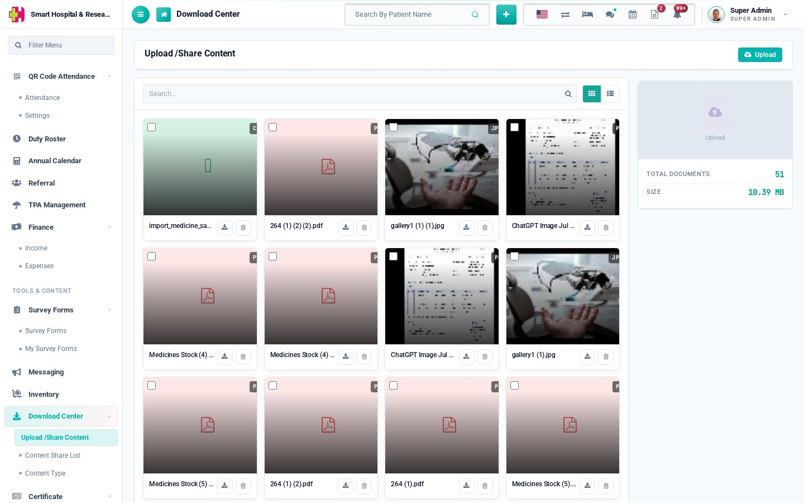

#### Screen 4.6 — Content Share List

- **Menu path:** Tools & Content → Download Center › Content Share List · **URL:** `/admin/content/list`
- **Purpose:** Everything shared so far, with filters and download counters.
- **Grid (21 rows):** Title | Send To | Share Date | Valid Upto | Shared By | Description | Action
- **Panels on screen:** Content Share List
- **Actions:** 2, Save, Update
- **Search / filters:** envato_market_purchase_code, email, app-envato_market_purchase_code, app-email

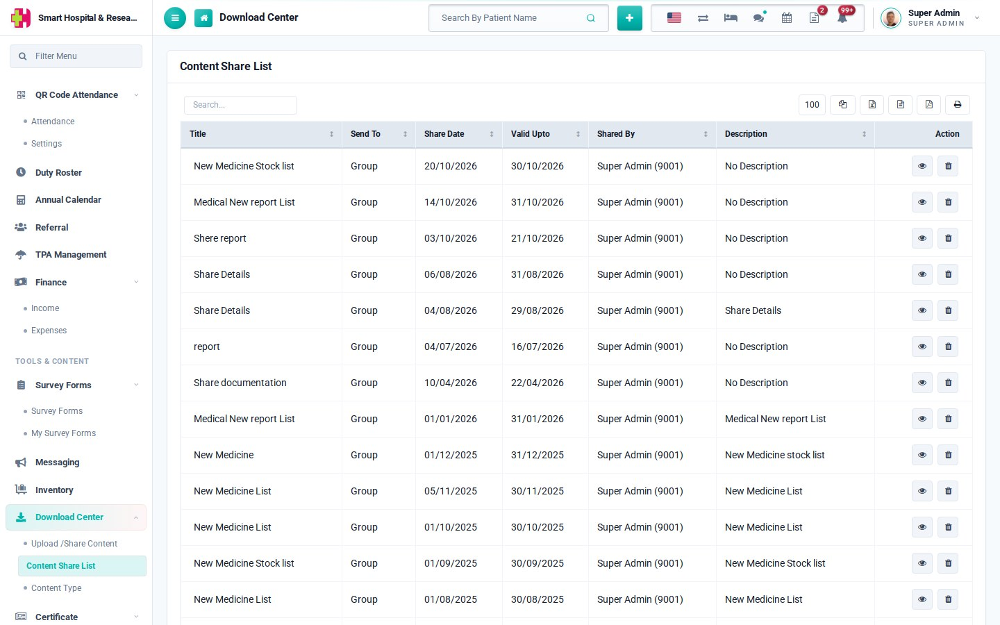

#### Screen 4.7 — Content Type

- **Menu path:** Tools & Content → Download Center › Content Type · **URL:** `/admin/contenttype/`
- **Purpose:** Content type master used when uploading shared content.
- **Grid (5 rows):** Name | Description | Action
- **Panels on screen:** Content Type Add Content Type
- **Actions:** 2, Add Content Type, Save, Update
- **Search / filters:** name, name, description, envato_market_purchase_code, email, app-envato_market_purchase_code, app-email
- **Form 1** (posts to `/admin/contenttype/add`): `Name` (text); `Description` (textarea)

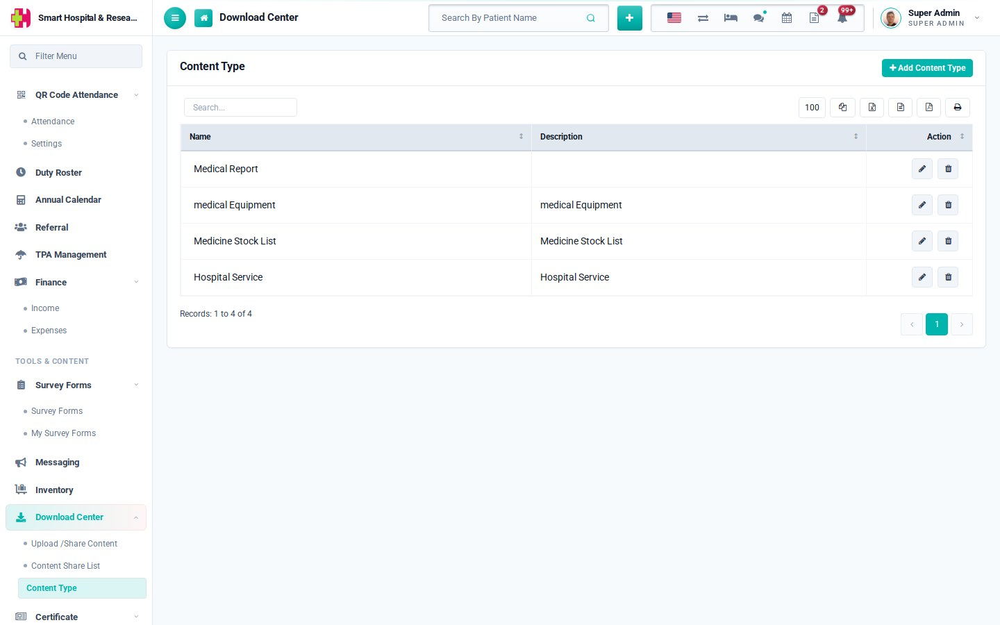

#### Screen 4.8 — Generate Certificate

- **Menu path:** Tools & Content → Certificate › Certificate · **URL:** `/admin/generatecertificate`
- **Purpose:** Certificate generator: pick module and discharged patients, choose a template and generate single or bulk certificates.
- **Grid (2 rows):** # | OPD/IPD No | Patient Name | Gender | Mobile Number | Discharged
- **Panels on screen:** Generate Certificate Certificate Template · Patient List Generate
- **Actions:** 2, Certificate Template, Search, Generate, Save, Update
- **Search / filters:** module, patient_status, certificate_id, envato_market_purchase_code, email, app-envato_market_purchase_code, app-email
- **Form 1** (posts to `/admin/generatecertificate/search`): `Module` (select) — OPD, IPD; `Patient Status` (select) — Not Discharged, Discharged; `Certificate Template` (select) — Sample Patient File Cover, Certificate Template
- **Form 2** (posts to `/admin/generatecertificate/generatemultiple`): `field` (checkbox)

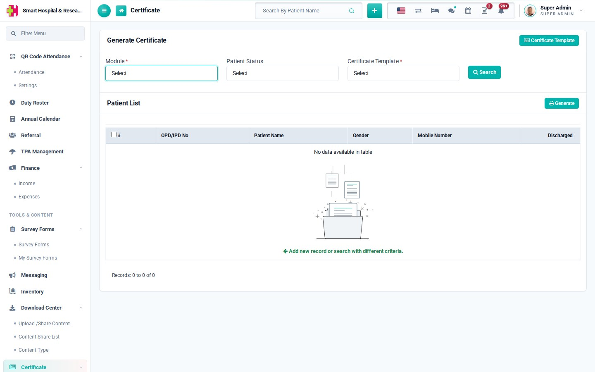

#### Screen 4.9 — Generate Patient ID Card

- **Menu path:** Tools & Content → Certificate › Patient ID Card · **URL:** `/admin/generatepatientidcard/`
- **Purpose:** Patient ID-card generation from templates with photo and MR number.
- **Grid (2 rows):** Patient Name | Age | Gender | Phone | Guardian Name | Address
- **Panels on screen:** Generate Patient ID Card ID Card Template · Patient List Generate
- **Actions:** 2, ID Card Template, Search, Generate, Save, Update
- **Search / filters:** patient_id, patient_id_card, envato_market_purchase_code, email, app-envato_market_purchase_code, app-email
- **Form 1**: `Patient` (select) — All, AADI(1171), Aadi jain(1179), Aadish Mody(1072), AANU(1233), AANU(1234); `ID Card Template` (select) — Sample Patient Id Card, Patient Id Card
- **Form 2** (posts to `/admin/Generatepatientidcard/generatemultiple`): `field` (checkbox)

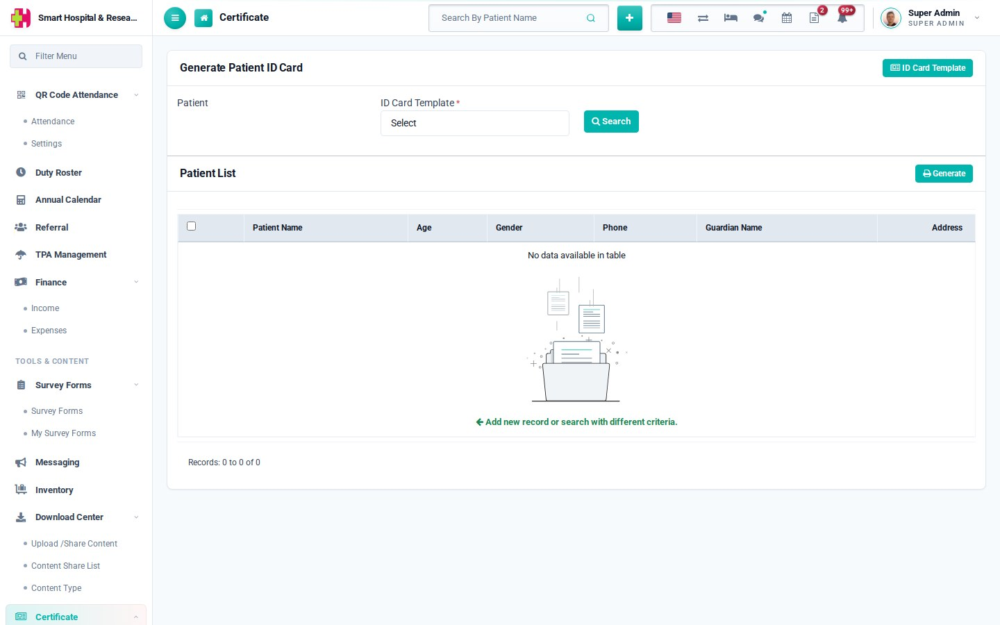

#### Screen 4.10 — Generate Staff ID Card

- **Menu path:** Tools & Content → Certificate › Staff ID Card · **URL:** `/admin/generatestaffidcard/`
- **Purpose:** Staff ID-card generation from templates.
- **Grid (2 rows):** Staff ID | Name | Designation | Department | Father Name | Mother Name | Date Of Joining | Address | Phone | Date Of Birth
- **Panels on screen:** Generate Staff ID Card ID Card Template · Staff List Generate
- **Actions:** 2, ID Card Template, Search, Generate, Save, Update
- **Search / filters:** role_id, id_card, envato_market_purchase_code, email, app-envato_market_purchase_code, app-email
- **Form 1**: `Role` (select) — Admin, Accountant, Doctor, Pharmacist, Pathologist, Radiologist; `ID Card Template` (select) — Sample Staff Id Card, Staff Id Card
- **Form 2** (posts to `/admin/generatestaffidcard/generatemultiple`): `field` (checkbox)

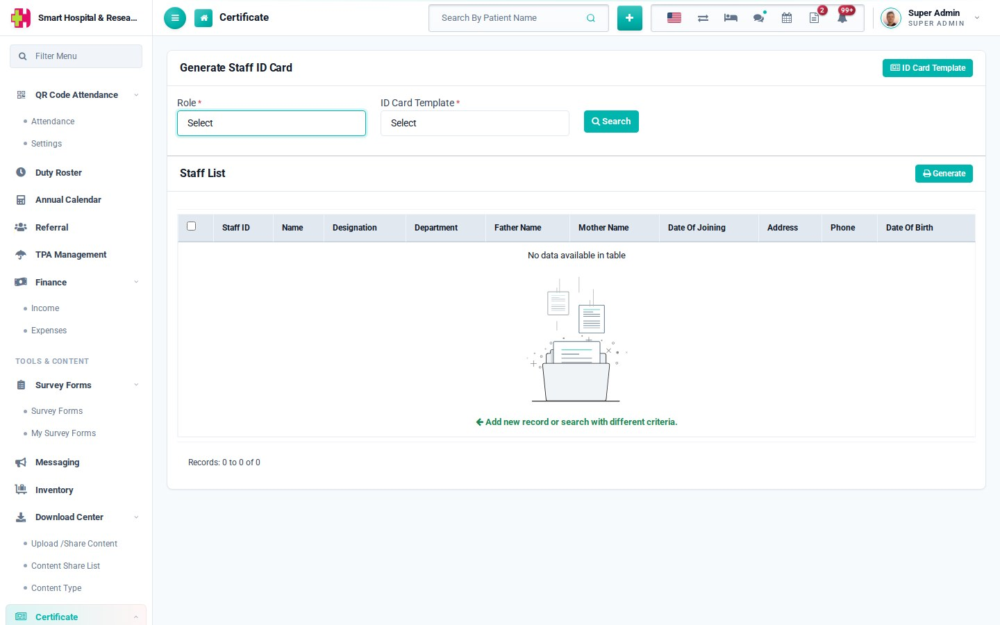

#### Screen 4.11 — Page List

- **Menu path:** Tools & Content → Front CMS · **URL:** `/admin/front/page`
- **Purpose:** Website content management: pages, banners, news, gallery, contact and SEO for the public site.
- **Grid (16 rows):** Title | URL | Page Type | Action
- **Panels on screen:** Page List Add Page Media Manager Menus
- **Actions:** 2, Add Page, Media Manager, Menus, Save, Update
- **Search / filters:** envato_market_purchase_code, email, app-envato_market_purchase_code, app-email

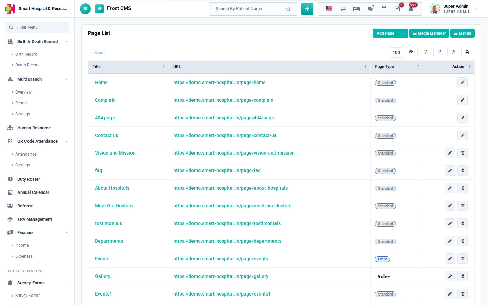

#### Screen 4.12 — Live Consultation

- **Menu path:** Tools & Content → Live Consultation › Live Consultation · **URL:** `/admin/zoom_conference/consult`
- **Purpose:** Zoom teleconsultation: schedule a session for a patient, share the link, start/end and log the call.
- **Grid (26 rows):** Consultation Title | Description | Date | Api Used | Created By | Created For | Patient | Status | Action
- **Panels on screen:** Live Consultation Add
- **Actions:** 2, Add, Start, Reset, Save, New Patient, Update
- **Search / filters:** chg_status, chg_status, chg_status, chg_status, chg_status, chg_status, chg_status, chg_status, chg_status, chg_status
- **Form 1** (posts to `/admin/zoom_conference/chgstatus`): `chg_status` (select) — Awaited, Cancelled, Finished
- **Form 2** (posts to `/admin/zoom_conference/addcredential`): `Zoom Api Key *` (text); `Zoom Api Secret *` (text)
- **Form 3** (posts to `/admin/zoom_conference/addByOther`): `Consultation Title` (text); `Consultation Date *` (text); `Consultation Duration Minutes *` (number); `OPD/IPD` (select) — None, OPD, IPD; `OPD/IPD No` (select); `OPD Checkup ID *` (select); `Consultant Doctor *` (select) — Amit Singh (9009), Reyan Jain (9011), Sansa Gomez (9008), Sonia Bush (9002); `Enabled` (radio); `Enabled` (radio); `Enabled` (radio); `Enabled` (radio); `Description` (textarea)

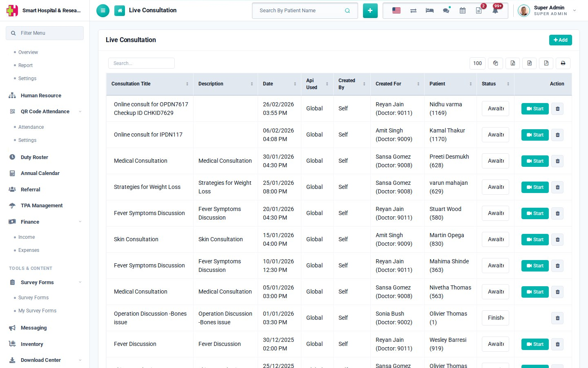

#### Screen 4.13 — Live Meeting

- **Menu path:** Tools & Content → Live Consultation › Live Meeting · **URL:** `/admin/zoom_conference/meeting`
- **Purpose:** Internal staff video meetings with scheduling and participants.
- **Grid (32 rows):** Meeting Title | Description | Date | Meeting Duration Minutes | Api Used | Created By | Status | Action
- **Panels on screen:** Live Meeting Add
- **Actions:** 2, Add, Start, Join, Save, Update
- **Search / filters:** chg_status, chg_status, chg_status, chg_status, chg_status, chg_status, chg_status, chg_status, chg_status, chg_status
- **Form 1** (posts to `/admin/zoom_conference/chgstatusmeeting`): `chg_status` (select) — Awaited, Cancelled, Finished
- **Form 2** (posts to `/admin/zoom_conference/addMeeting`): `Meeting Title *` (text); `date` (text); `Meeting Duration Minutes *` (number); `Enabled` (radio); `Enabled` (radio); `Enabled` (radio); `Enabled` (radio); `Description` (textarea); `Sonia Bush (Doctor : 9002)` (checkbox); `Sansa Gomez (Doctor : 9008)` (checkbox); `Belina Turner (Pathologist : 9005)` (checkbox); `John Hook (Radiologist : 9006)` (checkbox); `Brad Frost (Accountant : 9003)` (checkbox); `Natasha Romanoff (Nurse : 9010)` (checkbox); `Amit Singh (Doctor : 9009)` (checkbox); `Reyan Jain (Doctor : 9011)` (checkbox); `Harry Grant (Pharmacist : 9012)` (checkbox); `Jason Abbot (Admin : 9017)` (checkbox); `Maria Ford (Receptionist : 9018)` (checkbox); `April Clinton (Nurse : 9020)` (checkbox)

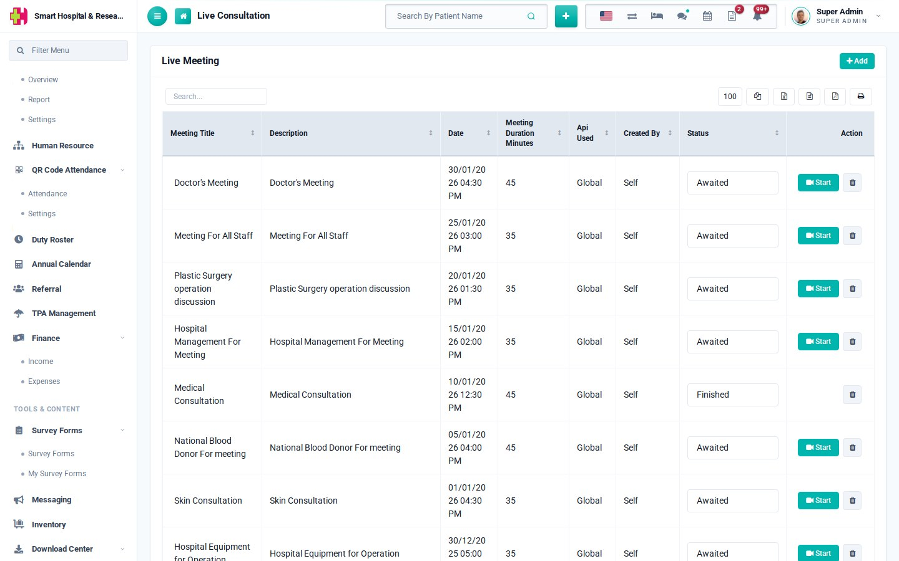

#### Module 4 — data-entry dialogs captured

| Screen | Dialog | Fields | Screenshot |
|---|---|---|---|
| Item Stock List | **Add Item Stock** | 9 | `030-inventory__add-item-stock.jpg` |
| Upload /Share Content | **Upload** | 3 | `031-download-center-upload-share-content__upload.jpg` |
| Live Consultation | **Live Consult Select Patient New Patient** | 13 | `038-live-consultation-live-consultation__live-consult-select-patient-new-patient.jpg` |
| Live Meeting | **Add Live Meeting** | 20 | `039-live-consultation-live-meeting__add-live-meeting.jpg` |

**Add Item Stock** — opened from *Item Stock List*

- **Form** (posts to `/admin/itemstock/add`): `Item Category *` (select) — Syringe Packs, Cotton Packs, Medical Equipment, Bed Sheets, Uniforms, Surgical blades; `Item *` (select); `Supplier *` (select) — VK Supplier, Quick Service; `Store` (select) — SK Pharma, Vinay Pharmacy, Vardaan; `quantity` (text); `Purchase Price *` (text); `Date` (text); `Description` (textarea); `item_photo` (file)

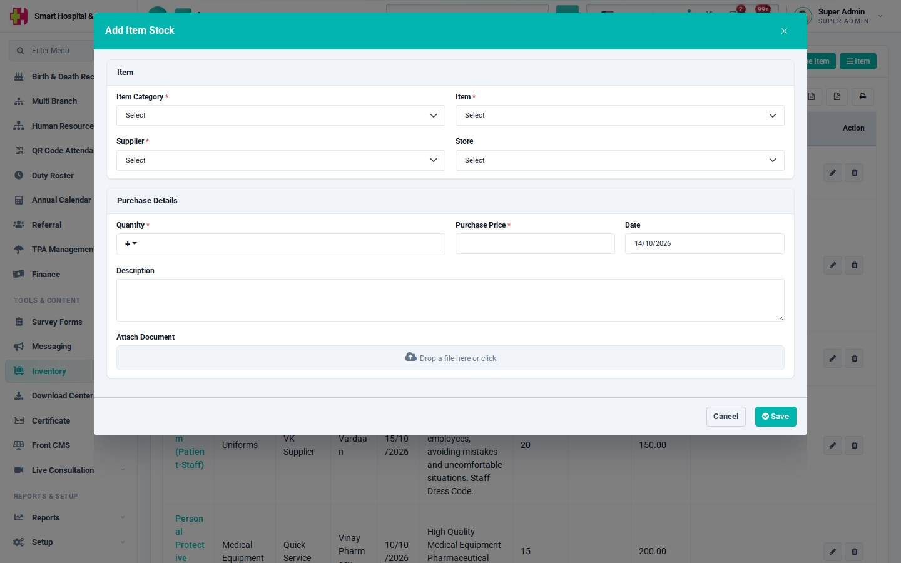

**Upload** — opened from *Upload /Share Content*

- **Form** (posts to `/#`) *(dialog)*: `Search…` (text)


**Live Consult Select Patient New Patient** — opened from *Live Consultation*

- **Form** (posts to `/admin/zoom_conference/chgstatus`): `chg_status` (select) — Awaited, Cancelled, Finished


**Add Live Meeting** — opened from *Live Meeting*

- **Form** (posts to `/admin/zoom_conference/chgstatusmeeting`): `chg_status` (select) — Awaited, Cancelled, Finished


### 2.5 Reports, Masters & Configuration

The 17 management reports plus the master data and lookups that make the rest of the application work.

**Key capabilities**

- Report centre covering finance, appointment, OPD, IPD, pharmacy, pathology, radiology, blood bank, ambulance, birth/death, HR, TPA, inventory, live consultation, operation theatre, patient and the system audit log.
- Masters for charges, beds, print headers, front-office purposes, operation theatre, pharmacy, pathology, radiology, blood bank, symptoms, ICD-10, findings, vitals, finance heads, leave types, referral commission, appointment slots, inventory items and custom fields.

| # | Screen | What it covers | Path |
|---|---|---|---|
| 1 | **Finance** | Reports › Finance | `/admin/report/finance` |
| 2 | **Appointment** | Reports › Appointment | `/admin/report/appointment` |
| 3 | **OPD** | Reports › OPD | `/admin/report/opd` |
| 4 | **IPD** | Reports › IPD | `/admin/report/ipd` |
| 5 | **Pharmacy** | Reports › Pharmacy | `/admin/report/pharmacy` |
| 6 | **Pathology** | Reports › Pathology | `/admin/report/pathology` |
| 7 | **Radiology** | Reports › Radiology | `/admin/report/radiology` |
| 8 | **Blood Bank** | Reports › Blood Bank | `/admin/report/blood_bank` |
| 9 | **Ambulance** | Reports › Ambulance | `/admin/report/ambulance` |
| 10 | **Birth Death Report** | Reports › Birth Death | `/admin/report/birth_death` |
| 11 | **Human Resource** | Reports › Human Resource | `/admin/report/human_resource` |
| 12 | **TPA** | Reports › TPA | `/admin/report/tpa` |
| 13 | **Inventory** | Reports › Inventory | `/admin/report/inventory` |
| 14 | **Live Consultation** | Reports › Live Consultation | `/admin/report/live_consultation` |
| 15 | **Log** | Reports › Log | `/admin/report/log` |
| 16 | **OT** | Reports › OT | `/admin/report/ot` |
| 17 | **Reports › Patient** | Reports › Patient | `/admin/report/patient` |
| 18 | **Charges Details List** | The charge catalogue (consultation, procedures, room, investigations, services) reused by billing, OPD and IPD. | `/admin/charges` |
| 19 | **Bed Status** | Bed/ward master with live occupancy status board. | `/admin/setup/bed/status` |
| 20 | **Appointment Header Footer** | Per-module print header/footer designer used by every printed bill, report, prescription, certificate and ID card. | `/admin/printing` |
| 21 | **Purpose List** | Setup › Front Office | `/admin/visitorspurpose` |
| 22 | **Operation List** | Setup › Operations | `/admin/operationtheatre/index` |
| 23 | **Medicine Category List** | Medicine categories, units, suppliers and the medicine master (batch, MRP, sale price, GST, reorder level). | `/admin/medicinecategory/medicine` |
| 24 | **Pathology Category List** | Pathology categories and tests with parameters, units and normal ranges. | `/admin/pathologycategory/addcategory` |
| 25 | **Radiology Category List** | Radiology categories and studies. | `/admin/lab/addlab` |
| 26 | **Product List** | Blood-bank components, bag types and product stock. | `/admin/bloodbank/products` |
| 27 | **Symptoms Head List** | Symptom library used by OPD/IPD clinical entry. | `/admin/symptoms` |
| 28 | **ICD-10 Codes List** | ICD-10 code library used for diagnosis entry. | `/admin/icd10` |
| 29 | **Finding List** | Finding library used by clinical encounters. | `/admin/finding` |
| 30 | **Vital List** | Vital-sign master (temperature, pulse, BP, respiration, SpO2, BMI) for IPD/OPD charts. | `/admin/vital` |
| 31 | **Settings** | Zoom API keys/secret so live consultation and live meeting work. | `/admin/zoom_conference` |
| 32 | **Income Head List** | Income and expense heads used by the finance ledger and reports. | `/admin/incomehead` |
| 33 | **Leave Type List** | Leave types and standing HR configuration. | `/admin/leavetypes` |
| 34 | **Referral Commission List** | Referral commission percentages per referral person/service. | `/admin/referral/commission` |
| 35 | **Slots** | Appointment slots and the online-appointment intake queue. | `/admin/onlineappointment/index` |
| 36 | **Item Category List** | Item categories and the item master for inventory. | `/admin/itemcategory` |
| 37 | **Add Custom Field** | Add hospital-specific fields to core entities without changing the schema. | `/admin/customfield` |

#### Screen 5.1 — Finance

- **Menu path:** Reports & Setup → Reports › Finance · **URL:** `/admin/report/finance`
- **Purpose:** Reports › Finance
- **Panels on screen:** Finance
- **Actions:** 2, Save, Update
- **Search / filters:** envato_market_purchase_code, email, app-envato_market_purchase_code, app-email


#### Screen 5.2 — Appointment

- **Menu path:** Reports & Setup → Reports › Appointment · **URL:** `/admin/report/appointment`
- **Purpose:** Reports › Appointment
- **Panels on screen:** Appointment
- **Actions:** 2, Save, Update
- **Search / filters:** envato_market_purchase_code, email, app-envato_market_purchase_code, app-email


#### Screen 5.3 — OPD

- **Menu path:** Reports & Setup → Reports › OPD · **URL:** `/admin/report/opd`
- **Purpose:** Reports › OPD
- **Panels on screen:** OPD
- **Actions:** 2, Save, Update
- **Search / filters:** envato_market_purchase_code, email, app-envato_market_purchase_code, app-email


#### Screen 5.4 — IPD

- **Menu path:** Reports & Setup → Reports › IPD · **URL:** `/admin/report/ipd`
- **Purpose:** Reports › IPD
- **Panels on screen:** IPD
- **Actions:** 2, Save, Update
- **Search / filters:** envato_market_purchase_code, email, app-envato_market_purchase_code, app-email


#### Screen 5.5 — Pharmacy

- **Menu path:** Reports & Setup → Reports › Pharmacy · **URL:** `/admin/report/pharmacy`
- **Purpose:** Reports › Pharmacy
- **Panels on screen:** Pharmacy
- **Actions:** 2, Save, Update
- **Search / filters:** envato_market_purchase_code, email, app-envato_market_purchase_code, app-email


#### Screen 5.6 — Pathology

- **Menu path:** Reports & Setup → Reports › Pathology · **URL:** `/admin/report/pathology`
- **Purpose:** Reports › Pathology
- **Panels on screen:** Pathology
- **Actions:** 2, Save, Update
- **Search / filters:** envato_market_purchase_code, email, app-envato_market_purchase_code, app-email


#### Screen 5.7 — Radiology

- **Menu path:** Reports & Setup → Reports › Radiology · **URL:** `/admin/report/radiology`
- **Purpose:** Reports › Radiology
- **Panels on screen:** Radiology
- **Actions:** 2, Save, Update
- **Search / filters:** envato_market_purchase_code, email, app-envato_market_purchase_code, app-email


#### Screen 5.8 — Blood Bank

- **Menu path:** Reports & Setup → Reports › Blood Bank · **URL:** `/admin/report/blood_bank`
- **Purpose:** Reports › Blood Bank
- **Panels on screen:** Blood Bank
- **Actions:** 2, Save, Update
- **Search / filters:** envato_market_purchase_code, email, app-envato_market_purchase_code, app-email


#### Screen 5.9 — Ambulance

- **Menu path:** Reports & Setup → Reports › Ambulance · **URL:** `/admin/report/ambulance`
- **Purpose:** Reports › Ambulance
- **Panels on screen:** Ambulance
- **Actions:** 2, Save, Update
- **Search / filters:** envato_market_purchase_code, email, app-envato_market_purchase_code, app-email


#### Screen 5.10 — Birth Death Report

- **Menu path:** Reports & Setup → Reports › Birth Death · **URL:** `/admin/report/birth_death`
- **Purpose:** Reports › Birth Death
- **Panels on screen:** Birth Death Report
- **Actions:** 2, Save, Update
- **Search / filters:** envato_market_purchase_code, email, app-envato_market_purchase_code, app-email


#### Screen 5.11 — Human Resource

- **Menu path:** Reports & Setup → Reports › Human Resource · **URL:** `/admin/report/human_resource`
- **Purpose:** Reports › Human Resource
- **Panels on screen:** Human Resource
- **Actions:** 2, Save, Update
- **Search / filters:** envato_market_purchase_code, email, app-envato_market_purchase_code, app-email


#### Screen 5.12 — TPA

- **Menu path:** Reports & Setup → Reports › TPA · **URL:** `/admin/report/tpa`
- **Purpose:** Reports › TPA
- **Panels on screen:** TPA
- **Actions:** 2, Save, Update
- **Search / filters:** envato_market_purchase_code, email, app-envato_market_purchase_code, app-email


#### Screen 5.13 — Inventory

- **Menu path:** Reports & Setup → Reports › Inventory · **URL:** `/admin/report/inventory`
- **Purpose:** Reports › Inventory
- **Panels on screen:** Inventory
- **Actions:** 2, Save, Update
- **Search / filters:** envato_market_purchase_code, email, app-envato_market_purchase_code, app-email


#### Screen 5.14 — Live Consultation

- **Menu path:** Reports & Setup → Reports › Live Consultation · **URL:** `/admin/report/live_consultation`
- **Purpose:** Reports › Live Consultation
- **Panels on screen:** Live Consultation
- **Actions:** 2, Save, Update
- **Search / filters:** envato_market_purchase_code, email, app-envato_market_purchase_code, app-email


#### Screen 5.15 — Log

- **Menu path:** Reports & Setup → Reports › Log · **URL:** `/admin/report/log`
- **Purpose:** Reports › Log
- **Panels on screen:** Log
- **Actions:** 2, Save, Update
- **Search / filters:** envato_market_purchase_code, email, app-envato_market_purchase_code, app-email


#### Screen 5.16 — OT

- **Menu path:** Reports & Setup → Reports › OT · **URL:** `/admin/report/ot`
- **Purpose:** Reports › OT
- **Panels on screen:** OT
- **Actions:** 2, Save, Update
- **Search / filters:** envato_market_purchase_code, email, app-envato_market_purchase_code, app-email


#### Screen 5.17 — Reports › Patient

- **Menu path:** Reports & Setup → Reports › Patient · **URL:** `/admin/report/patient`
- **Purpose:** Reports › Patient
- **Panels on screen:** Patient
- **Actions:** 2, Save, Update
- **Search / filters:** envato_market_purchase_code, email, app-envato_market_purchase_code, app-email


#### Screen 5.18 — Charges Details List

- **Menu path:** Reports & Setup → Setup › Hospital Charges · **URL:** `/admin/charges`
- **Purpose:** The charge catalogue (consultation, procedures, room, investigations, services) reused by billing, OPD and IPD.
- **Grid (22 rows):** Name | Charge Category | Charge Type | Unit | Tax(%) | Standard Charge ($) | Action
- **Panels on screen:** Charges Details List Add Charges
- **Actions:** 2, Add Charges, Apply To All, Save, Update
- **Search / filters:** charge_name, charge_type, charge_category, unit_type, taxcategory, tax_percentage, standard_charge, schedule_charge_14, schedule_charge_13, schedule_charge_12
- **Form 1**: `Charge Name` (text); `Charge Type` (select) — Appointment, OPD, IPD, Pathology, Radiology, Blood Bank; `Charge Category` (select); `Unit Type` (select) — (ML), Litter, (nm), per day, Hour, Insurance; `Tax Category` (select) — Blood Module, OPD Tax, IPD Tax, Operation Charges, Pathology Tax, Radiology Tax; `tax_percentage` (text); `Standard Charge ($)` (text); `Description` (textarea); `schedule_charge_14` (text); `schedule_charge_13` (text); `schedule_charge_12` (text); `schedule_charge_8` (text); `schedule_charge_7` (text); `schedule_charge_6` (text); `schedule_charge_5` (text); `schedule_charge_4` (text); `schedule_charge_3` (text); `schedule_charge_2` (text); `schedule_charge_1` (text)


#### Screen 5.19 — Bed Status

- **Menu path:** Reports & Setup → Setup › Bed · **URL:** `/admin/setup/bed/status`
- **Purpose:** Bed/ward master with live occupancy status board.
- **Grid (55 rows):** Name | Bed Type | Bed Group | Floor | Status
- **Panels on screen:** Bed Status
- **Actions:** 2, Save, Update
- **Search / filters:** envato_market_purchase_code, email, app-envato_market_purchase_code, app-email


#### Screen 5.20 — Appointment Header Footer

- **Menu path:** Reports & Setup → Setup › Print Header Footer · **URL:** `/admin/printing`
- **Purpose:** Per-module print header/footer designer used by every printed bill, report, prescription, certificate and ID card.
- **Panels on screen:** Appointment Header Footer
- **Actions:** 2, Save, Update
- **Search / filters:** envato_market_purchase_code, email, app-envato_market_purchase_code, app-email
- **Form 1** (posts to `/admin/printing/update`): `(2230px × 300px)` (file); `footer_content` (textarea)


#### Screen 5.21 — Purpose List

- **Menu path:** Reports & Setup → Setup › Front Office · **URL:** `/admin/visitorspurpose`
- **Purpose:** Setup › Front Office
- **Grid (4 rows):** Purpose | Description | Action
- **Grid (2 rows):** Purpose * | Description
- **Panels on screen:** Purpose List Add Purpose
- **Actions:** 2, Add Purpose, Add, Save, Update
- **Search / filters:** visitors_purpose_1, description_1, envato_market_purchase_code, email, app-envato_market_purchase_code, app-email
- **Form 1** (posts to `/admin/visitorspurpose/add_multiple_purpose`): `visitors_purpose_1` (text); `description_1` (text)
- **Form 2** (posts to `/admin/visitorspurpose/edit`): `Purpose` (input); `Description` (textarea)


#### Screen 5.22 — Operation List

- **Menu path:** Reports & Setup → Setup › Operations · **URL:** `/admin/operationtheatre/index`
- **Purpose:** Setup › Operations
- **Grid (9 rows):** Name | Category | Action
- **Grid (2 rows):** Operation Name * | Category *
- **Panels on screen:** Operation List Add Operation
- **Actions:** 2, Add Operation, Add, Save, Update
- **Search / filters:** Operation Name, category_1, edit_category, envato_market_purchase_code, email, app-envato_market_purchase_code, app-email
- **Form 1** (posts to `/admin/operationtheatre/add_multiple_addoperation`): `Operation Name` (text); `category_1` (select) — ENT and Oral Surgery, Gynaecology, Ophthalmology, Orthopedic Surgery, Plastic Surgery, Thoracic Surgery
- **Form 2** (posts to `/admin/operationtheatre/edit`): `Operation Name` (input); `Category` (select) — ENT and Oral Surgery, Gynaecology, Ophthalmology, Orthopedic Surgery, Plastic Surgery, Thoracic Surgery


#### Screen 5.23 — Medicine Category List

- **Menu path:** Reports & Setup → Setup › Pharmacy · **URL:** `/admin/medicinecategory/medicine`
- **Purpose:** Medicine categories, units, suppliers and the medicine master (batch, MRP, sale price, GST, reorder level).
- **Grid (14 rows):** Category Name | Action
- **Panels on screen:** Medicine Category List Add Medicine Category
- **Actions:** 2, Add Medicine Category, Save, Update
- **Search / filters:** medicine_category, medicine_category, envato_market_purchase_code, email, app-envato_market_purchase_code, app-email
- **Form 1** (posts to `/admin/medicinecategory/add`): `Category Name` (text)


#### Screen 5.24 — Pathology Category List

- **Menu path:** Reports & Setup → Setup › Pathology · **URL:** `/admin/pathologycategory/addcategory`
- **Purpose:** Pathology categories and tests with parameters, units and normal ranges.
- **Grid (7 rows):** Category Name | Action
- **Panels on screen:** Pathology Category List Add Pathology Category
- **Actions:** 2, Add Pathology Category, Save, Update
- **Search / filters:** category_name, category_name, envato_market_purchase_code, email, app-envato_market_purchase_code, app-email
- **Form 1** (posts to `/admin/pathologycategory/add`): `Category Name` (text)


#### Screen 5.25 — Radiology Category List

- **Menu path:** Reports & Setup → Setup › Radiology · **URL:** `/admin/lab/addlab`
- **Purpose:** Radiology categories and studies.
- **Grid (11 rows):** Category Name | Action
- **Panels on screen:** Radiology Category List Add Radiology Category
- **Actions:** 2, Add Radiology Category, Save, Update
- **Search / filters:** lab_name, lab_name, envato_market_purchase_code, email, app-envato_market_purchase_code, app-email
- **Form 1** (posts to `/admin/lab/add`): `Category Name` (text)


#### Screen 5.26 — Product List

- **Menu path:** Reports & Setup → Setup › Blood Bank · **URL:** `/admin/bloodbank/products`
- **Purpose:** Blood-bank components, bag types and product stock.
- **Grid (15 rows):** Name | Type | Action
- **Panels on screen:** Product List Add Products
- **Actions:** 2, Add Products, Save, Update
- **Search / filters:** type, name, envato_market_purchase_code, email, app-envato_market_purchase_code, app-email
- **Form 1** (posts to `/admin/bloodbank/add_product`): `Type` (select) — Blood Group, Component; `Name` (text)


#### Screen 5.27 — Symptoms Head List

- **Menu path:** Reports & Setup → Setup › Symptoms · **URL:** `/admin/symptoms`
- **Purpose:** Symptom library used by OPD/IPD clinical entry.
- **Grid (8 rows):** Symptoms Head | Symptoms Type | Symptoms Description | Action
- **Panels on screen:** Symptoms Head List Add Symptoms Head
- **Actions:** 2, Add Symptoms Head, Save, Update
- **Search / filters:** symptoms_title, type, symptoms_title, type, envato_market_purchase_code, email, app-envato_market_purchase_code, app-email
- **Form 1** (posts to `/admin/symptoms/add`): `Symptoms Head *` (text); `Symptoms Type *` (select) — Eating or weight problems, Emotional problems, Muscle or joint problems, Skin problems, Bladder problems, Stomach problems; `Description` (textarea)


#### Screen 5.28 — ICD-10 Codes List

- **Menu path:** Reports & Setup → Setup › ICD-10 · **URL:** `/admin/icd10`
- **Purpose:** ICD-10 code library used for diagnosis entry.
- **Grid (6 rows):** ICD Code | Description | Group | Action
- **Panels on screen:** ICD-10 Codes List Add ICD Code
- **Actions:** 2, Add ICD Code, Save, Update
- **Search / filters:** group_id, icd_code, icd_description, group_id, icd_code, icd_description, envato_market_purchase_code, email, app-envato_market_purchase_code, app-email
- **Form 1** (posts to `/admin/icd10/add`): `Group *` (select) — Select Group, Infectious & Parasitic Diseases, Infectious Diseases, Mental & Behavioural Disorders, Neoplasms, Viral Diseases; `ICD Code *` (text); `Description *` (text)


#### Screen 5.29 — Finding List

- **Menu path:** Reports & Setup → Setup › Findings · **URL:** `/admin/finding`
- **Purpose:** Finding library used by clinical encounters.
- **Grid (13 rows):** Finding | Category | Finding Description | Action
- **Panels on screen:** Finding List Add Finding
- **Actions:** 2, Add Finding, Save, Update
- **Search / filters:** name, type, name, type, envato_market_purchase_code, email, app-envato_market_purchase_code, app-email
- **Form 1** (posts to `/admin/finding/add`): `Finding` (text); `Category` (select) — Fever, Typhidot (or Widal Test), Skin Problem, Bone Density Problems, Hair Problems, Eye Diseases; `Description` (textarea)


#### Screen 5.30 — Vital List

- **Menu path:** Reports & Setup → Setup › Vitals · **URL:** `/admin/vital`
- **Purpose:** Vital-sign master (temperature, pulse, BP, respiration, SpO2, BMI) for IPD/OPD charts.
- **Grid (6 rows):** Name | Reference Range | Unit | Action
- **Panels on screen:** Vital List Add Vital
- **Actions:** 2, Add Vital, Save, Update
- **Search / filters:** vital_name, From, To, unit, envato_market_purchase_code, email, app-envato_market_purchase_code, app-email
- **Form 1**: `Vital Name` (text); `From` (text); `To` (text); `Unit` (text)


#### Screen 5.31 — Settings

- **Menu path:** Reports & Setup → Setup › Zoom Setting · **URL:** `/admin/zoom_conference`
- **Purpose:** Zoom API keys/secret so live consultation and live meeting work.
- **Panels on screen:** Settings
- **Actions:** 2, Get Access Token, Save, Update
- **Search / filters:** zoom_api_key, zoom_api_secret, envato_market_purchase_code, email, app-envato_market_purchase_code, app-email
- **Form 1** (posts to `/admin/zoom_conference`): `Zoom Api Key` (text); `Zoom Api Secret` (text); `Disabled` (radio); `Disabled` (radio); `Disabled` (radio); `Disabled` (radio); `Default OPD Duration (In Minutes)` (number); `Default IPD Duration (In Minutes)` (number)


#### Screen 5.32 — Income Head List

- **Menu path:** Reports & Setup → Setup › Finance · **URL:** `/admin/incomehead`
- **Purpose:** Income and expense heads used by the finance ledger and reports.
- **Grid (5 rows):** Income Head | Action
- **Grid (2 rows):** Income Head * | Description
- **Panels on screen:** Income Head List Add Income Head
- **Actions:** 2, Add Income Head, Add, Save, Update
- **Search / filters:** incomehead_1, description_1, incomehead, envato_market_purchase_code, email, app-envato_market_purchase_code, app-email
- **Form 1** (posts to `/admin/incomehead/add_multiple_income_head`): `incomehead_1` (text); `description_1` (text)
- **Form 2** (posts to `/admin/incomehead/edit`): `Income Head` (text); `Description` (textarea)


#### Screen 5.33 — Leave Type List

- **Menu path:** Reports & Setup → Setup › Human Resource · **URL:** `/admin/leavetypes`
- **Purpose:** Leave types and standing HR configuration.
- **Grid (7 rows):** Name | Action
- **Panels on screen:** Leave Type List Add Leave Type
- **Actions:** 2, Add Leave Type, Save, Update
- **Search / filters:** type, type, envato_market_purchase_code, email, app-envato_market_purchase_code, app-email
- **Form 1** (posts to `/admin/leavetypes/createLeaveType`): `Name` (text)


#### Screen 5.34 — Referral Commission List

- **Menu path:** Reports & Setup → Setup › Referral · **URL:** `/admin/referral/commission`
- **Purpose:** Referral commission percentages per referral person/service.
- **Grid (5 rows):** Category | Module - Commission | Action
- **Panels on screen:** Referral Commission List Add Referral Commission
- **Actions:** 2, Add Referral Commission, Apply To All, Save, Update
- **Search / filters:** category, commission, module_commission[], module_commission[], module_commission[], module_commission[], module_commission[], module_commission[], module_commission[], commission
- **Form 1**: `Category` (select) — Select Category, District Hospital (DH), OPD Department, IPD Department, Clinical Services within the Community, Valuing the Benefit of Clinical Services; `Standard Commission (%)` (text); `module_commission[]` (text); `module_commission[]` (text); `module_commission[]` (text); `module_commission[]` (text); `module_commission[]` (text); `module_commission[]` (text); `module_commission[]` (text)
- **Form 2**: `Category` (select) — District Hospital (DH), OPD Department, IPD Department, Clinical Services within the Community, Valuing the Benefit of Clinical Services; `Standard Commission (%)` (text); `module_commission[]` (text); `module_commission[]` (text); `module_commission[]` (text); `module_commission[]` (text); `module_commission[]` (text); `module_commission[]` (text); `module_commission[]` (text)


#### Screen 5.35 — Slots

- **Menu path:** Reports & Setup → Setup › Appointment · **URL:** `/admin/onlineappointment/index`
- **Purpose:** Appointment slots and the online-appointment intake queue.
- **Panels on screen:** Slots
- **Actions:** 2, Search, Save, Update
- **Search / filters:** doctor, shift, charge_category, charge_id, envato_market_purchase_code, email, app-envato_market_purchase_code, app-email
- **Form 1** (posts to `/admin/onlineappointment/`): `Doctor *` (select) — Amit Singh (9009), Reyan Jain (9011), Sansa Gomez (9008), Sonia Bush (9002); `Shift *` (select); `Consultation Duration Minutes *` (number); `Charge Category` (select) — Appointment Charges, Other Charges, OPD Consultation Fees, OPD Service, OPD Insurance, Intensive Care Units; `Charge` (select); `Amount ($)` (text)


#### Screen 5.36 — Item Category List

- **Menu path:** Reports & Setup → Setup › Inventory · **URL:** `/admin/itemcategory`
- **Purpose:** Item categories and the item master for inventory.
- **Grid (13 rows):** Item Category | Action
- **Grid (2 rows):** Item Category * | Description
- **Panels on screen:** Item Category List Add Item Category
- **Actions:** 2, Add Item Category, Add, Save, Update
- **Search / filters:** itemcategory_1, description_1, itemcategory, envato_market_purchase_code, email, app-envato_market_purchase_code, app-email
- **Form 1** (posts to `/admin/itemcategory/add_multiple_itemcategory`): `itemcategory_1` (text); `description_1` (text)
- **Form 2** (posts to `/admin/itemcategory/edit`): `Item Category *` (text); `Description` (textarea)


#### Screen 5.37 — Add Custom Field

- **Menu path:** Reports & Setup → Setup › Custom Fields · **URL:** `/admin/customfield`
- **Purpose:** Add hospital-specific fields to core entities without changing the schema.
- **Panels on screen:** Add Custom Field · Custom Field List · Ambulance Call · Antenatal · Appointment · Birth Record · Blood Issue · Component Issue
- **Actions:** 2, Save, Update
- **Search / filters:** belong_to, type, name, envato_market_purchase_code, email, app-envato_market_purchase_code, app-email
- **Form 1** (posts to `/admin/customfield`): `Field Belongs To` (select) — Ambulance Call, Antenatal, Appointment, Birth Record, Blood Issue, Component Issue; `Field Type` (select) — Checkbox, Color Picker, Date Picker, Datetime Picker, Input, Hyperlink; `Field Name` (text); `column` (number); `Field Values (Separate By Comma)` (textarea); `Required` (checkbox); `On Table` (checkbox); `On Print` (checkbox); `On Report` (checkbox); `On Patient Panel` (checkbox)


#### Module 5 — data-entry dialogs captured

| Screen | Dialog | Fields | Screenshot |
|---|---|---|---|
| Charges Details List | **Add Charges** | 19 | `057-setup-hospital-charges__add-charges.jpg` |
| Symptoms Head List | **Add Symptoms Head** | 3 | `066-setup-symptoms__add-symptoms-head.jpg` |
| ICD-10 Codes List | **Add ICD Code** | 3 | `067-setup-icd-10__add-icd-code.jpg` |
| Finding List | **Add Finding** | 3 | `068-setup-findings__add-finding.jpg` |

**Add Charges** — opened from *Charges Details List*

- **Form**: `Charge Name` (text); `Charge Type` (select) — Appointment, OPD, IPD, Pathology, Radiology, Blood Bank; `Charge Category` (select); `Unit Type` (select) — (ML), Litter, (nm), per day, Hour, Insurance; `Tax Category` (select) — Blood Module, OPD Tax, IPD Tax, Operation Charges, Pathology Tax, Radiology Tax; `tax_percentage` (text); `Standard Charge ($)` (text); `Description` (textarea); `schedule_charge_14` (text); `schedule_charge_13` (text); `schedule_charge_12` (text); `schedule_charge_8` (text); `schedule_charge_7` (text); `schedule_charge_6` (text); `schedule_charge_5` (text); `schedule_charge_4` (text); `schedule_charge_3` (text); `schedule_charge_2` (text); `schedule_charge_1` (text)


**Add Symptoms Head** — opened from *Symptoms Head List*

- **Form** (posts to `/admin/symptoms/add`): `Symptoms Head *` (text); `Symptoms Type *` (select) — Eating or weight problems, Emotional problems, Muscle or joint problems, Skin problems, Bladder problems, Stomach problems; `Description` (textarea)


**Add ICD Code** — opened from *ICD-10 Codes List*

- **Form** (posts to `/admin/icd10/add`): `Group *` (select) — Select Group, Infectious & Parasitic Diseases, Infectious Diseases, Mental & Behavioural Disorders, Neoplasms, Viral Diseases; `ICD Code *` (text); `Description *` (text)


**Add Finding** — opened from *Finding List*

- **Form** (posts to `/admin/finding/add`): `Finding` (text); `Category` (select) — Fever, Typhidot (or Widal Test), Skin Problem, Bone Density Problems, Hair Problems, Eye Diseases; `Description` (textarea)


## 3. Record-level screens (opened from real data)

These screens were reached by opening an actual record from a list, so they show the real clinical and financial layout, including every tab of the record.

### 3.1 Single-module billing screens (OPD / appointment)

- **Opened from:** `//admin/bill/dashboard` → `/admin/bill/appointment`
- **Screenshot:** `docs/assets/screens/detail-billing-screen.jpg`
- **Record tabs:** Today Appointment · Upcoming Appointment · Old Appointment
- **Table:** Patient Name | Appointment No | Date | Phone | Gender | Doctor | Source | Priority | Live Consultant | Alternate Address
- **Table:** Patient Name | Appointment No | Date | Phone | Gender | Doctor | Source | Priority | Live Consultant | Alternate Address
- **Table:** Patient Name | Appointment No | Date | Phone | Gender | Doctor | Source | Priority | Live Consultant | Alternate Address
- **Form** *(dialog)*: `Doctor` (select) — Amit Singh (9009), Reyan Jain (9011), Sansa Gomez (9008), Sonia Bush (9002); `Doctor Fees ($)` (text); `Shift` (select); `Appointment Date` (text); `Slot` (select); `Appointment Priority` (select) — Normal, Urgent, Very Urgent, Low; `Status *` (select) — Pending, Approved, Cancel; `Discount Percentage` (text); `Live Consultant (On Video Conference)` (select) — No, Yes; `Payment Mode` (select) — Cash, Cheque, Transfer to Bank Account, UPI, Online, Other; `Message` (textarea); `Cheque No` (text); `Cheque Date` (text); `document` (file); `Alternate Address` (textarea)
- **Form** *(dialog)*: `Doctor` (select) — Amit Singh (9009), Reyan Jain (9011), Sansa Gomez (9008), Sonia Bush (9002); `Doctor Fees ($)` (text); `Shift` (select); `Appointment Date` (text); `Slot` (select); `Appointment Priority` (select) — Normal, Urgent, Very Urgent, Low; `Payment Mode` (select) — Cash, Cheque, Transfer to Bank Account, UPI, Online, Other; `Discount Percentage` (text); `Status *` (select) — Pending, Approved, Cancel; `Live Consultant (On Video Conference)` (select) — No, Yes; `Message` (textarea)


**Tabs of this record**


### 3.2 IPD patient case — every tab of an admitted patient

- **Opened from:** `//admin/patient/ipdsearch` → `/admin/patient/ipdprofile/138/1`
- **Screenshot:** `docs/assets/screens/detail-ipd-profile.jpg`
- **Record tabs:** Overview · Nurse Notes · Medication · Prescription · Consultant Register · Lab Investigation · Operations · Charges · Payments · Live Consultation · Bed History · Timeline · Treatment History · Vitals
- **Table:** Date | Height (1 - 200 Centimeters) | Weight (0 - 150 Kilograms) | Pulse (70 - 100 Beats per) | Temperature (95.8 - 99.3 Fahrenheit ) | BP (90/60 - 140/90 mmHg)
- **Table:** Applied Date | Consultant Doctor | Instruction | Consultant Date | Action
- **Table:** Prescription No | Date | Finding | Action
- **Form** *(dialog)*: `Select` (select) — Sonia Bush (9002), Sansa Gomez (9008), Amit Singh (9009); `field` (search)
- **Form** *(dialog)*: `bed_group_id` (select) — VIP Ward - Ground Floor, Private Ward - 3rd Floor, General Ward Male - 3rd Floor, ICU - 2nd Floor, NICU - 2nd Floor, AC (Normal) - 1st Floor; `bed_no` (select); `discharge_revert_reason` (textarea)


**Tabs of this record**


### 3.3 OPD patient record — every tab of an out-patient

- **Opened from:** `//admin/patient/search` → `/admin/patient/profile/1084/1`
- **Screenshot:** `docs/assets/screens/detail-opd-profile-2.jpg`
- **Record tabs:** Overview · Visits · Lab Investigation · Treatment History · Timeline · Vitals
- **Table:** OPD NO | APPOINTMENT DATE | CONSULTANT | SYMPTOMS
- **Table:** OPD No | Case ID | Appointment Date | Consultant | Reference | Symptoms | Previous Medical Issue | Action
- **Table:** Test Name | Case ID | Lab | Sample Collected | Expected Date | Approved By | Action
- **Form** *(dialog)*: `Symptoms Type` (select) — Eating or weight problems, Emotional problems, Muscle or joint problems, Skin problems, Bladder problems, Stomach problems; `Symptoms Type` (search); `Select` (text); `Symptoms Description` (textarea); `ICD-10 Group` (select) — -- All Groups --, Infectious & Parasitic Diseases, Infectious Diseases, Mental & Behavioural Disorders, Neoplasms, Viral Diseases; `ICD-10 Diagnosis` (select) — [A09] Infectious Gastroenteritis, [A15.0] Pulmonary Tuberculosis, [B34.9] Viral Infection, Unspecified, [C50.9] Malignant Neoplasm of Breast, [F41.1] Generalized Anxiety Disorder; `ICD-10 Diagnosis` (search); `Note` (textarea); `Any Known Allergies` (textarea); `Appointment Date` (text); `Case` (text); `Casualty` (select) — No, Yes; `Old Patient` (select) — No, Yes; `TPA` (text); `Reference` (text); `Consultant Doctor` (select) — Amit Singh (9009), Reyan Jain (9011), Sansa Gomez (9008), Sonia Bush (9002); `Payment Date` (text); `Amount ($)` (text); `Payment Mode` (select) — Cash, Cheque, Transfer to Bank Account, UPI, Online, Other; `Payment Note` (text); `Cheque No` (text); `Cheque Date` (text); … +2 more
- **Form** *(dialog)*: `Title` (text); `Date` (text); `Description` (textarea); `timeline_doc` (file); `Visible to this person` (checkbox)


**Tabs of this record**


### 3.4 AANU (1234) Admitted

- **Opened from:** `/admin/patient/ipdsearch` → `/admin/patient/ipdprofile/138/1`
- **Screenshot:** `docs/assets/screens/detail-ipd-detail.jpg`
- **Record tabs:** Overview · Nurse Notes · Medication · Prescription · Consultant Register · Lab Investigation · Operations · Charges · Payments · Live Consultation · Bed History · Timeline · Treatment History · Vitals
- **Table:** Date | Height (1 - 200 Centimeters) | Weight (0 - 150 Kilograms) | Pulse (70 - 100 Beats per) | Temperature (95.8 - 99.3 Fahrenheit ) | BP (90/60 - 140/90 mmHg)
- **Table:** Applied Date | Consultant Doctor | Instruction | Consultant Date | Action
- **Table:** Prescription No | Date | Finding | Action
- **Form** *(dialog)*: `Select` (select) — Sonia Bush (9002), Sansa Gomez (9008), Amit Singh (9009); `field` (search)
- **Form** *(dialog)*: `bed_group_id` (select) — VIP Ward - Ground Floor, Private Ward - 3rd Floor, General Ward Male - 3rd Floor, ICU - 2nd Floor, NICU - 2nd Floor, AC (Normal) - 1st Floor; `bed_no` (select); `discharge_revert_reason` (textarea)


**Tabs of this record**


### 3.5 Patient

- **Opened from:** `/admin/admin/search` → `/admin/patient/import`
- **Screenshot:** `docs/assets/screens/detail-patient-master-detail.jpg`
- **Table:** *Patient | Guardian | Gender | Age (Year) | Age (Month) | Age (Day) | Marital Status | Phone | Email | Address
- **Form** (posts to `/admin/patient/import`): `blood_group` (select) — B+, A+, AB-, AB+, O-, A-; `file` (file)


## 4. Sub-screens reachable from the modules

These screens are not menu entries but are reachable from the modules above (per-module billing, master imports, return registers, status boards, payroll …). They are part of the product surface and are captured here for completeness.

| # | Screen | Path | Purpose |
|---|---|---|---|
| 1 | **Billing - Appointment module** | `/admin/bill/appointment` | Grid: Patient Name | Appointment No | Date | Phone | Gender | Doctor |
| 2 | **Billing - OPD module** | `/admin/bill/opd` | Grid: Name | Patient Id | Guardian Name | Gender | Phone | Generated By |
| 3 | **Pathology Billing** | `/admin/bill/pathology` | Grid: Bill No | Case ID | Reporting Date | Patient Name | Generated By | Reference Doctor |
| 4 | **Radiology Billing** | `/admin/bill/radiology` | Grid: Bill No | Case ID | Reporting Date | Patient Name | Generated By | Reference Doctor |
| 5 | **Blood Issue Billing** | `/admin/bill/issueblood` | Grid: Bill No | Case ID | Issue Date | Received To | Blood Group | Gender |
| 6 | **Blood Components Issue Billing** | `/admin/bill/issuecomponent` | Grid: Bill No | Case ID | Issue Date | Generated By | Received To | Blood Group |
| 7 | **Single Module Billing** | `/admin/bill/dashboard` | Billing - Bill dashboard |
| 8 | **Billing - OPD bill screen** | `/admin/bill/opd` | Grid: Name | Patient Id | Guardian Name | Gender | Phone | Generated By |
| 9 | **Patient import** | `/admin/patient/import` | Grid: *Patient | Guardian | Gender | Age (Year) | Age (Month) | Age (Day) |
| 10 | **IPD Discharged Patient** | `/admin/patient/discharged_patients` | Grid: Name | Patient Id | Case ID | Gender | Phone | Generated By |
| 11 | **Patient import** | `/admin/patient/import` | Grid: *Patient | Guardian | Gender | Age (Year) | Age (Month) | Age (Day) |
| 12 | **IPD Discharged Patient** | `/admin/patient/discharged_patients` | Grid: Name | Patient Id | Case ID | Gender | Phone | Generated By |
| 13 | **Medicines Stock** | `/admin/pharmacy/search` | Grid: # | Medicine Name | Medicine Company | Medicine Composition | Medicine Category | Medicine Group |
| 14 | **Sale Return Bills** | `/admin/pharmacy/salereturnbills` | Grid: Return No | Bill No | Date | Patient Name | Generated By | Total ($) |
| 15 | **Medicines Stock** | `/admin/pharmacy/search` | Grid: # | Medicine Name | Medicine Company | Medicine Composition | Medicine Category | Medicine Group |
| 16 | **Pathology Test** | `/admin/pathology/search` | Grid: Test Name | Short Name | Test Type | Category | Sub Category | Method |
| 17 | **Sale Return Bills** | `/admin/pharmacy/salereturnbills` | Grid: Return No | Bill No | Date | Patient Name | Generated By | Total ($) |
| 18 | **Pathology Test** | `/admin/pathology/search` | Grid: Test Name | Short Name | Test Type | Category | Sub Category | Method |
| 19 | **Radiology Test** | `/admin/radio/search` | Grid: Test Name | Short Name | Test Type | Category Name | Sub Category | Report Days |
| 20 | **Blood bank status board** | `/admin/bloodbankstatus` | Grid: BAGS | LOT | INSTITUTION | ACTION |
| 21 | **Radiology Test** | `/admin/radio/search` | Grid: Test Name | Short Name | Test Type | Category Name | Sub Category | Report Days |
| 22 | **Blood bank status board** | `/admin/bloodbankstatus` | Grid: BAGS | LOT | INSTITUTION | ACTION |
| 23 | **QR Code Attendance** | `/admin/qrattendance/attendance/index` | Staff attendance register |
| 24 | **Payroll** | `/admin/payroll` | Payroll |
| 25 | **Appointment queue** | `/admin/appointment/index` | Grid: Patient Name | Appointment No | Date | Phone | Gender | Doctor |
| 26 | **Payroll** | `/admin/payroll` | Payroll |
| 27 | **Appointment queue** | `/admin/appointment/index` | Grid: Patient Name | Appointment No | Date | Phone | Gender | Doctor |
| 28 | **OPD patient view** | `/admin/patient/search` | Grid: Name | Patient Id | Guardian Name | Gender | Phone | Generated By |
| 29 | **OPD patient view** | `/admin/patient/search` | Grid: Name | Patient Id | Guardian Name | Gender | Phone | Generated By |

### 4.1 Billing - Appointment module — `/admin/bill/appointment`

- **Tabs:** Today Appointment · Upcoming Appointment · Old Appointment
- **Grid (2 rows):** Patient Name | Appointment No | Date | Phone | Gender | Doctor | Source | Priority | Live Consultant | Alternate Address | Created By | Status
- **Grid (25 rows):** Patient Name | Appointment No | Date | Phone | Gender | Doctor | Source | Priority | Live Consultant | Alternate Address | Created By | Status
- **Grid (101 rows):** Patient Name | Appointment No | Date | Phone | Gender | Doctor | Source | Priority | Live Consultant | Alternate Address | Created By | Status
- **Form** *(dialog)*: `Doctor` (select) — Amit Singh (9009), Reyan Jain (9011), Sansa Gomez (9008), Sonia Bush (9002); `Doctor Fees ($)` (text); `Shift` (select); `Appointment Date` (text); `Slot` (select); `Appointment Priority` (select) — Normal, Urgent, Very Urgent, Low; `Status *` (select) — Pending, Approved, Cancel; `Discount Percentage` (text); `Live Consultant (On Video Conference)` (select) — No, Yes; `Payment Mode` (select) — Cash, Cheque, Transfer to Bank Account, UPI, Online, Other; `Message` (textarea); `Cheque No` (text); `Cheque Date` (text); `document` (file); `Alternate Address` (textarea)
- **Form** *(dialog)*: `Doctor` (select) — Amit Singh (9009), Reyan Jain (9011), Sansa Gomez (9008), Sonia Bush (9002); `Doctor Fees ($)` (text); `Shift` (select); `Appointment Date` (text); `Slot` (select); `Appointment Priority` (select) — Normal, Urgent, Very Urgent, Low; `Payment Mode` (select) — Cash, Cheque, Transfer to Bank Account, UPI, Online, Other; `Discount Percentage` (text); `Status *` (select) — Pending, Approved, Cancel; `Live Consultant (On Video Conference)` (select) — No, Yes; `Message` (textarea)


### 4.2 Billing - OPD module — `/admin/bill/opd`

- **Tabs:** Today OPD · Upcoming OPD · Old OPD
- **Grid (2 rows):** Name | Patient Id | Guardian Name | Gender | Phone | Generated By | Consultant Doctor | Last Visit | Previous Medical Issue | Total Visit | Is Antenatal | Action
- **Form** (posts to `/admin/patient`) *(dialog)*: `symptoms_type` (select) — Eating or weight problems, Emotional problems, Muscle or joint problems, Skin problems, Bladder problems, Stomach problems; `field` (search); `Select` (text); `Symptoms Description` (textarea); `Note` (textarea); `Any Known Allergies` (textarea); `Previous Medical Issue` (textarea); `Appointment Date` (text); `case` (text); `casualty` (select) — No, Yes; `old_patient` (select) — No, Yes; `refference` (text); `consultant_doctor` (select) — Amit Singh (9009), Reyan Jain (9011), Sansa Gomez (9008), Sonia Bush (9002); `Apply TPA` (checkbox); `Charge Category` (select) — OPD Consultation Fees, OPD Service, OPD Insurance, Blood pressure check, Eye check, Cholesterol level check; `Charge` (select); `Standard Charge ($)` (text); `Applied Charge ($)` (text); `discount_percentage` (text); `percentage` (text); `Amount ($)` (text); `Payment Mode` (select) — Cash, Cheque, Transfer to Bank Account, UPI, Online, Other; … +6 more
- **Form** *(dialog)*: `Name` (text); `Guardian Name` (text); `Gender` (select); `Marital Status` (select) — Single, Married, Widowed, Separated, Not Specified; `file` (file); `Any Known Allergies` (text); `Phone` (text); `Blood Group` (select) — B+, A+, AB-, AB+, O-, A-; `Age` (text); `Month` (text)


### 4.3 Pathology Billing — `/admin/bill/pathology`

- **Grid (101 rows):** Bill No | Case ID | Reporting Date | Patient Name | Generated By | Reference Doctor | Previous Report Value | Amount ($) | Discount ($) | Tax ($) | Net Amount ($) | Paid Amount ($)
- **Form** *(dialog)*: `Apply TPA` (select); `Prescription No` (text); `Apply TPA` (checkbox); `Bill No` (text); `Case ID` (text); `Date` (text)
- **Form** (posts to `/admin/pathology/updatecollection`) *(dialog)*: `Sample Collected Person Name` (select) — Belina Turner (9005); `Collected Date` (text); `Pathology Center` (text)


### 4.4 Radiology Billing — `/admin/bill/radiology`

- **Grid (100 rows):** Bill No | Case ID | Reporting Date | Patient Name | Generated By | Reference Doctor | Previous Report Value | Amount ($) | Discount ($) | Tax ($) | Net Amount ($) | Paid Amount ($)
- **Form** *(dialog)*: `Apply TPA` (select); `Prescription No` (text); `Apply TPA` (checkbox); `Bill No` (text); `Case ID` (text); `Date` (text)
- **Form** *(dialog)*: `Sample Collected Person Name` (select) — John Hook (9006); `Collected Date` (text); `Radiology Center` (text)


### 4.5 Blood Issue Billing — `/admin/bill/issueblood`

- **Grid (74 rows):** Bill No | Case ID | Issue Date | Received To | Blood Group | Gender | Donor Name | Bags | Generated By | Blood Qty | Amount ($) | Discount
- **Form** *(dialog)*: `Apply TPA` (select); `Case ID` (text); `Apply TPA` (checkbox)
- **Form** *(dialog)*: `patient_id` (select) — Select Patient, AADI ( ), Aadi jain ( ), Aadish Mody ( ), AANU ( ), AANU ( ); `Issue Date *` (text); `Hospital Doctor` (select) — Amit Singh, Reyan Jain, Sansa Gomez, Sonia Bush; `Doctor Name *` (text); `Technician` (text); `Donor Name *` (select) — Select Donor; `Blood Group` (text); `Lot` (text); `Bag` (text); `Amount ($) *` (text); `Remarks` (textarea)


### 4.6 Blood Components Issue Billing — `/admin/bill/issuecomponent`

- **Grid (68 rows):** Bill No | Case ID | Issue Date | Generated By | Received To | Blood Group | Component | Gender | Donor Name | Bags | Blood Group | Amount ($)
- **Form** *(dialog)*: `Apply TPA` (select); `Case ID` (text); `Apply TPA` (checkbox)
- **Form** *(dialog)*: `patient_id` (select) — Select Patient, AADI ( ), Aadi jain ( ), Aadish Mody ( ), AANU ( ), AANU ( ); `Issue Date *` (text); `Hospital Doctor` (select) — Amit Singh, Reyan Jain, Sansa Gomez, Sonia Bush; `Doctor Name *` (text); `Technician` (text); `Donor Name *` (select) — Select Donor; `Blood Group` (text); `Lot` (text); `Bag` (text); `Amount ($) *` (text); `Remarks` (textarea)


### 4.7 Single Module Billing — `/admin/bill/dashboard`

- **Form** (posts to `/admin/bill/dashboard`): `Case ID` (text)


### 4.8 Billing - OPD bill screen — `/admin/bill/opd`

- **Tabs:** Today OPD · Upcoming OPD · Old OPD
- **Grid (2 rows):** Name | Patient Id | Guardian Name | Gender | Phone | Generated By | Consultant Doctor | Last Visit | Previous Medical Issue | Total Visit | Is Antenatal | Action
- **Form** (posts to `/admin/patient`) *(dialog)*: `symptoms_type` (select) — Eating or weight problems, Emotional problems, Muscle or joint problems, Skin problems, Bladder problems, Stomach problems; `field` (search); `Select` (text); `Symptoms Description` (textarea); `Note` (textarea); `Any Known Allergies` (textarea); `Previous Medical Issue` (textarea); `Appointment Date` (text); `case` (text); `casualty` (select) — No, Yes; `old_patient` (select) — No, Yes; `refference` (text); `consultant_doctor` (select) — Amit Singh (9009), Reyan Jain (9011), Sansa Gomez (9008), Sonia Bush (9002); `Apply TPA` (checkbox); `Charge Category` (select) — OPD Consultation Fees, OPD Service, OPD Insurance, Blood pressure check, Eye check, Cholesterol level check; `Charge` (select); `Standard Charge ($)` (text); `Applied Charge ($)` (text); `discount_percentage` (text); `percentage` (text); `Amount ($)` (text); `Payment Mode` (select) — Cash, Cheque, Transfer to Bank Account, UPI, Online, Other; … +6 more
- **Form** *(dialog)*: `Name` (text); `Guardian Name` (text); `Gender` (select); `Marital Status` (select) — Single, Married, Widowed, Separated, Not Specified; `file` (file); `Any Known Allergies` (text); `Phone` (text); `Blood Group` (select) — B+, A+, AB-, AB+, O-, A-; `Age` (text); `Month` (text)


### 4.9 Patient import — `/admin/patient/import`

- **Grid (2 rows):** *Patient | Guardian | Gender | Age (Year) | Age (Month) | Age (Day) | Marital Status | Phone | Email | Address | Remarks | Known Allergies
- **Form** (posts to `/admin/patient/import`): `blood_group` (select) — B+, A+, AB-, AB+, O-, A-; `file` (file)


### 4.10 IPD Discharged Patient — `/admin/patient/discharged_patients`

- **Grid (21 rows):** Name | Patient Id | Case ID | Gender | Phone | Generated By | Consultant Doctor | Admission Date | Discharged Date | Tax ($) | Net Amount ($) | Total ($)


### 4.11 Patient import — `/admin/patient/import`

- **Grid (2 rows):** *Patient | Guardian | Gender | Age (Year) | Age (Month) | Age (Day) | Marital Status | Phone | Email | Address | Remarks | Known Allergies
- **Form** (posts to `/admin/patient/import`): `blood_group` (select) — B+, A+, AB-, AB+, O-, A-; `file` (file)


### 4.12 IPD Discharged Patient — `/admin/patient/discharged_patients`

- **Grid (21 rows):** Name | Patient Id | Case ID | Gender | Phone | Generated By | Consultant Doctor | Admission Date | Discharged Date | Tax ($) | Net Amount ($) | Total ($)


### 4.13 Medicines Stock — `/admin/pharmacy/search`

- **Grid (99 rows):** # | Medicine Name | Medicine Company | Medicine Composition | Medicine Category | Medicine Group | Unit | Available Qty | Action
- **Form** *(dialog)*: `Medicine Name *` (text); `Medicine Category *` (select) — Syrup, Capsule, Injection, Ointment, Cream, Surgical; `Medicine Company` (select) — Johnson & Johnson, Alkem Laboratories, Biocon Limited., Lupin Limited., medimax; `Medicine Composition` (text); `Medicine Group` (select) — Antibacterials, Antimycobacterials, Antiparasitics, Antigout agents, HIPERIN; `Unit *` (select) — mg/mL, mm, ml, mg, g/dl; `Min Level` (text); `Re-Order Level` (text); `vat` (text); `Box/Packing *` (text); `VAT A/C` (text); `Rack Number` (text); `Note` (textarea); `file` (file)
- **Form** *(dialog)*: `Medicine Category` (select) — Syrup, Capsule, Injection, Ointment, Cream, Surgical; `medicine_image` (file)


### 4.14 Sale Return Bills — `/admin/pharmacy/salereturnbills`

- **Grid (7 rows):** Return No | Bill No | Date | Patient Name | Generated By | Total ($) | Discount ($) | Tax ($) | Net Amount ($) | Action


### 4.15 Medicines Stock — `/admin/pharmacy/search`

- **Grid (99 rows):** # | Medicine Name | Medicine Company | Medicine Composition | Medicine Category | Medicine Group | Unit | Available Qty | Action
- **Form** *(dialog)*: `Medicine Name *` (text); `Medicine Category *` (select) — Syrup, Capsule, Injection, Ointment, Cream, Surgical; `Medicine Company` (select) — Johnson & Johnson, Alkem Laboratories, Biocon Limited., Lupin Limited., medimax; `Medicine Composition` (text); `Medicine Group` (select) — Antibacterials, Antimycobacterials, Antiparasitics, Antigout agents, HIPERIN; `Unit *` (select) — mg/mL, mm, ml, mg, g/dl; `Min Level` (text); `Re-Order Level` (text); `vat` (text); `Box/Packing *` (text); `VAT A/C` (text); `Rack Number` (text); `Note` (textarea); `file` (file)
- **Form** *(dialog)*: `Medicine Category` (select) — Syrup, Capsule, Injection, Ointment, Cream, Surgical; `medicine_image` (file)


### 4.16 Pathology Test — `/admin/pathology/search`

- **Grid (20 rows):** Test Name | Short Name | Test Type | Category | Sub Category | Method | Report Days | Tax (%) | Charge ($) | Amount ($) | Action
- **Form** *(dialog)*: `Name *` (text); `Guardian Name` (text); `Phone` (text); `Gender` (select) — Male, Female; `Date Of Birth` (text); `Year` (text); `Month` (text); `Day` (text); `Blood Group` (select); `Marital Status` (select) — Single, Married, Widowed, Separated, Not Specified; `Email` (text); `Address` (input); `National Identification Number` (input); `file` (file); `Remarks` (textarea); `Any Known Allergies` (textarea); `TPA` (select); `TPA ID` (input); `TPA Validity` (input); `Alternate Number` (text)


### 4.17 Sale Return Bills — `/admin/pharmacy/salereturnbills`

- **Grid (7 rows):** Return No | Bill No | Date | Patient Name | Generated By | Total ($) | Discount ($) | Tax ($) | Net Amount ($) | Action


### 4.18 Pathology Test — `/admin/pathology/search`

- **Grid (20 rows):** Test Name | Short Name | Test Type | Category | Sub Category | Method | Report Days | Tax (%) | Charge ($) | Amount ($) | Action
- **Form** *(dialog)*: `Name *` (text); `Guardian Name` (text); `Phone` (text); `Gender` (select) — Male, Female; `Date Of Birth` (text); `Year` (text); `Month` (text); `Day` (text); `Blood Group` (select); `Marital Status` (select) — Single, Married, Widowed, Separated, Not Specified; `Email` (text); `Address` (input); `National Identification Number` (input); `file` (file); `Remarks` (textarea); `Any Known Allergies` (textarea); `TPA` (select); `TPA ID` (input); `TPA Validity` (input); `Alternate Number` (text)


### 4.19 Radiology Test — `/admin/radio/search`

- **Grid (15 rows):** Test Name | Short Name | Test Type | Category Name | Sub Category | Report Days | Tax (%) | Charge ($) | Amount ($) | Action
- **Form** *(dialog)*: `Name *` (text); `Guardian Name` (text); `Phone` (text); `Gender` (select) — Male, Female; `Date Of Birth` (text); `Year` (text); `Month` (text); `Day` (text); `Blood Group` (select); `Marital Status` (select) — Single, Married, Widowed, Separated, Not Specified; `Email` (text); `Address` (input); `National Identification Number` (input); `file` (file); `Remarks` (textarea); `Any Known Allergies` (textarea); `TPA` (select); `TPA ID` (input); `TPA Validity` (input); `Alternate Number` (text)


### 4.20 Blood bank status board — `/admin/bloodbankstatus`

- **Grid (2 rows):** BAGS | LOT | INSTITUTION | ACTION
- **Grid (10 rows):** BAGS | LOT | COMPONENTS | ACTION
- **Grid (7 rows):** Components Name * | Bag * | Volume | Unit | Lot * | Institution
- **Form** (posts to `/admin/bloodbankstatus/status`) *(dialog)*: `Blood Group` (text); `status (in bags) *` (text)
- **Form** *(dialog)*: `Blood Donor *` (select); `Donate Date *` (text); `Bag *` (text); `Volume` (text); `Unit Type` (select) — (ML), Litter, (nm), per day, Hour, Insurance; `Lot` (text); `Charge Category *` (select); `Charge Name *` (select); `Standard Charge ($) *` (text); `Institution` (text); `note` (textarea); `total` (text); `discount_percent` (text); `discount` (text); `tax_percentage` (text); `tax` (text); `net_amount` (text); `Payment Mode` (select) — Cash, Cheque, Transfer to Bank Account, UPI, Online, Other; `Payment Amount ($) *` (text); `Cheque No *` (text); `Cheque Date *` (text); `document` (file)


### 4.21 Radiology Test — `/admin/radio/search`

- **Grid (15 rows):** Test Name | Short Name | Test Type | Category Name | Sub Category | Report Days | Tax (%) | Charge ($) | Amount ($) | Action
- **Form** *(dialog)*: `Name *` (text); `Guardian Name` (text); `Phone` (text); `Gender` (select) — Male, Female; `Date Of Birth` (text); `Year` (text); `Month` (text); `Day` (text); `Blood Group` (select); `Marital Status` (select) — Single, Married, Widowed, Separated, Not Specified; `Email` (text); `Address` (input); `National Identification Number` (input); `file` (file); `Remarks` (textarea); `Any Known Allergies` (textarea); `TPA` (select); `TPA ID` (input); `TPA Validity` (input); `Alternate Number` (text)


### 4.22 Blood bank status board — `/admin/bloodbankstatus`

- **Grid (2 rows):** BAGS | LOT | INSTITUTION | ACTION
- **Grid (10 rows):** BAGS | LOT | COMPONENTS | ACTION
- **Grid (7 rows):** Components Name * | Bag * | Volume | Unit | Lot * | Institution
- **Form** (posts to `/admin/bloodbankstatus/status`) *(dialog)*: `Blood Group` (text); `status (in bags) *` (text)
- **Form** *(dialog)*: `Blood Donor *` (select); `Donate Date *` (text); `Bag *` (text); `Volume` (text); `Unit Type` (select) — (ML), Litter, (nm), per day, Hour, Insurance; `Lot` (text); `Charge Category *` (select); `Charge Name *` (select); `Standard Charge ($) *` (text); `Institution` (text); `note` (textarea); `total` (text); `discount_percent` (text); `discount` (text); `tax_percentage` (text); `tax` (text); `net_amount` (text); `Payment Mode` (select) — Cash, Cheque, Transfer to Bank Account, UPI, Online, Other; `Payment Amount ($) *` (text); `Cheque No *` (text); `Cheque Date *` (text); `document` (file)


### 4.23 QR Code Attendance — `/admin/qrattendance/attendance/index`


### 4.24 Payroll — `/admin/payroll`

- **Form** (posts to `/admin/payroll`): `Role` (select) — Admin, Accountant, Doctor, Pharmacist, Pathologist, Radiologist; `Month` (select) — January, February, March, April, May, June; `Year` (select) — 2025, 2026
- **Form** (posts to `/admin/payroll/paymentSuccess`) *(dialog)*: `Name` (text); `Payment Amount ($)` (text); `Month Year` (text); `Payment Mode` (select) — Cash, Cheque, Transfer to Bank Account, UPI, Online, Other; `Cheque No` (text); `Cheque Date` (text); `document` (file); `Payment Date` (text); `Note` (textarea)


### 4.25 Appointment queue — `/admin/appointment/index`

- **Tabs:** Today Appointment · Upcoming Appointment · Old Appointment
- **Grid (2 rows):** Patient Name | Appointment No | Date | Phone | Gender | Doctor | Source | Priority | Live Consultant | Alternate Address | Created By | Status
- **Grid (25 rows):** Patient Name | Appointment No | Date | Phone | Gender | Doctor | Source | Priority | Live Consultant | Alternate Address | Created By | Status
- **Grid (101 rows):** Patient Name | Appointment No | Date | Phone | Gender | Doctor | Source | Priority | Live Consultant | Alternate Address | Created By | Status
- **Form** *(dialog)*: `patient_id` (select); `Doctor` (select) — Amit Singh (9009), Reyan Jain (9011), Sansa Gomez (9008), Sonia Bush (9002); `Doctor Fees ($)` (text); `Shift` (select); `Appointment Date` (text); `Slot` (select); `Appointment Priority` (select) — Normal, Urgent, Very Urgent, Low; `Status *` (select) — Pending, Approved, Cancel; `Discount Percentage` (text); `Live Consultant (On Video Conference)` (select) — No, Yes; `Payment Mode` (select) — Cash, Cheque, Transfer to Bank Account, UPI, Online, Other; `Message` (textarea); `Cheque No` (text); `Cheque Date` (text); `document` (file); `Alternate Address` (textarea)
- **Form** *(dialog)*: `Doctor` (select) — Amit Singh (9009), Reyan Jain (9011), Sansa Gomez (9008), Sonia Bush (9002); `Doctor Fees ($)` (text); `Shift` (select); `Appointment Date` (text); `Slot` (select); `Appointment Priority` (select) — Normal, Urgent, Very Urgent, Low; `Discount Percentage` (text); `Status *` (select) — Pending, Approved, Cancel; `Live Consultant (On Video Conference)` (select) — No, Yes; `Message` (textarea)


### 4.26 Payroll — `/admin/payroll`

- **Form** (posts to `/admin/payroll`): `Role` (select) — Admin, Accountant, Doctor, Pharmacist, Pathologist, Radiologist; `Month` (select) — January, February, March, April, May, June; `Year` (select) — 2025, 2026
- **Form** (posts to `/admin/payroll/paymentSuccess`) *(dialog)*: `Name` (text); `Payment Amount ($)` (text); `Month Year` (text); `Payment Mode` (select) — Cash, Cheque, Transfer to Bank Account, UPI, Online, Other; `Cheque No` (text); `Cheque Date` (text); `document` (file); `Payment Date` (text); `Note` (textarea)


### 4.27 Appointment queue — `/admin/appointment/index`

- **Tabs:** Today Appointment · Upcoming Appointment · Old Appointment
- **Grid (2 rows):** Patient Name | Appointment No | Date | Phone | Gender | Doctor | Source | Priority | Live Consultant | Alternate Address | Created By | Status
- **Grid (25 rows):** Patient Name | Appointment No | Date | Phone | Gender | Doctor | Source | Priority | Live Consultant | Alternate Address | Created By | Status
- **Grid (101 rows):** Patient Name | Appointment No | Date | Phone | Gender | Doctor | Source | Priority | Live Consultant | Alternate Address | Created By | Status
- **Form** *(dialog)*: `patient_id` (select); `Doctor` (select) — Amit Singh (9009), Reyan Jain (9011), Sansa Gomez (9008), Sonia Bush (9002); `Doctor Fees ($)` (text); `Shift` (select); `Appointment Date` (text); `Slot` (select); `Appointment Priority` (select) — Normal, Urgent, Very Urgent, Low; `Status *` (select) — Pending, Approved, Cancel; `Discount Percentage` (text); `Live Consultant (On Video Conference)` (select) — No, Yes; `Payment Mode` (select) — Cash, Cheque, Transfer to Bank Account, UPI, Online, Other; `Message` (textarea); `Cheque No` (text); `Cheque Date` (text); `document` (file); `Alternate Address` (textarea)
- **Form** *(dialog)*: `Doctor` (select) — Amit Singh (9009), Reyan Jain (9011), Sansa Gomez (9008), Sonia Bush (9002); `Doctor Fees ($)` (text); `Shift` (select); `Appointment Date` (text); `Slot` (select); `Appointment Priority` (select) — Normal, Urgent, Very Urgent, Low; `Discount Percentage` (text); `Status *` (select) — Pending, Approved, Cancel; `Live Consultant (On Video Conference)` (select) — No, Yes; `Message` (textarea)


### 4.28 OPD patient view — `/admin/patient/search`

- **Tabs:** Today OPD · Upcoming OPD · Old OPD · Patient View
- **Grid (96 rows):** Name | Patient Id | Guardian Name | Gender | Phone | Generated By | Consultant | Last Visit | Is Antenatal | Total Recheckup
- **Grid (2 rows):** OPD No | Patient Name | Case ID | Appointment Date | Generated By | Consultant | Reference | Symptoms | Is Antenatal | Previous Medical Issue | Action
- **Form** (posts to `/admin/patient`) *(dialog)*: `field` (select); `symptoms_type` (select) — Eating or weight problems, Emotional problems, Muscle or joint problems, Skin problems, Bladder problems, Stomach problems; `field` (search); `field` (text); `Symptoms Description` (textarea); `ICD Group` (select) — Select Group, Infectious & Parasitic Diseases, Infectious Diseases, Mental & Behavioural Disorders, Neoplasms, Viral Diseases; `ICD-10 Diagnosis` (select) — [A09] Infectious Gastroenteritis, [A15.0] Pulmonary Tuberculosis, [B34.9] Viral Infection, Unspecified, [C50.9] Malignant Neoplasm of Breast, [F41.1] Generalized Anxiety Disorder; `ICD-10 Diagnosis` (search); `Note` (textarea); `Any Known Allergies` (textarea); `Previous Medical Issue` (textarea); `Appointment Date *` (text); `case` (text); `casualty` (select) — No, Yes; `old_patient` (select) — No, Yes; `refference` (text); `Apply TPA` (checkbox); `consultant_doctor` (select) — Amit Singh (9009), Reyan Jain (9011), Sansa Gomez (9008), Sonia Bush (9002); `Charge Category` (select) — OPD Consultation Fees, OPD Service, OPD Insurance, Blood pressure check, Eye check, Cholesterol level check; `Charge *` (select); `Standard Charge ($)` (text); `Applied Charge ($) *` (text); … +10 more
- **Form** *(dialog)*: `Name` (text); `Guardian Name` (text); `Gender` (select) — Male, Female; `Marital Status` (select) — Single, Married, Widowed, Separated, Not Specified; `file` (file); `Any Known Allergies` (text); `Phone` (text); `Blood Group` (select) — B+, A+, AB-, AB+, O-, A-; `Age` (text); `Month` (text)


### 4.29 OPD patient view — `/admin/patient/search`

- **Tabs:** Today OPD · Upcoming OPD · Old OPD · Patient View
- **Grid (96 rows):** Name | Patient Id | Guardian Name | Gender | Phone | Generated By | Consultant | Last Visit | Is Antenatal | Total Recheckup
- **Grid (2 rows):** OPD No | Patient Name | Case ID | Appointment Date | Generated By | Consultant | Reference | Symptoms | Is Antenatal | Previous Medical Issue | Action
- **Form** (posts to `/admin/patient`) *(dialog)*: `field` (select); `symptoms_type` (select) — Eating or weight problems, Emotional problems, Muscle or joint problems, Skin problems, Bladder problems, Stomach problems; `field` (search); `field` (text); `Symptoms Description` (textarea); `ICD Group` (select) — Select Group, Infectious & Parasitic Diseases, Infectious Diseases, Mental & Behavioural Disorders, Neoplasms, Viral Diseases; `ICD-10 Diagnosis` (select) — [A09] Infectious Gastroenteritis, [A15.0] Pulmonary Tuberculosis, [B34.9] Viral Infection, Unspecified, [C50.9] Malignant Neoplasm of Breast, [F41.1] Generalized Anxiety Disorder; `ICD-10 Diagnosis` (search); `Note` (textarea); `Any Known Allergies` (textarea); `Previous Medical Issue` (textarea); `Appointment Date *` (text); `case` (text); `casualty` (select) — No, Yes; `old_patient` (select) — No, Yes; `refference` (text); `Apply TPA` (checkbox); `consultant_doctor` (select) — Amit Singh (9009), Reyan Jain (9011), Sansa Gomez (9008), Sonia Bush (9002); `Charge Category` (select) — OPD Consultation Fees, OPD Service, OPD Insurance, Blood pressure check, Eye check, Cholesterol level check; `Charge *` (select); `Standard Charge ($)` (text); `Applied Charge ($) *` (text); … +10 more
- **Form** *(dialog)*: `Name` (text); `Guardian Name` (text); `Gender` (select) — Male, Female; `Marital Status` (select) — Single, Married, Widowed, Separated, Not Specified; `file` (file); `Any Known Allergies` (text); `Phone` (text); `Blood Group` (select) — B+, A+, AB-, AB+, O-, A-; `Age` (text); `Month` (text)


## 5. Roles and access model

Nine staff roles plus the patient portal. Each role gets its own dashboard and its own slice of the menu; the table below was produced by logging in as each role and reading the rendered sidebar.

> **This section is the source of the platform's role table.** The screens-reachable column below is what `packages/contracts/openapi.json` → `x-dizi-roles` carries as `legacyScreens`, alongside each role's abilities, the shell it lands on in the new app, and the reason it has them. That table is what the Keycloak realm (`infra/keycloak/realm-dizihospital.json`), the app's navigation (`apps/web/lib/auth.ts`) and the API's ability check (`services/api/app/Modules/Identity/ContractRoles.php`) all read, so the mapping is checked by `packages/contracts/check.mjs` rather than kept in step by hand. The key decisions — recorded in the table rather than here, so they can be argued with — are: three of the nine roles (nurse, pathologist, radiologist) share the clinical shell because that is the work they do in the new platform; the two admin roles differ by the vendor's own screens, which the new platform does not have; and **every one of the nine requires MFA**, because every one of them reaches a clinical or a financial record (ADR 0003). `auditor` is not a legacy role: it is a read-only account for an inspection, and it exists as a role rather than as an exception in code.

| Role | Demo user | Sections visible | Screens reachable | Landing page |
|---|---|---|---|---|
| **Super Admin** | `superadmin@gmail.com` | Core Operations, Clinical, Administration, Tools & Content, Reports & Setup | 76 | `/admin/admin/dashboard` |
| **Admin** | `jason@gmail.com` | Core Operations, Clinical, Administration, Tools & Content, Reports & Setup | 74 | `/admin/admin/dashboard` |
| **Doctor** | `sonia@gmail.com` | Core Operations, Clinical, Administration, Tools & Content, Reports & Setup | 42 | `/admin/admin/dashboard` |
| **Pharmacist** | `harry@gmail.com` | Core Operations, Clinical, Administration, Tools & Content, Reports & Setup | 18 | `/admin/admin/dashboard` |
| **Pathologist** | `belinat@gmail.com` | Core Operations, Clinical, Administration, Tools & Content, Reports & Setup | 20 | `/admin/admin/dashboard` |
| **Radiologist** | `johnhook@gmail.com` | Core Operations, Clinical, Administration, Tools & Content, Reports & Setup | 17 | `/admin/admin/dashboard` |
| **Accountant** | `bradf@gmail.com` | Core Operations, Clinical, Administration, Tools & Content, Reports & Setup | 45 | `/admin/admin/dashboard` |
| **Receptionist** | `maria@gmail.com` | Core Operations, Clinical, Administration, Tools & Content, Reports & Setup | 40 | `/admin/admin/dashboard` |
| **Nurse** | `april@gmail.com` | Core Operations, Clinical, Administration, Tools & Content, Reports & Setup | 16 | `/admin/admin/dashboard` |

### 5.1 Super Admin

Unrestricted access to every module, master and setting, plus the multi-branch console and vendor licence screens.

- **Core Operations:** Dashboard, Patient, Billing, Appointment, OPD - Out Patient, IPD - In Patient
- **Clinical:** Pharmacy, Pathology, Radiology, Blood Bank, Ambulance, Front Office
- **Administration:** Birth & Death Record, Multi Branch, Human Resource, QR Code Attendance, Duty Roster, Annual Calendar, Referral, TPA Management, Finance
- **Tools & Content:** Survey Forms, Messaging, Inventory, Download Center, Certificate, Front CMS, Live Consultation
- **Reports & Setup:** Reports, Setup

Screens captured for this role: Dashboard (`/admin/admin/dashboard`), Patient (`/admin/admin/search`), Billing (`/admin/bill/dashboard`), Appointment (`/admin/appointment/index`), OPD - Out Patient (`/admin/patient/search`), IPD - In Patient (`/admin/patient/ipdsearch`)


### 5.2 Admin

Hospital administrator: clinical, billing, hr, finance and reporting without the vendor/licence screens.

- **Core Operations:** Dashboard, Patient, Billing, Appointment, OPD - Out Patient, IPD - In Patient
- **Clinical:** Pharmacy, Pathology, Radiology, Blood Bank, Ambulance, Front Office
- **Administration:** Birth & Death Record, Multi Branch, Human Resource, QR Code Attendance, Duty Roster, Annual Calendar, Referral, TPA Management, Finance
- **Tools & Content:** Survey Forms, Messaging, Inventory, Download Center, Certificate, Front CMS, Live Consultation
- **Reports & Setup:** Reports, Setup

Screens captured for this role: Dashboard (`/admin/admin/dashboard`), Patient (`/admin/admin/search`), Billing (`/admin/bill/dashboard`), Appointment (`/admin/appointment/index`), OPD - Out Patient (`/admin/patient/search`), IPD - In Patient (`/admin/patient/ipdsearch`)


### 5.3 Doctor

Clinical workspace: appointments, opd/ipd patients, prescriptions, investigations and own-patient reports.

- **Core Operations:** Dashboard, Patient, Billing, Appointment, OPD - Out Patient, IPD - In Patient
- **Clinical:** Pathology, Radiology, Blood Bank, Ambulance
- **Administration:** Birth & Death Record, Human Resource, QR Code Attendance, TPA Management
- **Tools & Content:** Messaging, Download Center, Certificate, Live Consultation
- **Reports & Setup:** Reports, Setup

Screens captured for this role: Dashboard (`/admin/admin/dashboard`), Patient (`/admin/admin/search`), Billing (`/admin/bill/dashboard`), Appointment (`/admin/appointment/index`), OPD - Out Patient (`/admin/patient/search`), IPD - In Patient (`/admin/patient/ipdsearch`)


### 5.4 Pharmacist

Pharmacy only: sale/issue, stock, batch and expiry handling, pharmacy reports.

- **Core Operations:** Dashboard, Patient, Billing, OPD - Out Patient, IPD - In Patient
- **Clinical:** Pharmacy, Blood Bank
- **Administration:** Human Resource
- **Tools & Content:** Messaging, Download Center, Live Consultation
- **Reports & Setup:** Reports, Setup

Screens captured for this role: Dashboard (`/admin/admin/dashboard`), Patient (`/admin/admin/search`), Billing (`/admin/bill/dashboard`), OPD - Out Patient (`/admin/patient/search`), IPD - In Patient (`/admin/patient/ipdsearch`), Pharmacy (`/admin/pharmacy/bill`)


### 5.5 Pathologist

Laboratory only: test orders, sample collection, result entry and report generation.

- **Core Operations:** Dashboard, Patient, Billing, OPD - Out Patient, IPD - In Patient
- **Clinical:** Pathology, Blood Bank
- **Administration:** Human Resource
- **Tools & Content:** Messaging, Download Center, Live Consultation
- **Reports & Setup:** Reports, Setup

Screens captured for this role: Dashboard (`/admin/admin/dashboard`), Patient (`/admin/admin/search`), Billing (`/admin/bill/dashboard`), OPD - Out Patient (`/admin/patient/search`), IPD - In Patient (`/admin/patient/ipdsearch`), Pathology (`/admin/pathology/gettestreportbatch`)


### 5.6 Radiologist

Imaging only: study orders, scheduling and reporting.

- **Core Operations:** Dashboard, Patient, Billing, OPD - Out Patient, IPD - In Patient
- **Clinical:** Radiology
- **Administration:** Human Resource
- **Tools & Content:** Messaging, Download Center, Live Consultation
- **Reports & Setup:** Reports, Setup

Screens captured for this role: Dashboard (`/admin/admin/dashboard`), Patient (`/admin/admin/search`), Billing (`/admin/bill/dashboard`), OPD - Out Patient (`/admin/patient/search`), IPD - In Patient (`/admin/patient/ipdsearch`), Radiology (`/admin/radio/gettestreportbatch`)


### 5.7 Accountant

Finance: billing, income/expense, payroll and financial reports.

- **Core Operations:** Dashboard, Patient, Billing, Appointment, OPD - Out Patient, IPD - In Patient
- **Clinical:** Pharmacy, Pathology, Radiology, Blood Bank, Ambulance
- **Administration:** Human Resource, Referral, TPA Management, Finance
- **Tools & Content:** Messaging, Inventory, Download Center, Live Consultation
- **Reports & Setup:** Reports, Setup

Screens captured for this role: Dashboard (`/admin/admin/dashboard`), Patient (`/admin/admin/search`), Billing (`/admin/bill/dashboard`), Appointment (`/admin/appointment/index`), OPD - Out Patient (`/admin/patient/search`), IPD - In Patient (`/admin/patient/ipdsearch`)


### 5.8 Receptionist

Front desk: patient registration, appointments, opd visits, visitors and billing intake.

- **Core Operations:** Dashboard, Patient, Billing, Appointment, OPD - Out Patient, IPD - In Patient
- **Clinical:** Pharmacy, Pathology, Radiology, Blood Bank, Ambulance, Front Office
- **Administration:** Birth & Death Record, Human Resource, TPA Management
- **Tools & Content:** Messaging, Inventory, Download Center, Live Consultation
- **Reports & Setup:** Reports, Setup

Screens captured for this role: Dashboard (`/admin/admin/dashboard`), Patient (`/admin/admin/search`), Billing (`/admin/bill/dashboard`), Appointment (`/admin/appointment/index`), OPD - Out Patient (`/admin/patient/search`), IPD - In Patient (`/admin/patient/ipdsearch`)


### 5.9 Nurse

Ward work: ipd patients, vitals, nursing notes, duty roster and bed status.

- **Core Operations:** Dashboard, Patient, OPD - Out Patient, IPD - In Patient
- **Administration:** Human Resource
- **Tools & Content:** Messaging, Download Center, Live Consultation
- **Reports & Setup:** Reports, Setup

Screens captured for this role: Dashboard (`/admin/admin/dashboard`), Patient (`/admin/admin/search`), OPD - Out Patient (`/admin/patient/search`), IPD - In Patient (`/admin/patient/ipdsearch`), Human Resource (`/admin/staff`), Messaging (`/admin/notification`)


## 6. Public website and patient portal

The same installation serves the public hospital website (driven by Front CMS) and a patient self-service portal.

- **Home page blocks:** World-class care, close to home · Our Specialties · Our Doctors · Sonia Bush · Sansa Gomez · Amit Singh · Reyan Jain · Three steps. No paperwork. · Pick a slot · Meet the specialist · Get reports & care · Trusted care, measurable results
- **Public pages discovered:** Appointment (`/form/appointment`), https://demo.smart-hospital.in/frontend (`/frontend`), Home (`/page/home`), Annual Calendar (`/page/annual_calendar`), Events (`/page/events`), About Us (`/`), https://demo.smart-hospital.in/page/about-hospitals (`/page/about-hospitals`), https://demo.smart-hospital.in/page/vision-and-mission (`/page/vision-and-mission`), https://demo.smart-hospital.in/page/meet-our-doctors (`/page/meet-our-doctors`), https://demo.smart-hospital.in/page/faq (`/page/faq`), https://demo.smart-hospital.in/page/departments (`/page/departments`), https://demo.smart-hospital.in/page/testimonials (`/page/testimonials`), Survey Form (`/surveys`), Gallery (`/page/gallery`)


**Patient portal sign-in** (`/site/userlogin`) — patients use the e-mail captured at registration to see appointments, prescriptions, investigations and bills.


## 7. Cross-cutting platform features

| Capability | What it does |
|---|---|
| **Authentication** | Separate admin and patient sign-in endpoints (`/site/login`, `/site/userlogin`), CSRF token on every form, forgot-password for both portals, password hashing. |
| **Role-based access control** | Nine staff roles controlling sidebar, screens and reports; role is set on the staff record. |
| **Multi-branch** | Branch master, branch switching from the header, consolidated overview and cross-branch reporting. |
| **Global patient search** | Persistent header search over the patient index, available from every screen. |
| **Quick Add launcher** | Floating launcher for the five most used create actions from anywhere in the app. |
| **Bed status board** | Live occupancy modal in the header, plus the bed master screen. |
| **Notifications** | Bell menu with module alerts (OPD/IPD/pathology/radiology/pharmacy/appointment), notice board and chat. |
| **Printing & PDF** | Bills, receipts, prescriptions, lab/radiology reports, certificates and ID cards, each with a configurable per-module header/footer. |
| **Data grids** | DataTables on every list: search, sort, pagination, page length and CSV/print/copy export. |
| **Dashboards & analytics** | KPI tiles, line and donut charts, module income share, staff attendance and activity feed. |
| **Charge master** | Central catalogue of billable items reused by billing, OPD and IPD. |
| **Clinical libraries** | Symptoms, findings, vitals, ICD-10 codes and prescription sets shared across clinical screens. |
| **Custom fields** | Extend core entities with hospital-specific fields from Setup → Custom Fields. |
| **Localisation** | Language switcher and phrase files (multi-language per vendor documentation). |
| **Communication** | Notice board, messaging, survey forms, download centre and e-mail/SMS notification settings. |
| **Telemedicine** | Zoom integration for live consultations and internal meetings. |
| **QR attendance** | QR-code based staff check-in with roster and holiday calendar. |
| **Audit trail** | System log report plus the dashboard activity feed (who did what, in which module, when). |
| **Two-factor authentication** | Optional Google Authenticator (TOTP) 2FA for superadmin and staff: enrol, reset and manual key configuration. |
| **Notification engine** | Event-driven notifications with per-event channel toggles across in-app, e-mail, SMS, WhatsApp and mobile push. |
| **WhatsApp messaging** | Patient/staff notifications over WhatsApp via Meta (Cloud API) or Twilio — one provider active at a time, reusing the event template. |
| **Mobile app** | Vendor Android app for staff and patients with push notifications (documented in the vendor help library, not part of this screen capture). |
| **Patient panel** | Patient self-service portal: personal dashboard with charts, appointment booking, OPD/IPD history, pharmacy/pathology/radiology/blood-bank/ambulance bills and Zoom live consultation. |

## 8. Complete screen inventory

| # | Section | Menu item | Screen | URL | Screenshot |
|---|---|---|---|---|---|
| 1 | Core Operations | Dashboard | Dashboard | `/admin/admin/dashboard` | `001-dashboard.jpg` |
| 2 | Core Operations | Patient | Patient List | `/admin/admin/search` | `002-patient.jpg` |
| 3 | Core Operations | Billing | Single Module Billing | `/admin/bill/dashboard` | `003-billing.jpg` |
| 4 | Core Operations | Appointment | Appointment | `/admin/appointment/index` | `004-appointment.jpg` |
| 5 | Core Operations | OPD - Out Patient | OPD - Out Patient | `/admin/patient/search` | `005-opd-out-patient.jpg` |
| 6 | Core Operations | IPD - In Patient | IPD Patient | `/admin/patient/ipdsearch` | `006-ipd-in-patient.jpg` |
| 7 | Clinical | Pharmacy | Pharmacy Bill | `/admin/pharmacy/bill` | `007-pharmacy.jpg` |
| 8 | Clinical | Pathology | Pathology Bill | `/admin/pathology/gettestreportbatch` | `008-pathology.jpg` |
| 9 | Clinical | Radiology | Radiology Bill | `/admin/radio/gettestreportbatch` | `009-radiology.jpg` |
| 10 | Clinical | Blood Bank | Blood Bank | `/admin/bloodbankstatus/` | `010-blood-bank.jpg` |
| 11 | Clinical | Ambulance | Ambulance Call List | `/admin/vehicle/getcallambulance` | `011-ambulance.jpg` |
| 12 | Clinical | Front Office | Visitor List | `/admin/visitors` | `012-front-office.jpg` |
| 13 | Administration | Birth & Death Record › Birth Record | Birth Record | `/admin/birthordeath` | `013-birth-death-record-birth-record.jpg` |
| 14 | Administration | Birth & Death Record › Death Record | Death Record | `/admin/birthordeath/death` | `014-birth-death-record-death-record.jpg` |
| 15 | Administration | Multi Branch › Overview | Overview | `/admin/multibranch/branch/overview` | `015-multi-branch-overview.jpg` |
| 16 | Administration | Multi Branch › Report | Report | `/admin/multibranch/branch/report` | `016-multi-branch-report.jpg` |
| 17 | Administration | Multi Branch › Settings | Setting | `/admin/multibranch/branch` | `017-multi-branch-settings.jpg` |
| 18 | Administration | Human Resource | Staff Directory | `/admin/staff` | `018-human-resource.jpg` |
| 19 | Administration | QR Code Attendance › Attendance | QR Code Attendance | `/admin/qrattendance/attendance/index` | `019-qr-code-attendance-attendance.jpg` |
| 20 | Administration | QR Code Attendance › Settings | Settings | `/admin/qrattendance/setting/index` | `020-qr-code-attendance-settings.jpg` |
| 21 | Administration | Duty Roster | Duty Roster | `/admin/dutyroster/roster_report` | `021-duty-roster.jpg` |
| 22 | Administration | Annual Calendar | Annual Calendar | `/admin/holiday/index` | `022-annual-calendar.jpg` |
| 23 | Administration | Referral | Referral Payment List | `/admin/referral/payment` | `023-referral.jpg` |
| 24 | Administration | TPA Management | TPA Management | `/admin/tpamanagement` | `024-tpa-management.jpg` |
| 25 | Administration | Finance › Income | Income List | `/admin/income` | `025-finance-income.jpg` |
| 26 | Administration | Finance › Expenses | Expense List | `/admin/expense` | `026-finance-expenses.jpg` |
| 27 | Tools & Content | Survey Forms › Survey Forms | Survey Forms | `/admin/survey` | `027-survey-forms-survey-forms.jpg` |
| 28 | Tools & Content | Survey Forms › My Survey Forms | Survey Forms › My Survey Forms | `/admin/survey/staff_forms` | `028-survey-forms-my-survey-forms.jpg` |
| 29 | Tools & Content | Messaging | Notice Board | `/admin/notification` | `029-messaging.jpg` |
| 30 | Tools & Content | Inventory | Item Stock List | `/admin/itemstock` | `030-inventory.jpg` |
| 31 | Tools & Content | Download Center › Upload /Share Content | Upload /Share Content | `/admin/content/upload` | `031-download-center-upload-share-content.jpg` |
| 32 | Tools & Content | Download Center › Content Share List | Content Share List | `/admin/content/list` | `032-download-center-content-share-list.jpg` |
| 33 | Tools & Content | Download Center › Content Type | Content Type | `/admin/contenttype/` | `033-download-center-content-type.jpg` |
| 34 | Tools & Content | Certificate › Certificate | Generate Certificate | `/admin/generatecertificate` | `034-certificate-certificate.jpg` |
| 35 | Tools & Content | Certificate › Patient ID Card | Generate Patient ID Card | `/admin/generatepatientidcard/` | `035-certificate-patient-id-card.jpg` |
| 36 | Tools & Content | Certificate › Staff ID Card | Generate Staff ID Card | `/admin/generatestaffidcard/` | `036-certificate-staff-id-card.jpg` |
| 37 | Tools & Content | Front CMS | Page List | `/admin/front/page` | `037-front-cms.jpg` |
| 38 | Tools & Content | Live Consultation › Live Consultation | Live Consultation | `/admin/zoom_conference/consult` | `038-live-consultation-live-consultation.jpg` |
| 39 | Tools & Content | Live Consultation › Live Meeting | Live Meeting | `/admin/zoom_conference/meeting` | `039-live-consultation-live-meeting.jpg` |
| 40 | Reports & Setup | Reports › Finance | Finance | `/admin/report/finance` | `040-reports-finance.jpg` |
| 41 | Reports & Setup | Reports › Appointment | Appointment | `/admin/report/appointment` | `041-reports-appointment.jpg` |
| 42 | Reports & Setup | Reports › OPD | OPD | `/admin/report/opd` | `042-reports-opd.jpg` |
| 43 | Reports & Setup | Reports › IPD | IPD | `/admin/report/ipd` | `043-reports-ipd.jpg` |
| 44 | Reports & Setup | Reports › Pharmacy | Pharmacy | `/admin/report/pharmacy` | `044-reports-pharmacy.jpg` |
| 45 | Reports & Setup | Reports › Pathology | Pathology | `/admin/report/pathology` | `045-reports-pathology.jpg` |
| 46 | Reports & Setup | Reports › Radiology | Radiology | `/admin/report/radiology` | `046-reports-radiology.jpg` |
| 47 | Reports & Setup | Reports › Blood Bank | Blood Bank | `/admin/report/blood_bank` | `047-reports-blood-bank.jpg` |
| 48 | Reports & Setup | Reports › Ambulance | Ambulance | `/admin/report/ambulance` | `048-reports-ambulance.jpg` |
| 49 | Reports & Setup | Reports › Birth Death | Birth Death Report | `/admin/report/birth_death` | `049-reports-birth-death.jpg` |
| 50 | Reports & Setup | Reports › Human Resource | Human Resource | `/admin/report/human_resource` | `050-reports-human-resource.jpg` |
| 51 | Reports & Setup | Reports › TPA | TPA | `/admin/report/tpa` | `051-reports-tpa.jpg` |
| 52 | Reports & Setup | Reports › Inventory | Inventory | `/admin/report/inventory` | `052-reports-inventory.jpg` |
| 53 | Reports & Setup | Reports › Live Consultation | Live Consultation | `/admin/report/live_consultation` | `053-reports-live-consultation.jpg` |
| 54 | Reports & Setup | Reports › Log | Log | `/admin/report/log` | `054-reports-log.jpg` |
| 55 | Reports & Setup | Reports › OT | OT | `/admin/report/ot` | `055-reports-ot.jpg` |
| 56 | Reports & Setup | Reports › Patient | Reports › Patient | `/admin/report/patient` | `056-reports-patient.jpg` |
| 57 | Reports & Setup | Setup › Hospital Charges | Charges Details List | `/admin/charges` | `057-setup-hospital-charges.jpg` |
| 58 | Reports & Setup | Setup › Bed | Bed Status | `/admin/setup/bed/status` | `058-setup-bed.jpg` |
| 59 | Reports & Setup | Setup › Print Header Footer | Appointment Header Footer | `/admin/printing` | `059-setup-print-header-footer.jpg` |
| 60 | Reports & Setup | Setup › Front Office | Purpose List | `/admin/visitorspurpose` | `060-setup-front-office.jpg` |
| 61 | Reports & Setup | Setup › Operations | Operation List | `/admin/operationtheatre/index` | `061-setup-operations.jpg` |
| 62 | Reports & Setup | Setup › Pharmacy | Medicine Category List | `/admin/medicinecategory/medicine` | `062-setup-pharmacy.jpg` |
| 63 | Reports & Setup | Setup › Pathology | Pathology Category List | `/admin/pathologycategory/addcategory` | `063-setup-pathology.jpg` |
| 64 | Reports & Setup | Setup › Radiology | Radiology Category List | `/admin/lab/addlab` | `064-setup-radiology.jpg` |
| 65 | Reports & Setup | Setup › Blood Bank | Product List | `/admin/bloodbank/products` | `065-setup-blood-bank.jpg` |
| 66 | Reports & Setup | Setup › Symptoms | Symptoms Head List | `/admin/symptoms` | `066-setup-symptoms.jpg` |
| 67 | Reports & Setup | Setup › ICD-10 | ICD-10 Codes List | `/admin/icd10` | `067-setup-icd-10.jpg` |
| 68 | Reports & Setup | Setup › Findings | Finding List | `/admin/finding` | `068-setup-findings.jpg` |
| 69 | Reports & Setup | Setup › Vitals | Vital List | `/admin/vital` | `069-setup-vitals.jpg` |
| 70 | Reports & Setup | Setup › Zoom Setting | Settings | `/admin/zoom_conference` | `070-setup-zoom-setting.jpg` |
| 71 | Reports & Setup | Setup › Finance | Income Head List | `/admin/incomehead` | `071-setup-finance.jpg` |
| 72 | Reports & Setup | Setup › Human Resource | Leave Type List | `/admin/leavetypes` | `072-setup-human-resource.jpg` |
| 73 | Reports & Setup | Setup › Referral | Referral Commission List | `/admin/referral/commission` | `073-setup-referral.jpg` |
| 74 | Reports & Setup | Setup › Appointment | Slots | `/admin/onlineappointment/index` | `074-setup-appointment.jpg` |
| 75 | Reports & Setup | Setup › Inventory | Item Category List | `/admin/itemcategory` | `075-setup-inventory.jpg` |
| 76 | Reports & Setup | Setup › Custom Fields | Add Custom Field | `/admin/customfield` | `076-setup-custom-fields.jpg` |

---

_Generated automatically from the capture pipeline in `tools/` on 2026-10-17. Re-run with `python3 tools/docs/build_docs.py` after a new capture._

