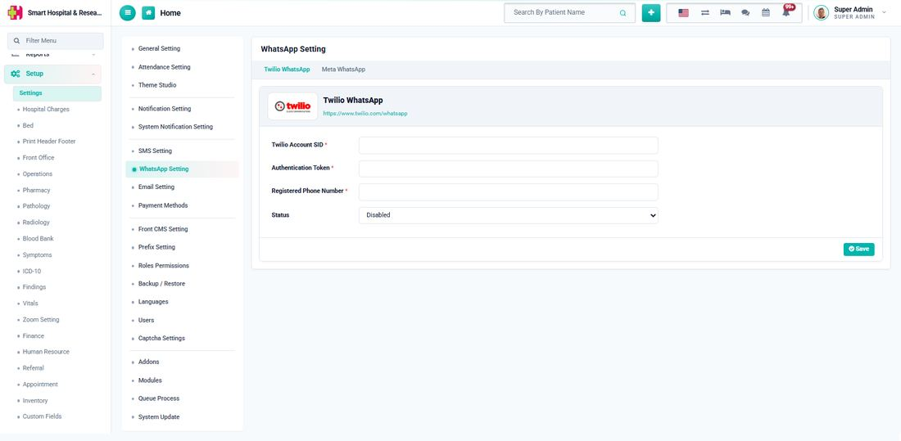
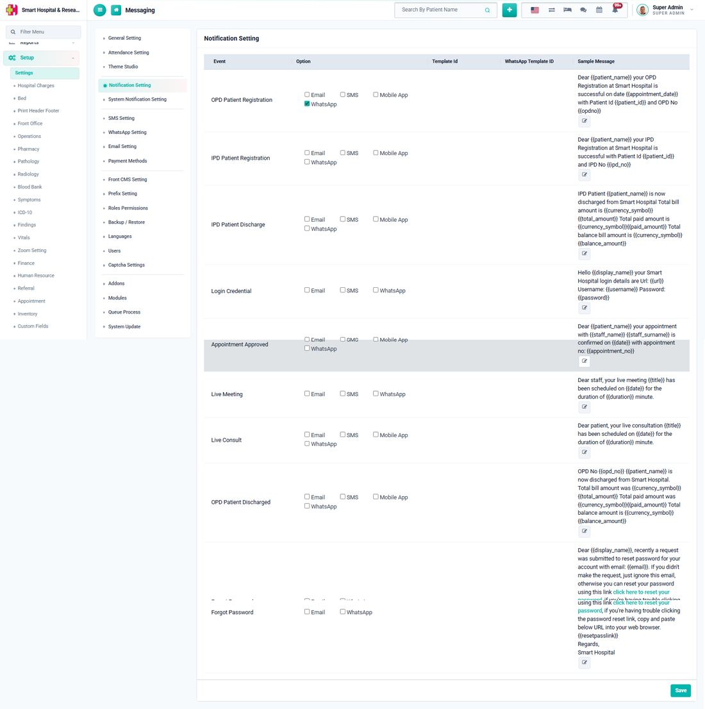

# About WhatsApp Messaging

_Sat, 25 Jul, 2026_ · [Ambulance (3)](https://smart-hospital.in/category/ambulance) · vendor article: https://smart-hospital.in/article/about-whatsapp-messaging

### About WhatsApp Messaging

Sat, 25 Jul, 2026

[Articles](https://smart-hospital.in/articles)[WhatsApp Messaging](https://smart-hospital.in/category/whatsapp-messaging)

---

WhatsApp Messaging module is for sending automatic WhatsApp notifications to patients and staff — the same events that already go out over Email, SMS and Mobile App push notifications can also be delivered over WhatsApp, using the exact template message the hospital has configured for that event.

Two WhatsApp providers are supported, configured from two tabs on the same settings page:

* **Twilio WhatsApp** — sends through your Twilio account's WhatsApp sandbox or approved sender number.
* **Meta WhatsApp** — sends through the official WhatsApp Business Platform (Cloud API), directly through Meta/Facebook.

Only **one** provider can be active at a time — enabling one automatically disables the other, since both ultimately send from the same "WhatsApp" channel.  
  

Once a provider is configured and enabled, WhatsApp becomes available as a delivery option next to Email, SMS and Mobile App on the **Notification Setting** page, where it can be switched on per event — for example OPD Patient Registration, IPD Patient Discharge, Appointment Approved, or Login Credentials.  
  

