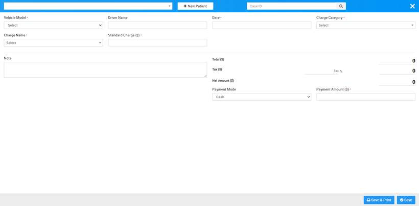
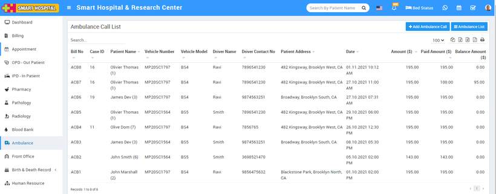

# How to add Ambulance Call?

_Mon, 01 Nov, 2021_ · [Ambulance (3)](https://smart-hospital.in/category/ambulance) · vendor article: https://smart-hospital.in/article/how-to-add-ambulance-call

### How to add Ambulance Call?

Mon, 01 Nov, 2021

[Articles](https://smart-hospital.in/articles)[Ambulance](https://smart-hospital.in/category/ambulance)

---

To add new ambulance call go to Ambulance module and  click on **+ Add Ambulance Call** button. Here select **Patient Name** from dropdown ( or click on **+ New Patient** button to add new patient or Enter **Case ID** so patient details will auto fill here) then enter **Vehicle Model**, **Driver Name**, **Date**, and **Charge** **Category**, **Charge** **Name**, **Standard** **Charge**, **Note** and click on **Save & Print** or **Save** button.  
  

You can check Ambulance Call created record at Ambulance Call list page.  
  

