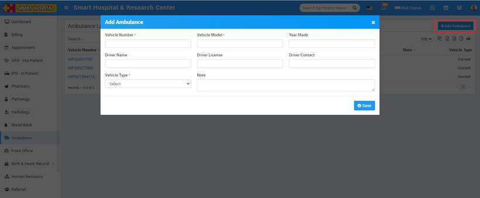
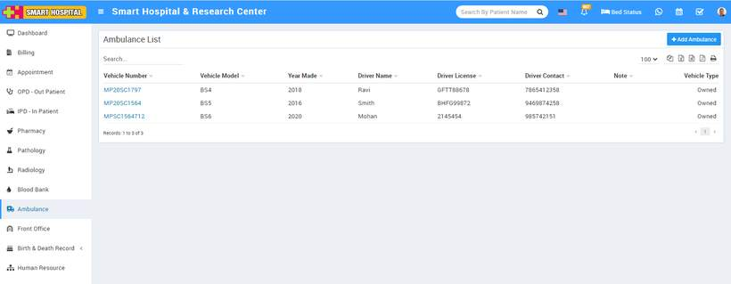

# How to add Ambulance?

_Mon, 01 Nov, 2021_ · [Ambulance (3)](https://smart-hospital.in/category/ambulance) · vendor article: https://smart-hospital.in/article/how-to-add-ambulance

### How to add Ambulance?

Mon, 01 Nov, 2021

[Articles](https://smart-hospital.in/articles)[Ambulance](https://smart-hospital.in/category/ambulance)

---

To add new ambulance vehicle, click on **Ambulance** link then click on the **Ambulance List** button, this will redirect you in Ambulance List page, now  click on **+ Add Ambulance** button, here enter **Vehicle Number**, **Vehicle Model**, **Year Made**, **Driver Name**, **Driver Licence**, **Driver Contact**, **Vehicle Type** and **Note**.  
  

Created Ambulance will show on the Ambulance list.  
  

