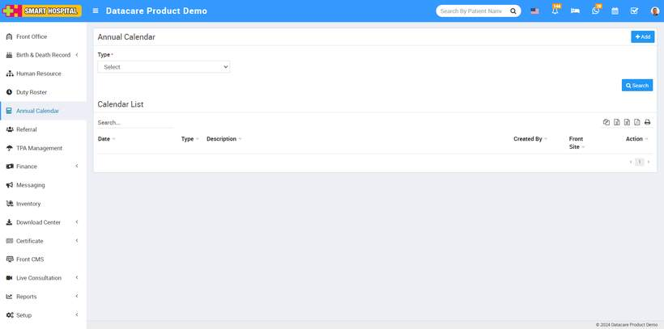
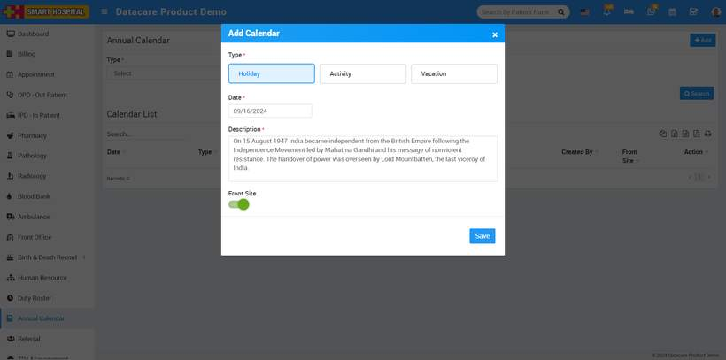
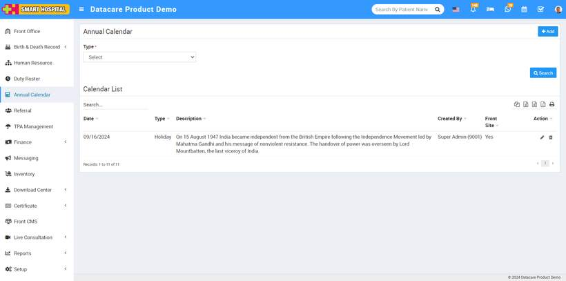
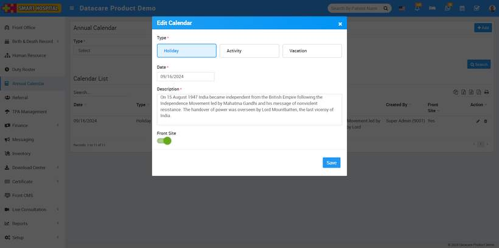
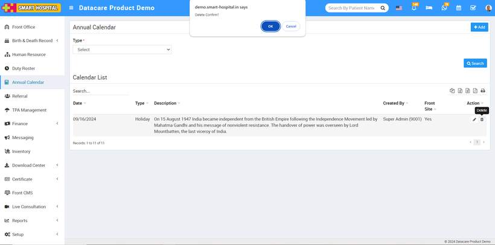
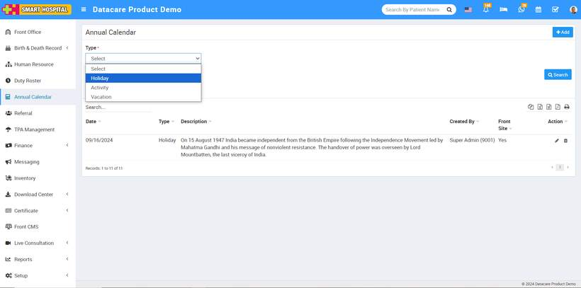
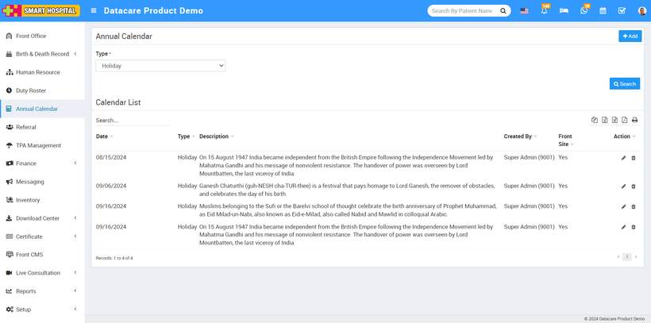
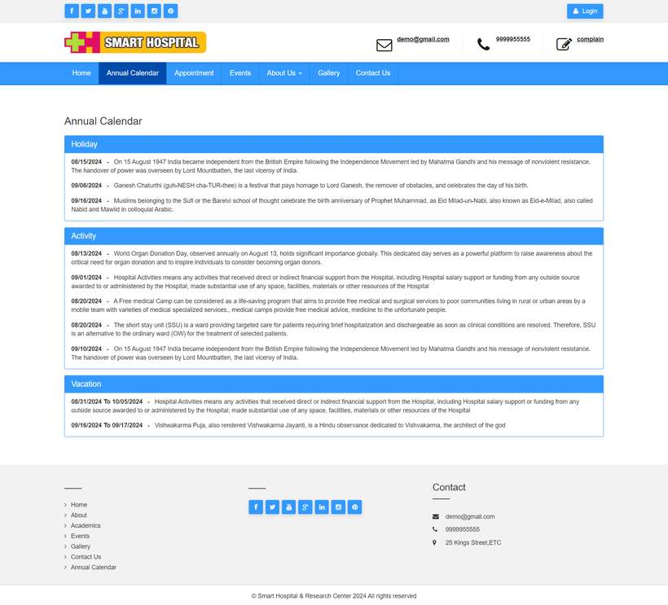
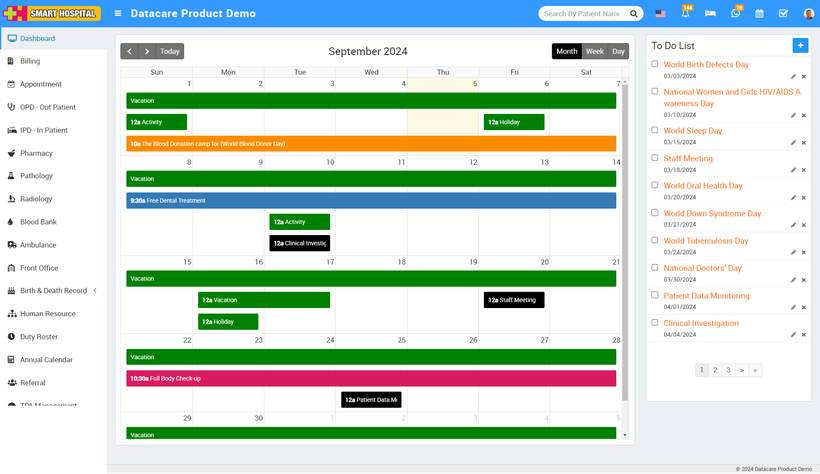
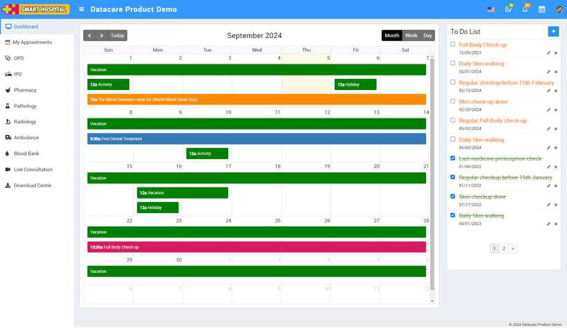

# How to add holiday in annual calendar on smart hospital?

_Thu, 05 Sep, 2024_ · [Annual Calendar (4)](https://smart-hospital.in/category/annual-calendar) · vendor article: https://smart-hospital.in/article/how-to-add-holiday-in-annual-calendar-on-smart-hospital

### How to add holiday in annual calendar on smart hospital?

Thu, 05 Sep, 2024

[Articles](https://smart-hospital.in/articles)[Annual Calendar](https://smart-hospital.in/category/annual-calendar)

---

To add a holiday to the annual calendar, go to the **Annual Calendar** module in your Smart Hospital system and click on it. The Annual Calendar page will open on the right side.  
  
  
  
Now go to the **Add** button, showing at the top right corner and click on it, Add window will be open In this window, you can see options for Type: **Holiday**, **Activity**, and **Vacation**. Simply select **'Holiday'** by clicking on it, then choose the date when the holiday will occur. Add a description of the holiday, and if you want to display this holiday with details on the front site of your Smart Hospital, click on the **'Front Site'** button.   
  
  
  
Finally, click the **'Save'** button to save your holiday details in the holiday list.  
  
  
  
To **edit** the holiday details simply go to the pencil icon showing at the right side and click on it, edit holiday window will be open  
  
  
  
Now update the details you want to change, then click the **'Save'** button. Your holiday details will be updated successfully.

To **delete** the holiday details, simply click on the delete icon on the right side, then click the **'OK'** button. The holiday details will be deleted successfully  
  
  
  
If you want to search specifically for holiday details, go to the top left of the page. Here, you'll see a **'Type'** dropdown menu. Select the **'Holiday'** option from the dropdown  
  
  
  
Then click on **Search**, in below list only display the holiday details.  
  
  
  
Additionally you can also see the holiday details on the front site of your Smart Hospital, as you enabled this option when adding the holiday. Simply go to the front site of your Smart Hospital and navigate to the annual calendar  
  
  
  
Here you can see the holiday details which you recently added from the annual calendar

You can see the holiday details on the **calendar** in both the **superadmin** and **patient** logins.

**For Superadmin login**, you can see a calendar icon at the top right corner. Click on it to open the calendar, where you can view the holiday details for the specific day you added

**For patient login**, you can see a calendar icon at the top right corner. Click on it to open the calendar, where you can view the holiday details for the specific day you added  
  

