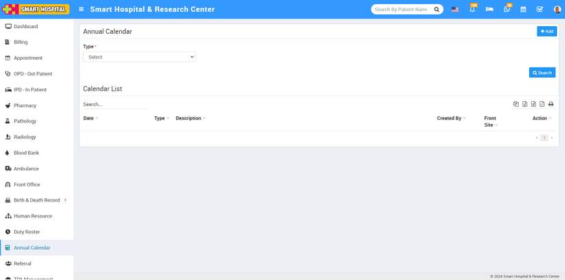
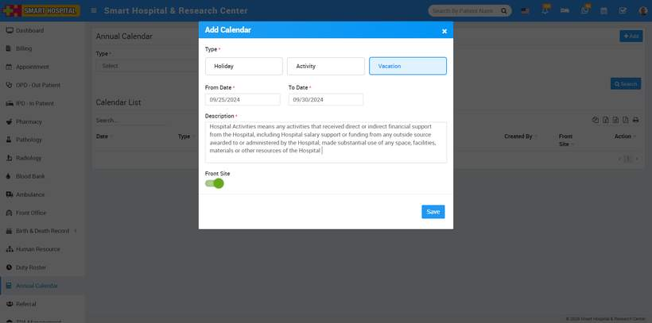
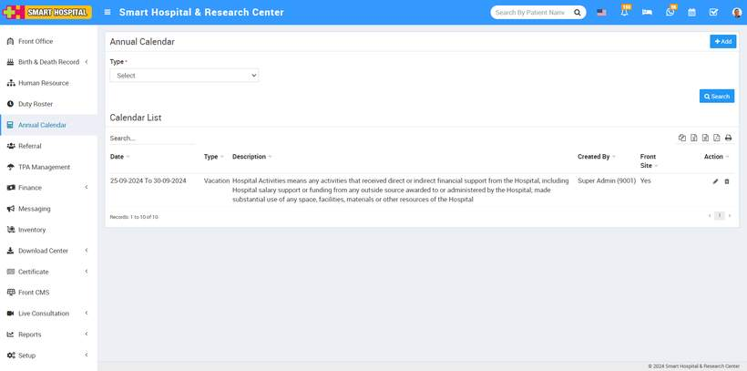
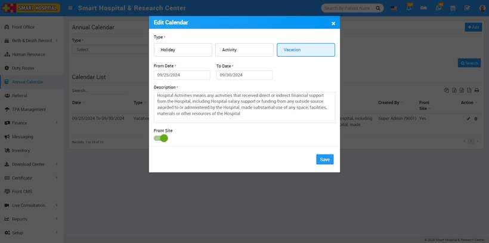
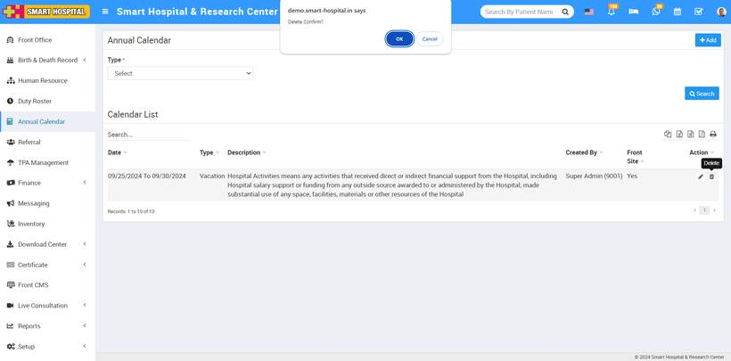
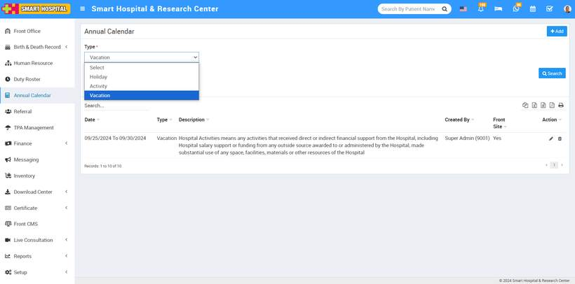
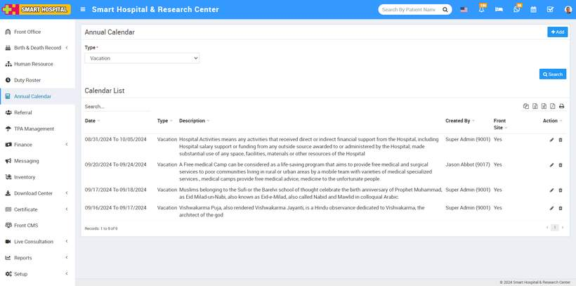
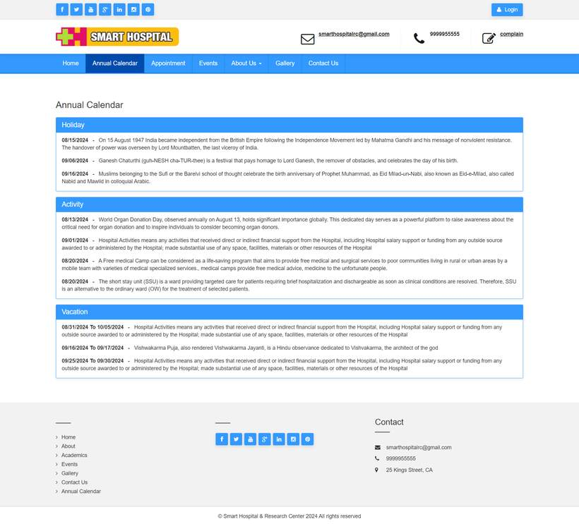
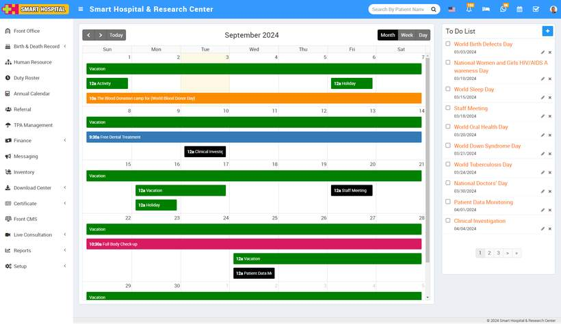
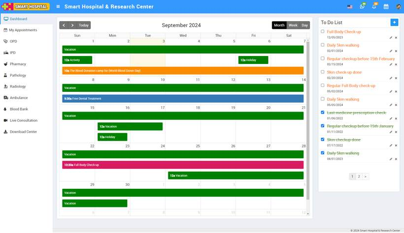

# How to add vacation in annual calendar?

_Tue, 03 Sep, 2024_ · [Annual Calendar (4)](https://smart-hospital.in/category/annual-calendar) · vendor article: https://smart-hospital.in/article/how-to-add-vacation-in-annual-calendar

### How to add vacation in annual calendar?

Tue, 03 Sep, 2024

[Articles](https://smart-hospital.in/articles)[Annual Calendar](https://smart-hospital.in/category/annual-calendar)

---

To add a vacation to the annual calendar, go to the **Annual Calendar** module in your Smart Hospital system and click on it. The Annual Calendar page will open on the right side.  
  
  
  
In this add window, you can see options for Type: **Holiday**, **Activity**, and **Vacation**. Simply select **Vacation** by clicking on it, then choose the date range when the vacation will occur. Add a description of the vacation, and if you want to display this vacation with details on the front site of your Smart Hospital, click on the **'Front Site'** button.  
  
  
  
 Finally, click the **'Save'** button to save your vacation details in the calendar list.  
  
  
  
  
  
To **edit** the vacation details simply go to the pencil icon showing at the right side and click on it, edit vacation window will be open  
  
  
  
  
Now update the details you want to change, then click the **'Save'** button. Your vacation details will be updated successfully.

To **delete** the vacation details, simply click on the delete icon on the right side, then click the **'OK'** button. The vacation details will be deleted successfully  
  
  
  
If you want to search specifically for vacation details, go to the top left of the page. Here, you'll see a **'Type'** dropdown menu. Select the **'Vacation'** option from the dropdown  
  
  
  
Then click on **Search**, in below list only display the vacation details.  
  
  
  
  
Additionally you can also see the vacation details on the front site of your Smart Hospital, as you enabled this option when adding the vacation. Simply go to the front site of your Smart Hospital and go to the annual calendar  
  
  
Here you can see the vacation details which you recently added from the annual calendar

You can see the vacation details on the **calendar** in both the **superadmin** and **patient** logins.

**For Superadmin login**, you can see a calendar icon at the top right corner. Click on it to open the calendar, where you can view the vacation details for the specific day you added

**For patient login**, you can see a calendar icon at the top right corner. Click on it to open the calendar, where you can view the vacation details for the specific day you added  
  

