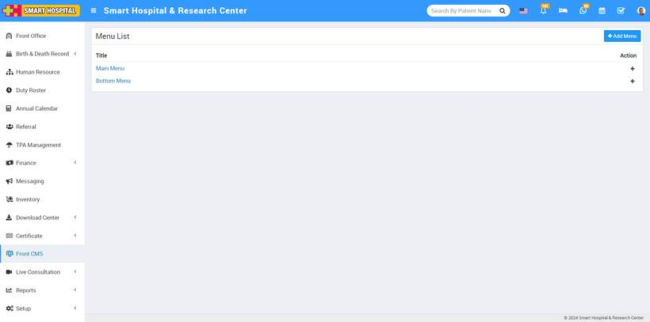
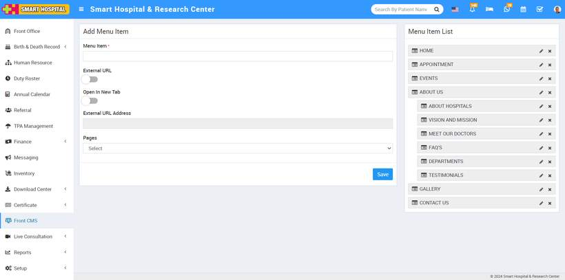
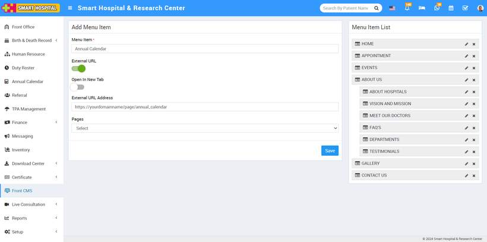
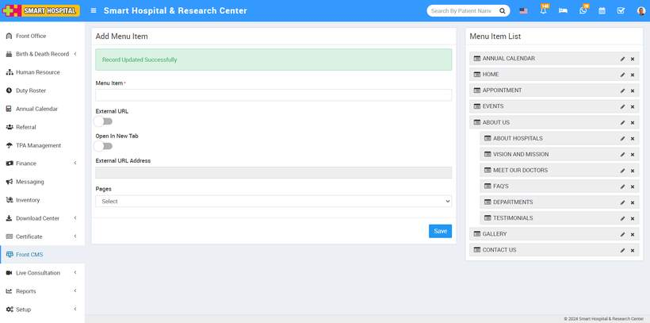
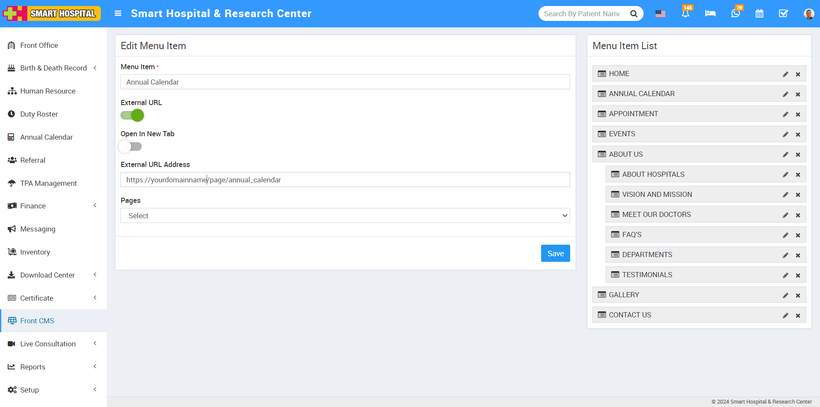
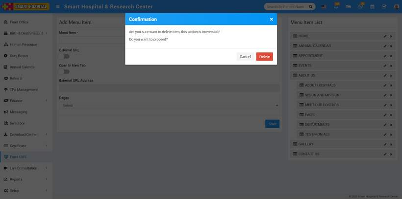
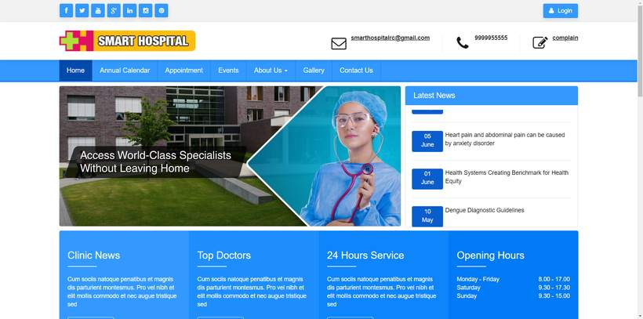
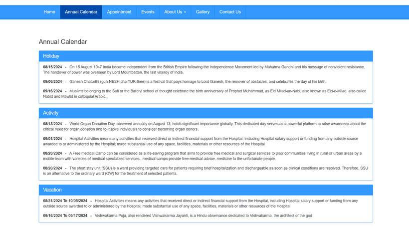

# How to show annual calendar tab on front site of smart hospital?

_Mon, 02 Sep, 2024_ · [Annual Calendar (4)](https://smart-hospital.in/category/annual-calendar) · vendor article: https://smart-hospital.in/article/how-to-show-annual-calendar-tab-on-front-site-of-smart-hospital

### How to show annual calendar tab on front site of smart hospital?

Mon, 02 Sep, 2024

[Articles](https://smart-hospital.in/articles)[Annual Calendar](https://smart-hospital.in/category/annual-calendar)

---

To display annual calendar on the front site of the Smart Hospital, go **to Front CMS > Menus**. Here, you can see the **'Add Menu**' form and the **Menu List**, which displays the **Main Menu** and the **Bottom Menu**. Click on the **'+'** icon in the **Main Menu** to go to the **'Add Menu Item'** page.    
  
  
  

When you click on **+ icon**, this will redirect you to the **Add Menu Item** page.  
  
  
  
  
Here you can view **Menu Item**, **External URL toggle button**, **Open in New Tab toggle button**, **External URL Address**, **Pages drop down** and **Save** button.  
  
In **Add Menu Item**, here enter **Menu Item**, enable **External** **URL toggle button**, keep disabled **Open In New Tab** button and in **External URL Address** enter your domain address then at the end of domain add annual calendar, such as **[https://yourdomain/annual\_calendar](https://yourdomain/examresult)**. In the **Pages**dropdown, don’t select any dropdown, leave it as it is, and then click on the **save** button. The new item can be seen on **Menu Item List** the right side.   
  
**For Example**- In Menu Item enter Annual Calendar, enable External URL toggle button, disable Open in New Tab, enter External URL Address, Pages drop down don’t select any dropdown then click on the **save** button.  
  
  
  
You can now view the **Annual Calendar** tab at the **Menu Item List** on the right site and you can drag and drop the **Annual Calendar** tab according to your preference.  
  
  
  
To edit the **Annual Calendar**, click on the **edit** icon present on the right side. Here you can Edit Menu Item.  
  
  
  
  
To delete the **Annual Calendar** tab, click the **Delete** icon on the right, Confirmation model will be open. Now click on **OK** button, Annual Calendar will be deleted successfully.  
  
  
  
You can view the annual calendar tab that has been generated successfully at the front site of your **Smart** **Hospital**.  
  
  
  
  
Now click on **Annual Calendar** on your Smart Hospital front site. Here, you can see the Annual Calendar details that you added through the Annual Calendar module of Smart Hospital.  
  

