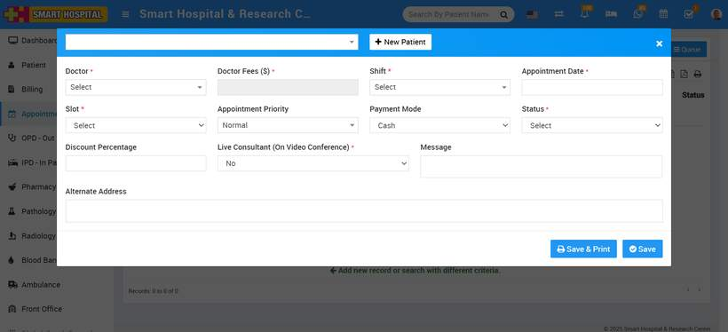
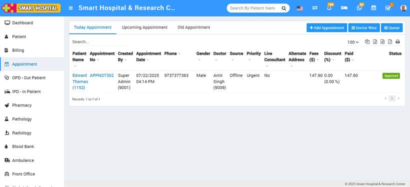
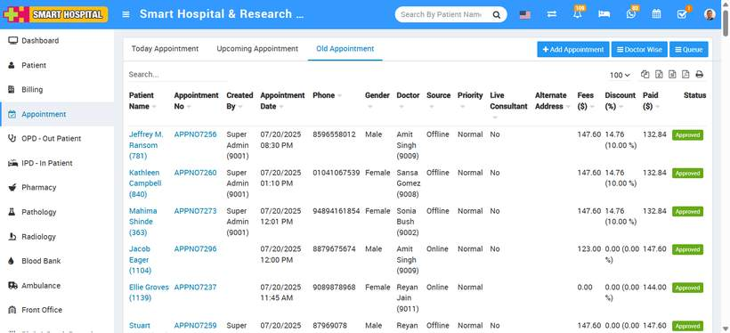
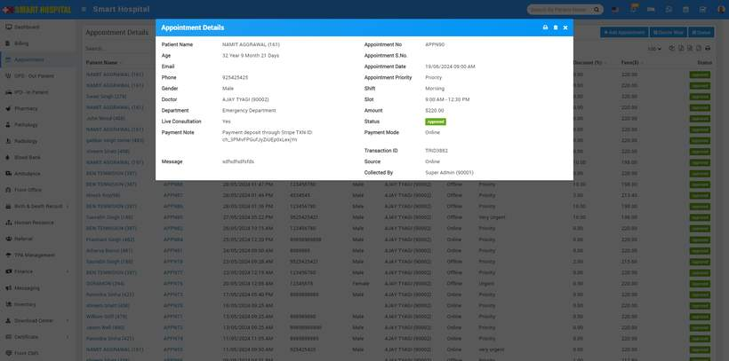
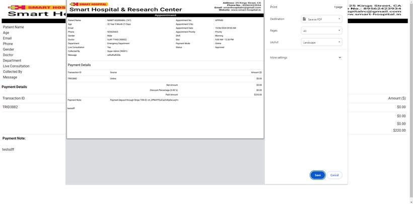
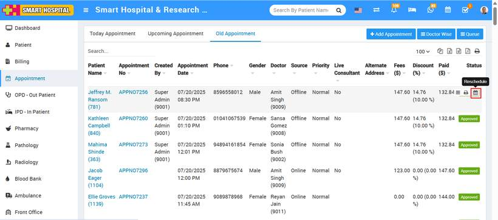
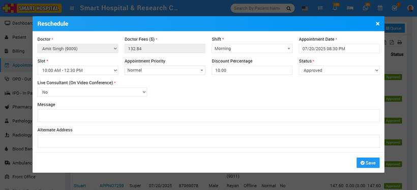

# How to add appointment in smart hospital?

_Tue, 22 Jul, 2025_ · [Appointment (8)](https://smart-hospital.in/category/appointment) · vendor article: https://smart-hospital.in/article/how-to-add-appointment-in-smart-hospital

### How to add appointment in smart hospital?

Tue, 22 Jul, 2025

[Articles](https://smart-hospital.in/articles)[Appointment](https://smart-hospital.in/category/appointment)

---

Appointment feature is for making Doctor Appointment. Receptionist or any permitted user can enter doctor appointment details here, also here can be Approved/Cancelled online appointments.  
  
To add new appointments go to **Appointment** link present at the left side menu then click on **+ Add Appointment** button. Here select existing patient from **Select Patient** dropdown (or you can create new patient record from **+New Patient**) then enter **Doctor**,**Docter Fees** (auto fill on Doctor's selection), **Shift**, **Appointment Date**, **Slot**, **Appointment Priority**, **Payment Mode**, **Status (Pending, Approved or Cancel)**, **Discount Percentage**, **Message** (optional), **Live Consultant(On Video Conference), Alternative Address** then click on **Save** **& Print** or **Save** button.   
  
  
  

**On the main page, you will see three tabs: 'Today’s Appointments', 'Upcoming Appointments', and 'Old Appointments'.**

* Appointments added for the current day will appear under the **'Today’s Appointments'** tab.
* Appointments booked for future dates will be listed under **'Upcoming Appointments'**.
* Appointments that have already passed will be shown under **'Old Appointments'**.

The appointment you recently added falls under today’s date, so you can view it in the **'Today’s Appointments'** list.

Appointments added from the front side of Smart Hospital will now be displayed in the appropriate tab based on their scheduled time — **Today’s Appointments**, **Upcoming Appointments**, or **Old Appointments**.

Previously, appointments created from the front side were not visible on the backend until the payment was completed. However, with the latest update, these appointments will now appear on the backend regardless of the payment status.

**An additional update has been made to this page. You can now see the name of the role that added the appointment displayed in the 'Created By' column.**

  
**Note-** If Appointment is approved and OPD is created for it then if you will change it's status as pending or cancelled then added OPD record will still be exist for the same record.  
  
  
  
  
To check added appointment details click on show button (buttons will be visible on mouseover event) present at **Status** column.   
  
  
  
  
You can print added appointment details from print option present at Status column.  
  
  
  
  
To reschedule your booked appointmnet, click on reschedule button present at Status column.  
  
  
  
  
Here you can change the time slot under available time slot to reschedule your appointment.  
  
  

