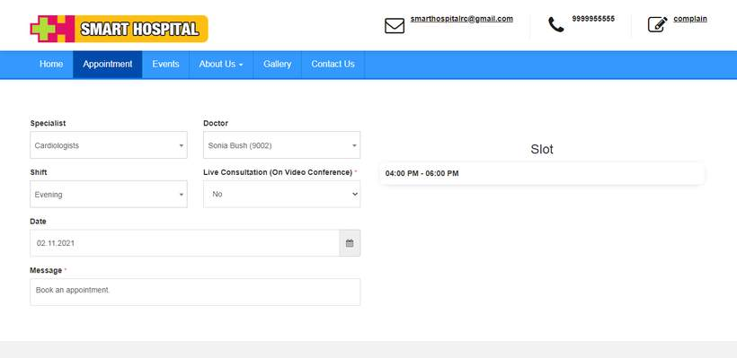
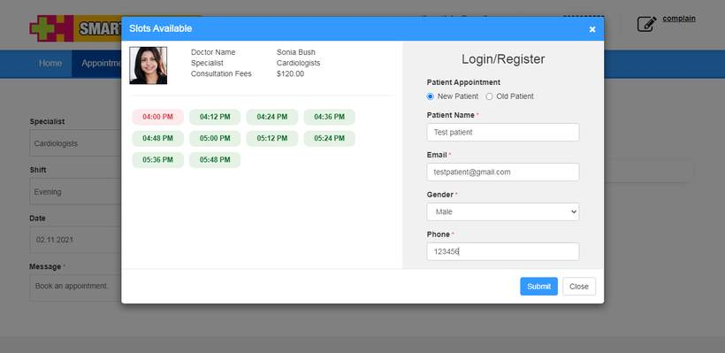
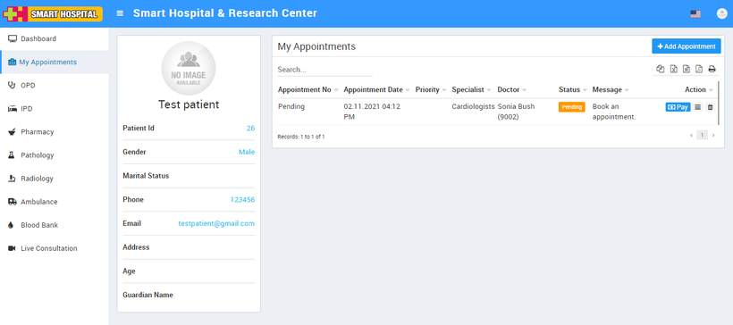
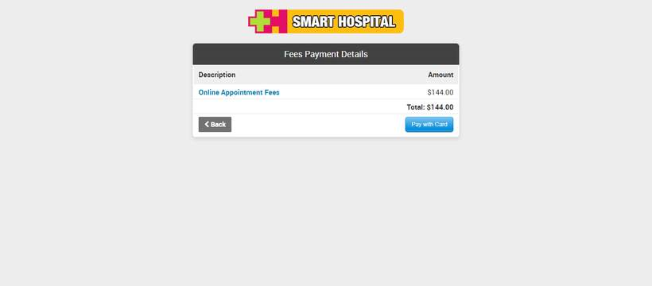
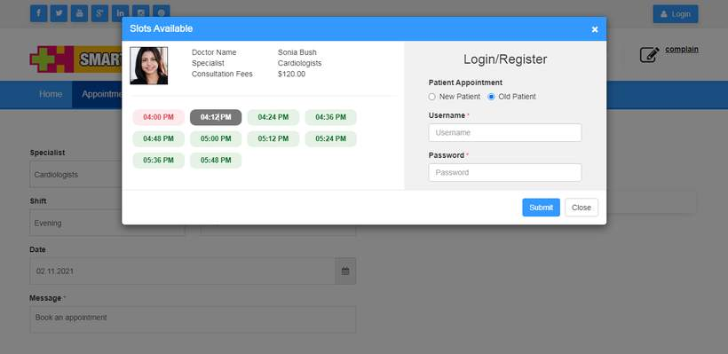

# How to book Appointment from front site?

_Wed, 29 Dec, 2021_ · [Appointment (8)](https://smart-hospital.in/category/appointment) · vendor article: https://smart-hospital.in/article/how-to-book-appointment-from-front-site

### How to book Appointment from front site?

Wed, 29 Dec, 2021

[Articles](https://smart-hospital.in/articles)[Appointment](https://smart-hospital.in/category/appointment)

---

In Smart Hospital, if user want to book an online appointment for patient from front site (in case patient is new or patient want to book an appointment from front site) then for this, user need to go to the Smart Hospital front site for e.g <https://demo.smart-hospital.in/> here click on Appointment tab (make sure Appointment is enable from Front CMS ). Now here enter the details like **Specialist, Doctor, Shift, Live Consultation (On Video Conference), Date** and  **Message** after enter these details if there is any slot available then it will show right side of the **Appointment** page at **Slot** section.  
  
  
  
After this click on Slot to proceed further. Here you will get all available time slot under your selected time slot. Click on any time slot for your appointment booking. Now for next user need to choose option for login so here you will get two option to proceed further for booking an appointment which are Register as a new user or login as an existing user.  
  
Note : If front CMS is disabled then use this **yourdomain/welcome/online\_appointment**  url to access online appointment feature.  
  
To register for new user select option as New Patient then fill all required details.  
  
  
  
After fill all the details when you click on **Submit** button so user account will create automatically and it will redirect to the My Appointment page after login to the panel.  
  
  
  
  
  
Now here user will see their appointment as pending for booking until patient don't make a payment. To make online payment click on **Pay** button available at **Appointment** page. It will redirect to the payment page from where you can make an online payment.  
  
  
  
After making payment successfully patient appointment will be booked and it's status will be show as Approved.  
  
For book an appointment for existing patient, click on Old Patient option. Here you will get option to enter username and password. After fill details when you login to the page it will redirect to the My appointment page of existing Patient account from where you can make online payment and book an appointment same as for new patient.  
  
  
  
**Note -**  
  
1. Patient appointment will not be booked until patient doesn't pay for it and it's status will show as Approved.  
2. If you book any appointment from front side, by default it will be booked for opd (later on admin can moved your appointment from OPD to IPD as per your requirement).
