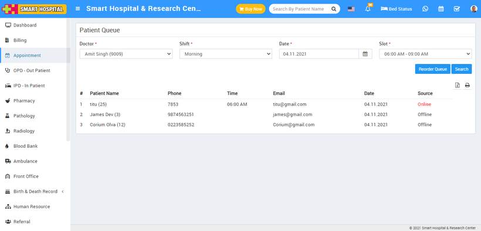
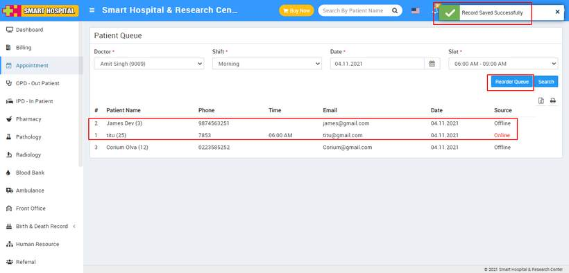

# How to check appointment Queue?

_Wed, 29 Dec, 2021_ · [Appointment (8)](https://smart-hospital.in/category/appointment) · vendor article: https://smart-hospital.in/article/how-to-check-appointment-queue

### How to check appointment Queue?

Wed, 29 Dec, 2021

[Articles](https://smart-hospital.in/articles)[Appointment](https://smart-hospital.in/category/appointment)

---

In Smart Hospital there are two ways to create patient appointment, first admin/staff create appointment from their account (offline appointment) and second is patient will create appointment from Front Site or patient account (online appointment).   
  
In online appointment when patient have created an online appointment then it will only considered as approved if patient have made full payment for appointment otherwise it will consider as pending appointment and can be rescheduled with new appointment time slot.  
  
Once appointments created for a day it will be list at appointment page but to check day wise booked appointment go to **Appointment > Queue** page. Here select **Doctor, Shift, Date and Slot** then click on **Search** button so you can view all the appointment for selected date and slot according to search criteria .  
  
In Queue page we have merged online and offline (window) appointments in single queue to generate and manage appointment serial number for per day per shift this will start appointment serial number from 1 for every day / every shift.  
  
  
  
Now If you want to rearrange the appointment serial number to manage appointments, there is a feature that is Reorder so through this you can rearrange the appointments by dragging it. To reorder appointment click on **Reorder Queue** button then drag the appointment row and replaced it.  
  

