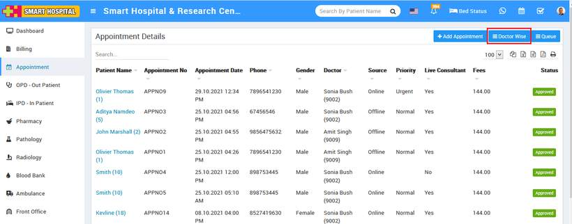
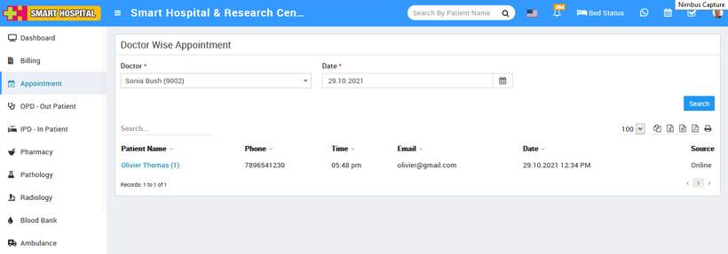

# How to check Doctor wise Appointment.

_Wed, 29 Dec, 2021_ · [Appointment (8)](https://smart-hospital.in/category/appointment) · vendor article: https://smart-hospital.in/article/how-to-check-doctor-wise-appointment

### How to check Doctor wise Appointment.

Wed, 29 Dec, 2021

[Articles](https://smart-hospital.in/articles)[Appointment](https://smart-hospital.in/category/appointment)

---

You can also check doctor wise  patient’s appointments in more managed way. for this go to Appointment link , this will redirect you in Appointment Details page then click on the Doctor Wise button present at the top right corner.  
  
  
  
At click of this button  you will be redirected to the **Doctor Wise Appointment** page, here you can search any appointment, for this select **Doctor** and **Date** and then click on the **Search** button, after clicking **Search** button you will show related doctor's appointment for the perticular date.  
  

