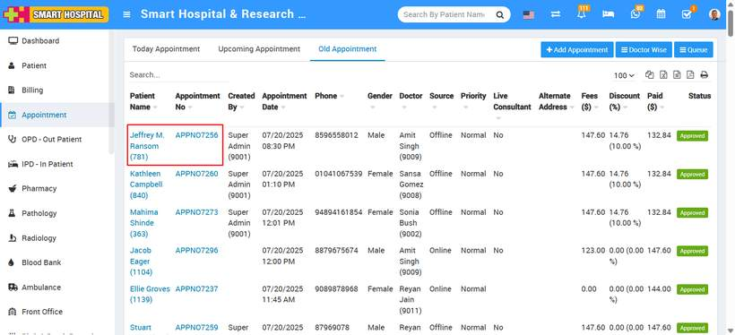
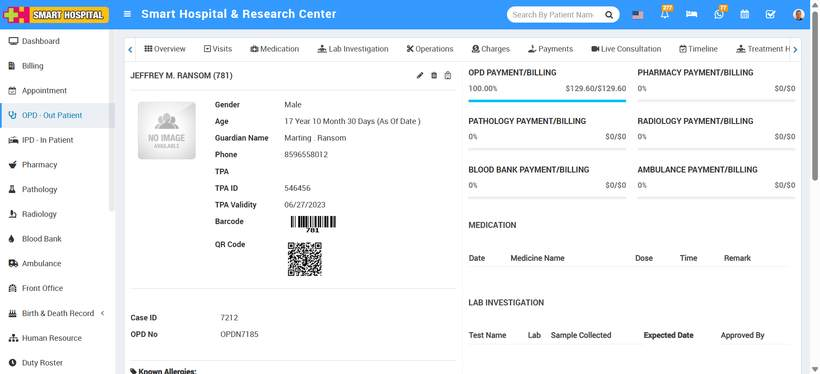

# How to direct open the patient details in Appointment?

_Tue, 22 Jul, 2025_ · [Appointment (8)](https://smart-hospital.in/category/appointment) · vendor article: https://smart-hospital.in/article/how-to-direct-open-the-patient-details-in-appointment

### How to direct open the patient details in Appointment?

Tue, 22 Jul, 2025

[Articles](https://smart-hospital.in/articles)[Appointment](https://smart-hospital.in/category/appointment)

---

To open the patient details in appointment module, just click on **Appointment**, appointment details list will be open in below   
  
  
  
  
In appointment details list, here you will see the multiple column's are available, if you want to open the patient details, simply go to the **Patient Name** and **Appointment No** column and click on either the Patient Name or Appointment No, that particular patient detail will be open  
  
  

