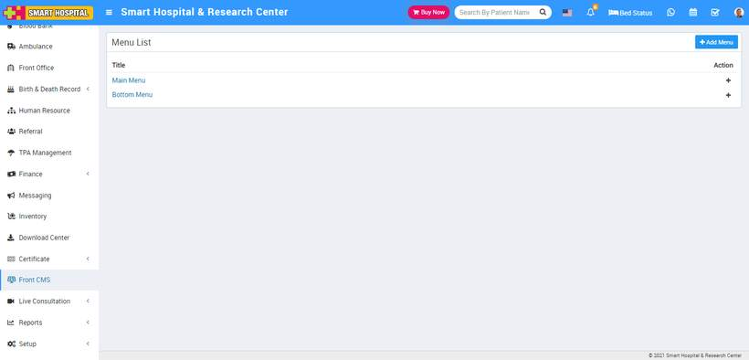
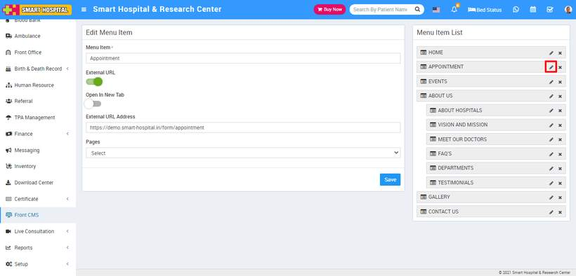

# How to enable Online Appointment for front site.

_Tue, 10 May, 2022_ · [Appointment (8)](https://smart-hospital.in/category/appointment) · vendor article: https://smart-hospital.in/article/how-to-enable-online-appointment-for-front-site

### How to enable Online Appointment for front site.

Tue, 10 May, 2022

[Articles](https://smart-hospital.in/articles)[Appointment](https://smart-hospital.in/category/appointment)

---

To enable Online Appointment for front site, go to **Front CMS > Menus**, then click on the **+** icon of **Main Menu**, this will redirect you in **Add Menu Item** page, here you will see all menu item list.  
  
  
  
Now click on the **Edit** icon of **Online Appointment** then enter **Menu Item** and **External URL Address like your Smart Hospital base url/form/appointment** and then click on the Save button.  
  

