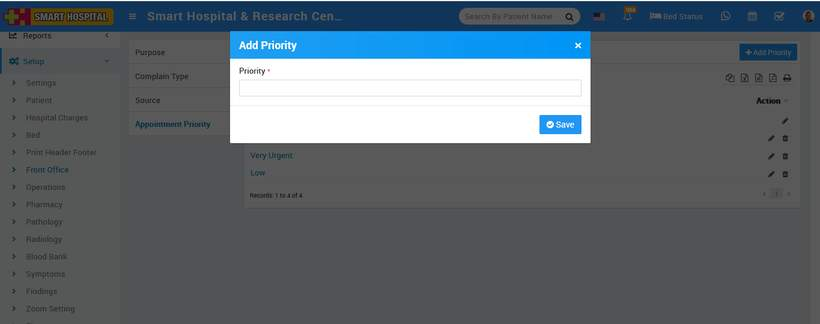
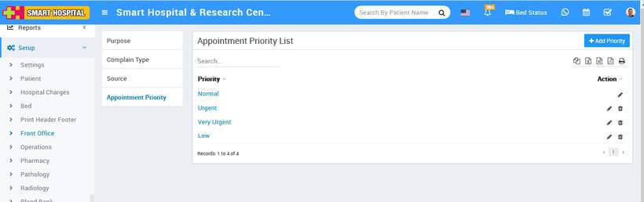

# Setup for Appointment.

_Thu, 18 Nov, 2021_ · [Appointment (8)](https://smart-hospital.in/category/appointment) · vendor article: https://smart-hospital.in/article/setup-for-appointment

### Setup for Appointment.

Thu, 18 Nov, 2021

[Articles](https://smart-hospital.in/articles)[Appointment](https://smart-hospital.in/category/appointment)

---

To setup appointment priority, go to **Setup >** **Front Office**. You can add **Appointment Priority** data which will be use in add appointment. Here enter **priority value** and then click on **Save** button.   
  
  
  
You can view this added record in the **Priority List** on Add Appointment page.  
  
  
  
To edit Priority click on edit and for delete click on delete icon present at **Action** column.
