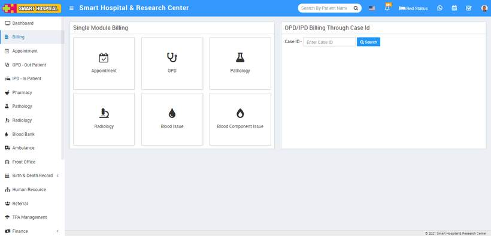

# About Billing

_Mon, 01 Nov, 2021_ · [Billing (3)](https://smart-hospital.in/category/billing) · vendor article: https://smart-hospital.in/article/about-billing

### About Billing

Mon, 01 Nov, 2021

[Articles](https://smart-hospital.in/articles)[Billing](https://smart-hospital.in/category/billing)

---

In Smart Hospital there is a feature of centralized billing so hospital staff not need to go to each module to generate patient bill individually for individual modules.   
  
In centralized Billing module there are two ways to generate patient bill -  
  

* One is for single module (like Appointment, OPD, Pathology, Radiology etc) which purpose where patient comes for a particular treatment like patient had came for only blood test so in this case staff need to only generate their blood test bill which it can generate from Pathology tab.
* Second one is for a billing of multiple treatments of patients under OPD / IPD which can be generate through a Case ID of patient.

             We will understand through an example, suppose a patient come to hospital for their treatment and referred to OPD. Here doctors do checkups and give prescription to patient in which doctor prescribed some medicine and pathology and radiology tests for patient. Now patient go through some radiology and pathology tests and purchased some medicine. Now after test reports doctor suggest patient to admit in the hospital for further treatments so here patient IPD record will be create and doctor will do further treatments which may include some more pathology, radiology tests, operations and medications. So for billing of all these treatments in one go OPD/IPD Billing Through Case Id feature is very useful, here staff only need a Patient Case ID so patient all treatments will reflect.  
  
  

