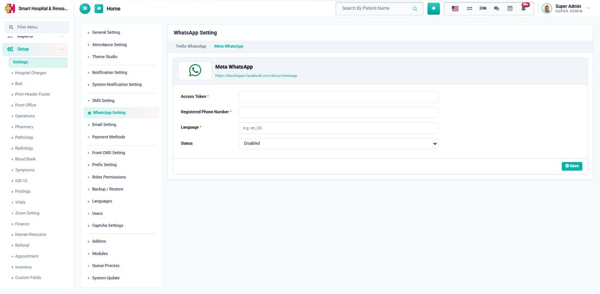

# How to configure WhatsApp using Meta (Cloud API)?

_Sat, 25 Jul, 2026_ · [Billing (3)](https://smart-hospital.in/category/billing) · vendor article: https://smart-hospital.in/article/how-to-configure-whatsapp-using-meta-cloud-api

### How to configure WhatsApp using Meta (Cloud API)?

Sat, 25 Jul, 2026

[Articles](https://smart-hospital.in/articles)[WhatsApp Messaging](https://smart-hospital.in/category/whatsapp-messaging)

---

Go to **Setup → Settings → WhatsApp Setting** from the sidebar and click on the **Meta WhatsApp** tab.  
  

Enter the following, taken from your Meta for Developers → WhatsApp app:

* **Access Token** — the permanent (or system user) access token for your WhatsApp Business app. Required, masked after saving.
* **Registered Phone Number** — here this is your WhatsApp **Phone Number ID** from the Meta Cloud API (not the phone number itself), required.
* **Language** — the language code your approved message templates were created in, e.g. `en_US`. Required.

Set **Status** to **Enabled** and click **Save**. Enabling Meta here automatically disables the Twilio provider.

**Note:** Meta WhatsApp only sends **pre-approved message templates** — each notification event's **WhatsApp Template ID** must match a template name that has already been approved in your Meta WhatsApp Business account, in the same language configured here.
