# OPD/IPD Billing Through Case ID

_Sat, 25 May, 2024_ · [Billing (3)](https://smart-hospital.in/category/billing) · vendor article: https://smart-hospital.in/article/opdipd-billing-through-case-id

### OPD/IPD Billing Through Case ID

Sat, 25 May, 2024

[Articles](https://smart-hospital.in/articles)[Billing](https://smart-hospital.in/category/billing)

---

To generate OPD/IPD billing through Case ID, go to **Billing > OPD/IPD Billing Through Case ID** here enter patient case id (you can get case id from patient OPD or IPD record) then click on search button.  
  
  
  
  
Now here you can see patient overall treatment details and charges from different modules OPD, IPD, Pharmacy, Pathology, Blood Bank and Ambulance which are linked through Case ID and Prescription No.  
  
To generate or print overall treatment bill on one bill or you can say single bill print click on **Bill Summary** button. Here you can check all modules bill details. To print this bill click on **Print** button present at top right corner.  
  
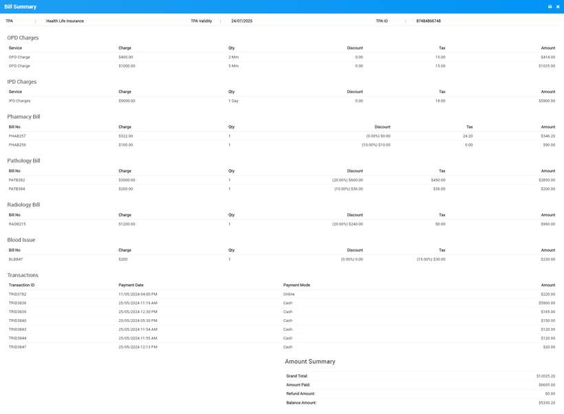  
  
  
  
You can also print individual module bill from print option present at respective module list page under details option.  

### OPD Billing through Case ID

To add Payments and Generate all treatment bill under OPD, firts we should create a OPD patient from OPD module so here patient Case ID will be generate so if patient have multiple visits for their treatment and wants their bill so for this go to **Billing > OPD/IPD Billing Through Case ID**, now here enter Case ID of patient and all their charges will show under a OPD tab.  
  
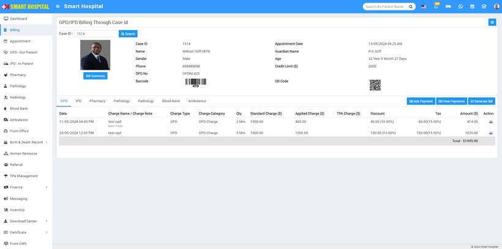  
  
  
  
Now to add payment click on **Add Payment** button present at right side under OPD tab, here enter **Date, Amount, Payment Mode and Note** then click on **Save** button.  
  
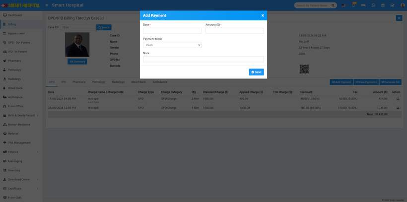  
  
  
Now to view all patient Payments done under OPD click on View Payments button present under OPD tab, here you can see payment details like **Date, Note, Payment Mode, Paid Amount** and also print bill of individually paid bill.  
  
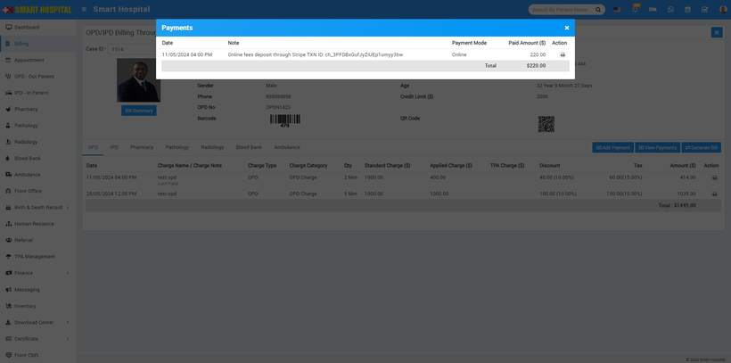  
  
To generate bill click on **Generate Bill** button present under OPD tab. Here all charges under OPD and IPD will be shown.  
  
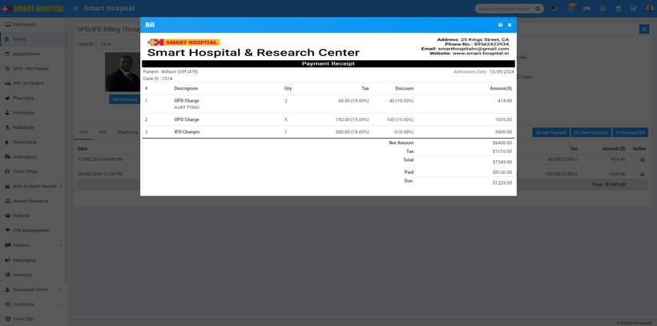  
  

### IPD Billing through Case ID

To add Payments and Generate all treatment bill under IPD, first we should create a IPD patient from IPD module so here patient Case ID will be generated so you can generate and print their IPD bill details using this case id, for this  go to **Billing > OPD/IPD Billing Through Case ID**, now here enter Case ID of patient and all their charges will show under a IPD tab.  
  
  
  
Now to add payment click on **Add Payment** button present at right side under IPD tab, here enter **Date, Amount, Payment Mode and Note** then click on **Save** button.  
  
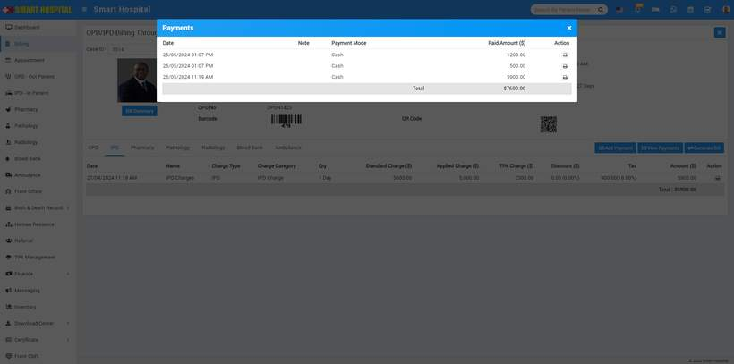  
  
To generate bill click on **Generate Bill** button present under IPD tab. Here all charges under OPD and IPD will be shown.  
  
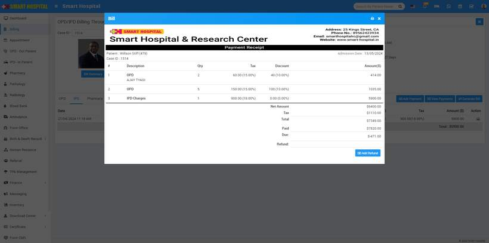  
  

### **Pharmacy**

To make payment and generate pharmacy bill, first you need to add patient from pharmacy module by using their prescription number then you need to enter case id in billing dashboard, while you enter case id and click on Search button, patient's all pharmacy related details will be shown on pharmacy tab.  
  
To check and pint pharmacy bill you can click on the **Show** icon which is present in the **Action** column (icon will be visible on mouseover of the column), by clicking this icon a pop-up window will be open, here you can see all bill information. To print bill information click on the **Print** icon present in the top of the modal.  
  
To make partial payment of bill click on the **+ Make Payment**  icon which is present in the **Action** column (icon will be visible on mouse over of the column only if bill payment balance amount will be greater than 0).  
  
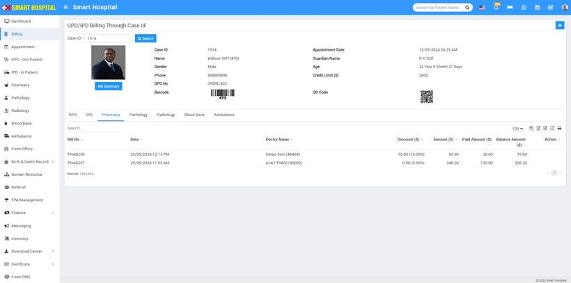  
  
  
  

### **Pathology**

To collect Pathology Test bill first you should create a pathology test record for patient from Pathology module, here you can create Pathology Test record though a prescription id so all the prescribed test unde OPD or IPD will be fetch automatically now if there is any payment remaining for Pathology Test, you can pay it from Billing module through Patient Case ID at one shot.  
  
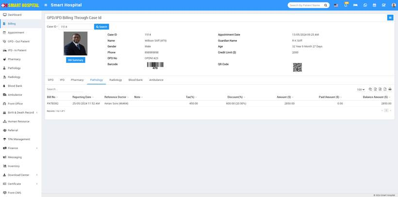  
  
  
To print Pathology Test report and bill click on View Reports option present at last column (button icon will be show on mouse hover) here you can see patient test reports and can print at from print button present at top of the header.  
  
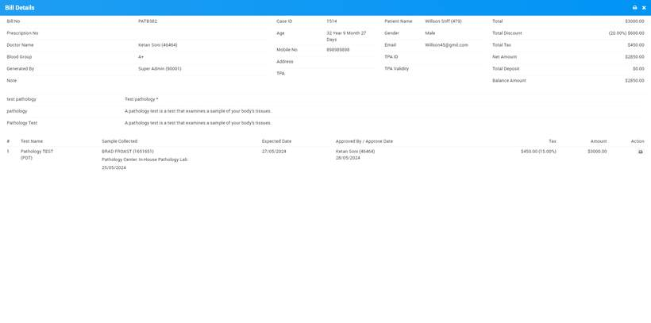  
  
You can also pay remaining pathology payment from here, for this click on **Add Payment** icon option present at last column (button will be show on mouse over only  if payment amount is balance).  
  
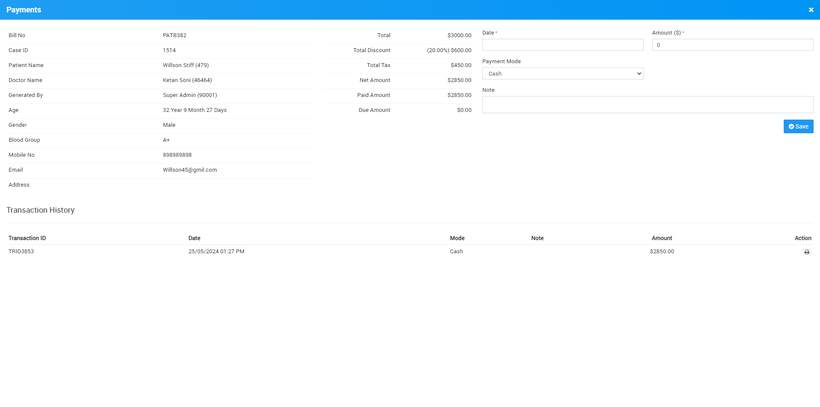  
  

### Radiology

To collect Radiology Test bill first you should create a radiology test record for patient, here you can create Radiology Test record though a prescription id so all the prescribed test under OPD or IPD will be fetch automatically now if there is any payment remaining for Radiology Test so patient can pay it from Billing module through Patient Case ID at one shot.  
  
  
  
To print Radiology Test report and bill click on View Reports option present at last column (button icon will be show on mouse hover) here you can see patient test reports and can print at from print button present at top of the header.  
  
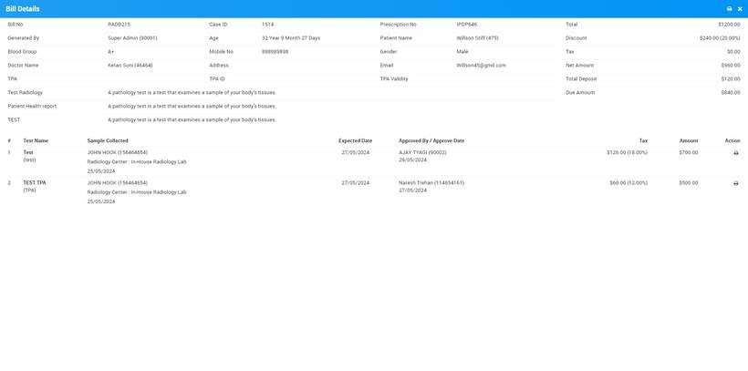  
  

### Blood Bank

  
To add Payments and Generate bill for Blood Bank through Case ID first we should create a Blood Bank record of patient from Blood Bank module so here patient Case ID will be generate now go to Billing > OPD/IPD Billing Through Case ID, now here enter Case ID of patient and all their charges will show under a Blood Bank tab.  
  
  
  
  
You can make partial payment from here, for this click on the + icon present on the action column, then fill mandatory details and then click on the Save button.  
  
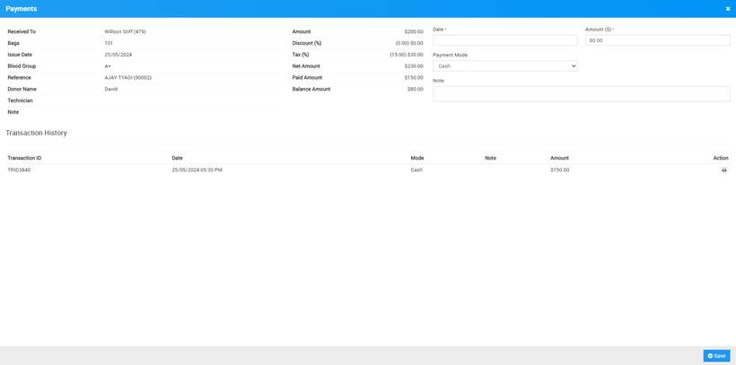  
  

### Ambulance

To add Payments and Generate bill for Ambulance through Case ID first we should create a Ambulance call record record of patient from Ambulance module so here patient Case ID will be generate now go to Billing > OPD/IPD Billing Through Case ID, now here enter Case ID of patient and all their charges will show under a Ambulance tab.  
  
  
  
  
You can make partial payment from here, for this click on the + icon present on the Action column, then fill mandatory details and then click on the **Save** button.  
  
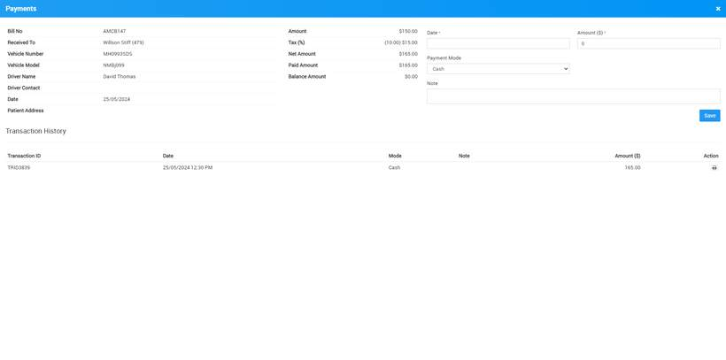  
  
To print payment details click on the **View Payment** icon present on the **Action** column, at click of this icon pop widow will be open then click on the **Print** icon present on the top right corner of the modal.
