# Single Module Billing

_Mon, 27 May, 2024_ · [Billing (3)](https://smart-hospital.in/category/billing) · vendor article: https://smart-hospital.in/article/single-module-billing

### Single Module Billing

Mon, 27 May, 2024

[Articles](https://smart-hospital.in/articles)[Billing](https://smart-hospital.in/category/billing)

---

In a single module billing we have included total 6 module which are **Appointment, OPD, Pathology, Radiology, Blood issue and Blood Component Issue**.  
  

### **Appointment**

To generate patient Appointment bill go to **Billing > Appointment**. Here click on **+ Add Appointment** so pop up window will be open here you should select patient from search patient field or you can add new patient from **+ New Patient** button then select **Doctor, Doctor Fees, Shift, Appointment Date, Slot, Appointment Priority, Payment Mode, Status, Message, Live Consultant, Full Details and Appointment Details** then click on **Save & Print** or **Save** button. You can share this bill receipt with patient after received bill amount.  
  
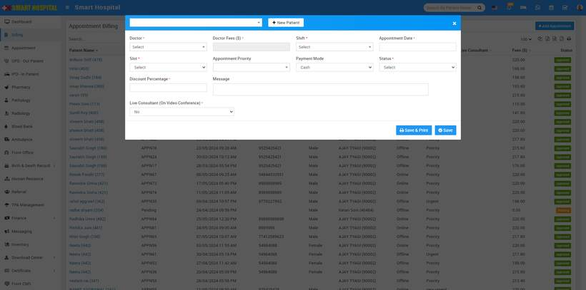  
  
You can also print bill for patient previously created Appointment which are listed at Appointment Billing list page. To print it click on **Show** button present at last column on mouse hover then click on print bill button.  
  
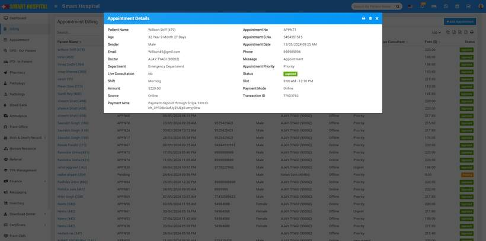  
  
  
To edit billing click on edit and for delete click on delete present at bill details.  
  

---

### **OPD**

To generate patient OPD bill go to **Billing > OPD**. Here you can see all OPD patient visits   
  
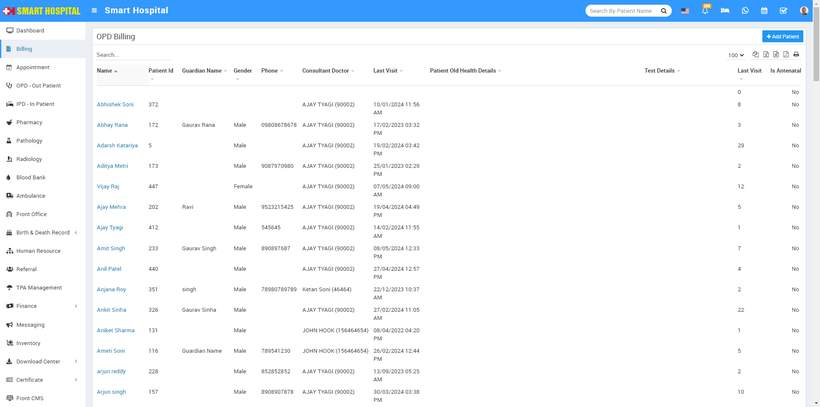  
  
  
To generate or print OPD bill for previously created OPD patient click on Show button available at last column on while you mouse hover   
  
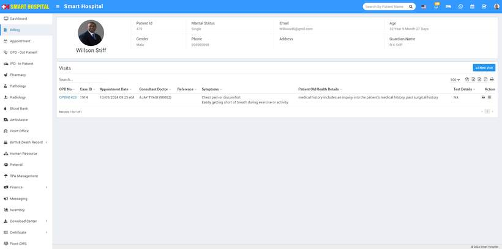  
  
then click on print bill icon located at **Action** column.  
  
  
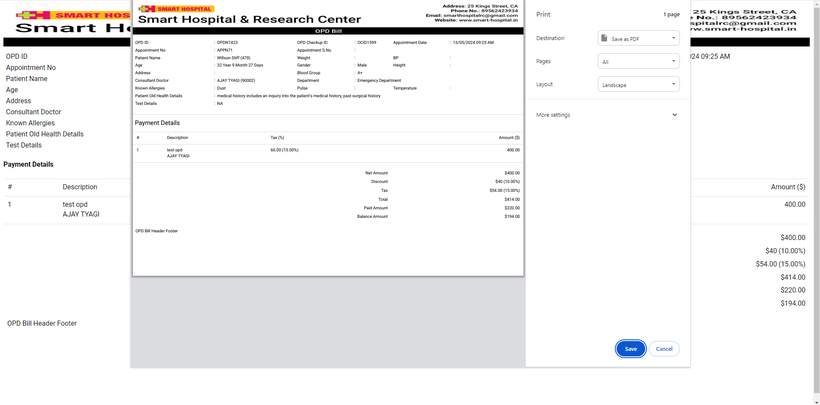  
  
  
To add **New Visit** for patient click on **New Visit** button present at top right corner, here enter details and click on **Save & Print** or **Save** button.  
  
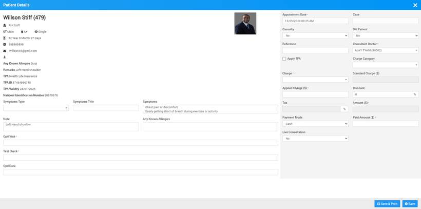  
  
You can also create a new OPD patient and then print the patient’s OPD bill. To do this, click on the **+ Add Patient** button. Enter the patient's information from the search field or by adding a new patient using the **+ New Patient** option. Then, enter the remaining details and click on the **Save & Print** or **Save button**  
  
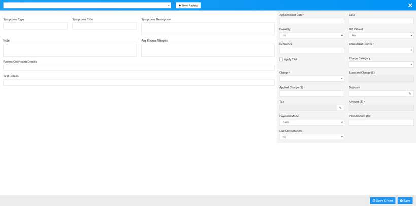  
  
  

---

### **Pathology**

To generate patient Pathology bill go to **Billing > Pathology**. Here you can see all patient pathology reports so to generate or print pathology test bill for previously created pathology patient records, click on View Reports button available at last column on mouseover.  
  
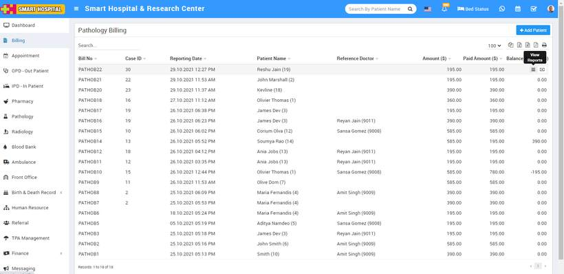  
  
Now click on **Print Bill** icon present at top right corner at header, this will print all tests bill in a single bill.  
  
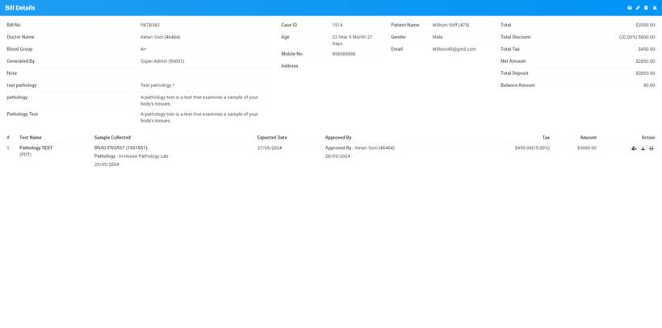  
  
  
  
Once you click on this **Print Bill** icon, it will be shown like this-  
  
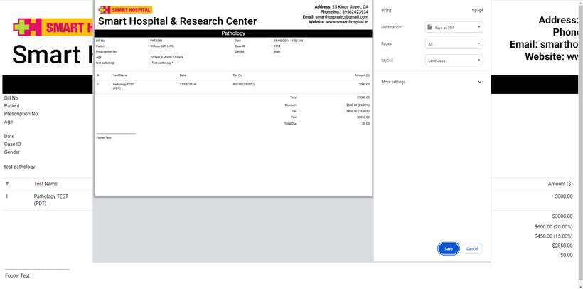  
  
  
  
If you want to print individual tests bill then you should generate it from print icon present at **Action** column.  
  
To create new patient pathology bill first create new pathology test record for this click on **+ Add Patient** button here enter Patient (patient can be added here in three ways 1. Search for patient at search area. 2. Add new patient through **+New Patient** and 3. Enter **Prescription No.** so patient details with prescribed test will auto fill at generate bill), 4. **Apply TPA** (**Third Party Administrator**) **Test Name, Reports Days, Report Date, Tax, Amount, Hospital Doctor and Doctor Name**, custom field details (if any) then after adding all pathology test details enter **Discount** and **Tax** if any to calculate final bill click on Calculate button then click on **Save** button. After this,  bill will be display on Pathology bill page.  
  
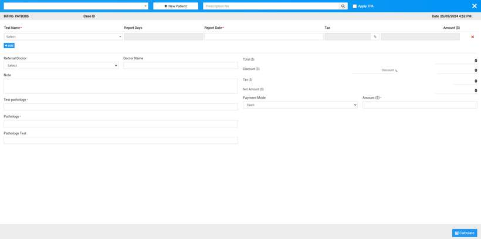  
  
  
Once patient is added in pathology billing list, you can add sample collected person for the particular test. For this click on the Show icon present in the pathology billing record list and then click on the notch icon present in Action column and then fill **Sample Collected Person Name**, **Collected Date** and **Pathology Center**and then finally click on the **Save** button.  
  
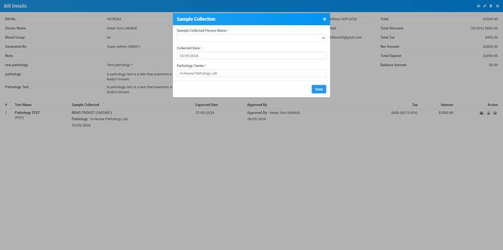  
  
  
You can edit and delete patient's pathology billing details, by clicking on **Edit** and **Delete** icon present on the to right corner of the modal.  

---

### **Radiology**

To generate patient Radiology bill go to **Billing > Radiology**. Here you can see all patient radiology reports so to generate or print radiology test bill for previously created radiology patient records click on **View Reports** button available at last column on mouseover.  
  
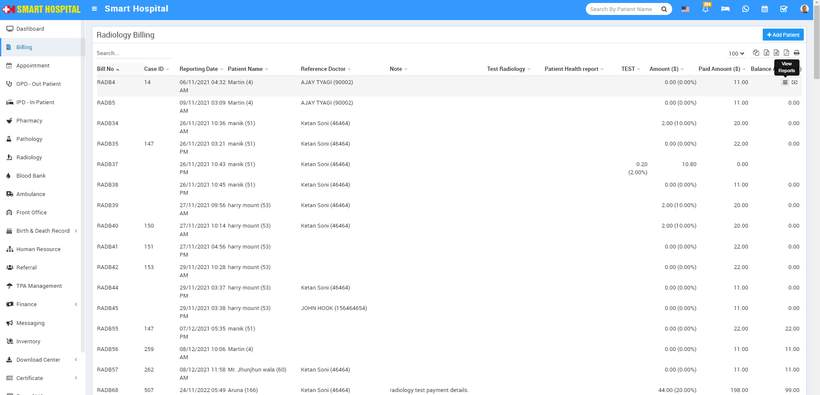  
  
  
Now click on **Print Bill** icon located at top right corner, this will print all tests bill in a single bill.  
  
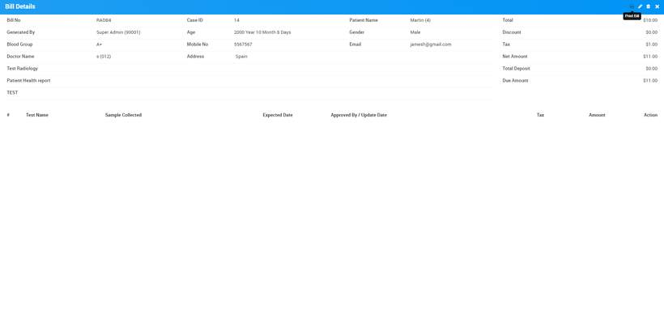  
  
If you want to print individual tests bill then you should generate it from print icon present at **Action** column.  
  
To create new patient radiology bill first create new radiology test record for this click on **+ Add Patient** button here enter Patient (patient can be added here in three ways 1. Search for patient at search area. 2. Add new patient through **+New Patient** and 3. Enter **Prescription No, 4.** check the checkbox of **Apply TPA (Third Party Administrator).** so patient details with prescribed test will auto fill at generate bill), **Test Name, Reports Days, Report Date, Tax, Amount, Hospital Doctor and Doctor Name**, custom field details (if any) then after adding all radiology test details enter **Discount** and **Tax** if any to calculate final bill click on Calculate button then click on **Save** button. After this,  bill will be display on Radiology bill page.  
  
  
  

---

### **Blood Issue**

To generate patient Blood Issue bill go to **Billing > Blood Issue**. Here you can see all patient blood issue record.  
  
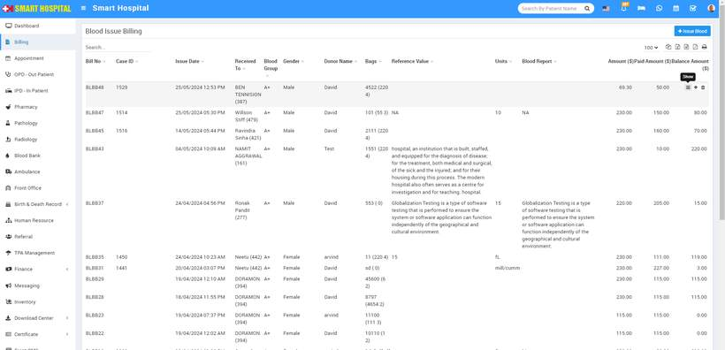  
  
To generate or print a Blood Issue bill for previously created records, click the **Show** button in the last column when you hover the mouse over it  
  
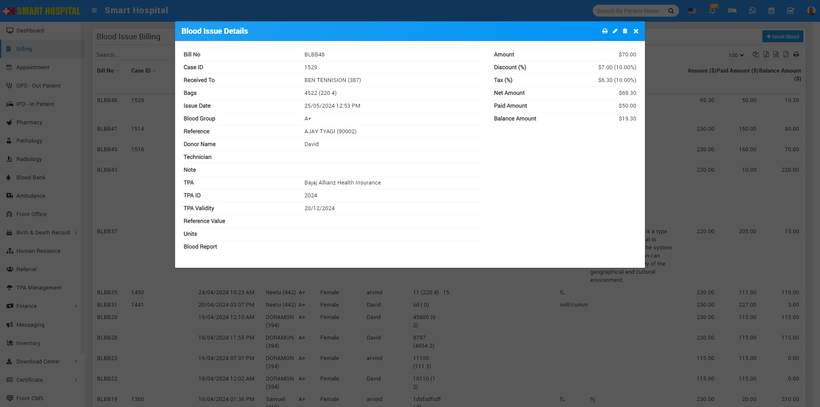  
  
Now click on **Print Bill** button located at top right corner.  
  
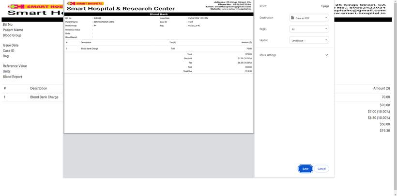  
  
  
To create patient new Blood Issue bill first create new Blood Issue record for this click on **+ Issue Blood** button here enter **Patient** from Select Patient (search for available patient) or create new patient from **+ New Patient** Button or add patient by entering **Case ID** (you can find Case Id from OPD or IPD detail of Patient), and check the check box of **Apply TPA(Third Party Administrator),** now enter **Issue Date, Hospital Doctor, Reference Name, Technician, Blood Group, Bag, Charge Category, Charge Name, Standard Charge, Note, Discount, Tax, Payment Mode**and **Payment Amount** (Payment Amount will automatically calculate) then click on **Save & Print**or **Save** button. After this bill will be display on issue Blood bill page.  
  
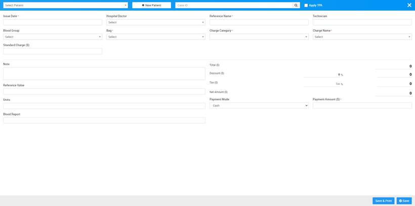  
  
  

---

### **Blood Component Issue**

To generate patient Blood component Issue bill go to **Billing > Blood Component Issue**. Here you can see all patient blood issue records  
  
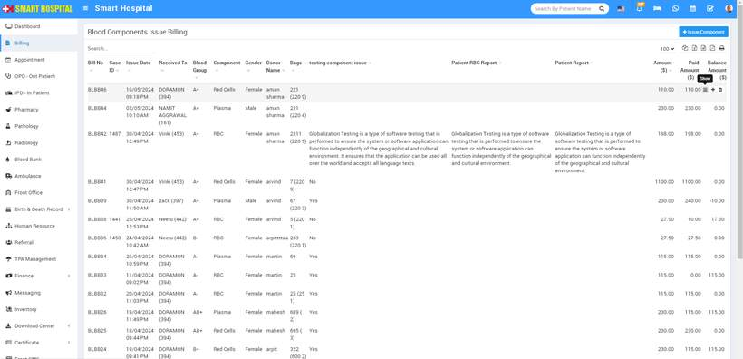  
  
 To generate or print a Blood Component Issue bill for previously created records, click the **Show** button in the last column when you hover the mouse over it  
  
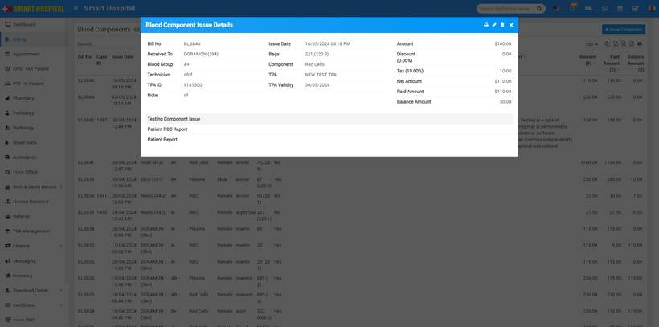  
  
Now click on **Print Bill** button present at top right corner at header.  
  
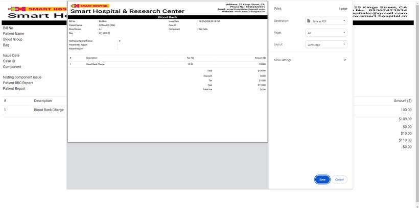  
  
  
To create patient new Blood Issue bill first create new Blood Issue record for this click on **+ Issue Blood** button  here enter **Patient** from Select Patient (search for available patient) or create new patient from **+ New Patient** Button or add patient by entering **Case ID** (you can find Case Id from OPD or IPD detail of Patient), and check the check box of **Apply TPA (Third Party Administrator)** now enter **Issue Date, Hospital Doctor, Reference Name, Technician, Blood Group, Components, Bag, Charge Category, Charge Name, Standard Charge, Note, Discount, Tax, Payment Mode**and **Payment Amount** (Payment Amount will automatically calculate) then click on **Save & Print**or **Save** button. After this bill will be display on issue Blood bill page.  
  
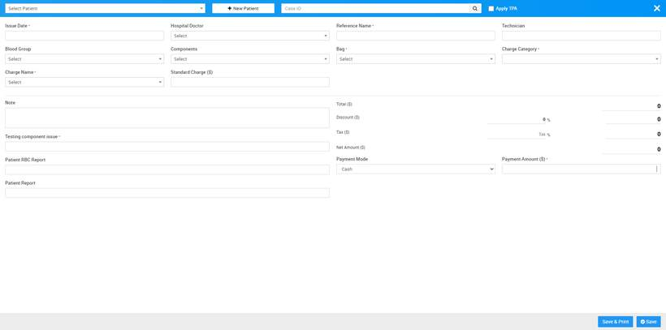
