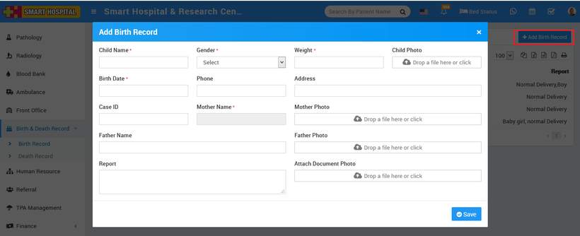
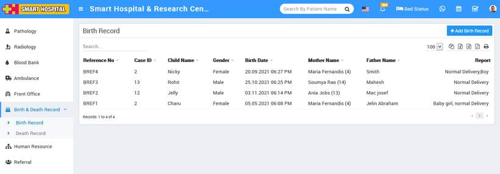

# How to add Birth Records?

_Mon, 01 Nov, 2021_ · [Birth & Death Record (2)](https://smart-hospital.in/category/birth-death-record) · vendor article: https://smart-hospital.in/article/how-to-add-birth-records

### How to add Birth Records?

Mon, 01 Nov, 2021

[Articles](https://smart-hospital.in/articles)[Birth & Death Record](https://smart-hospital.in/category/birth-death-record)

---

Here we will manage all babies birth record happened in hospital. To add record, click on **+ Add Birth Record** , here you enter **Child Name**, **Gender**, **Weight**, **Child** **Photo**, **Birth Date**, **Phone**, **Address**, **Mother** **Name**, **Case ID**, **Mother Photo**, **Father Name**, **Father Photo**, **Report**, **Attach Document**t(Any ID Proof or other required document), Custom Field (Optional).  
  

You can view this added record in the **Birth record list** on the right side of the page.  
  

To edit birth record click on **Edit** icon and to delete section click on **Delete** icon present in the birth record list.
