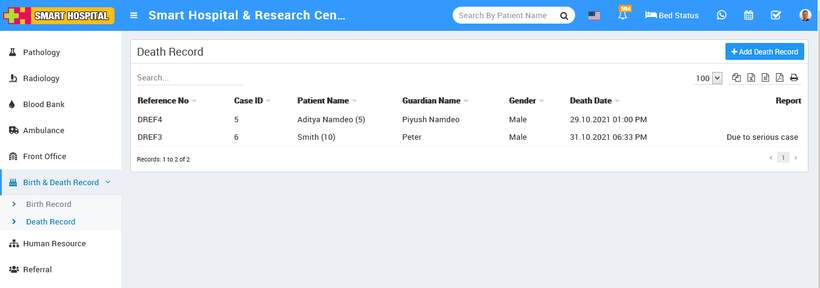

# How to add Death Records?

_Mon, 01 Nov, 2021_ · [Birth & Death Record (2)](https://smart-hospital.in/category/birth-death-record) · vendor article: https://smart-hospital.in/article/how-to-add-death-records

### How to add Death Records?

Mon, 01 Nov, 2021

[Articles](https://smart-hospital.in/articles)[Birth & Death Record](https://smart-hospital.in/category/birth-death-record)

---

here we will manage all expired patient record happened in hospital. To add record, click on **+ Add Death Record**, here you enter **Case ID**, **Patient Name**, **Death Date**, **Guardian Name**, **Report**, Custom Field (optional).  
  

You can view this added record in the **Death Record list under Record option** on the right side of the page.  
  

To edit death record click on **Edit** icon and to delete section click on **Delete** icon present in the death record list.
