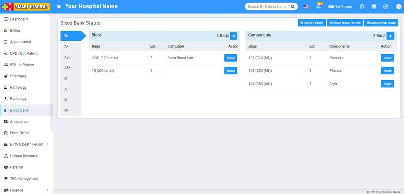

# About Blood Bank

_Mon, 01 Nov, 2021_ · [Blood Bank (6)](https://smart-hospital.in/category/blood-bank) · vendor article: https://smart-hospital.in/article/about-blood-bank

### About Blood Bank

Mon, 01 Nov, 2021

[Articles](https://smart-hospital.in/articles)[Blood Bank](https://smart-hospital.in/category/blood-bank)

---

The hospital blood bank is responsible for management of the hospital's blood stock. This includes maintaining an inventory for each blood group. The main goal of the Blood Bank is **to monitor Blood Bank data, Blood cells (component), Blood stock, Donor List**.

**Blood Bank** module is for managing blood bank status, component status, **donor details** and **blood and component issue details.  
  
**
