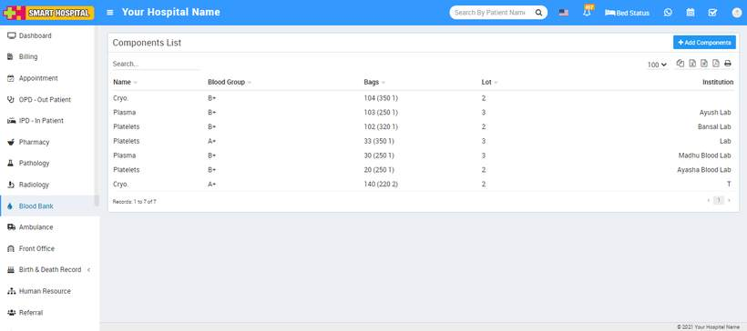

# How to add Component in Blood Bank?

_Mon, 01 Nov, 2021_ · [Blood Bank (6)](https://smart-hospital.in/category/blood-bank) · vendor article: https://smart-hospital.in/article/how-to-add-component-in-blood-bank

### How to add Component in Blood Bank?

Mon, 01 Nov, 2021

[Articles](https://smart-hospital.in/articles)[Blood Bank](https://smart-hospital.in/category/blood-bank)

---

The transfusable components that can be derived from donated blood are red cells, platelets, plasma, cryoprecipitate AHF (cryo), and granulocytes.  
  
To add component in Blood Bank go to **Blood Bank > Component Issue > Components > Add Components**. Here select **Blood Group** and **Bag** then enter **Components Name, Bag, Volume, Unit, Lot and Institution** then click on **Save** button.   
  
  
  
You can check this added record at **Components List** page.  
  
  
  
To delete Component click on delete icon shows on mouse hover at last column of **Component** list.
