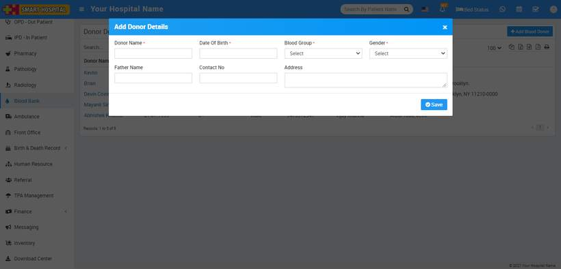
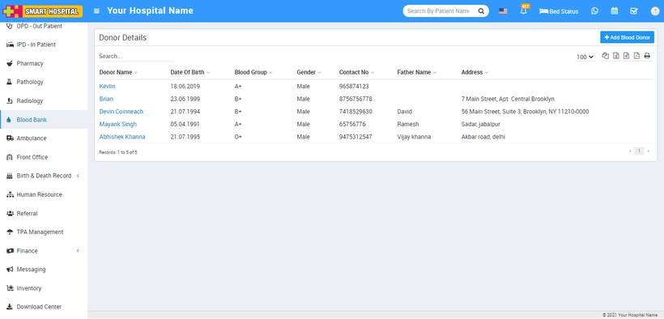
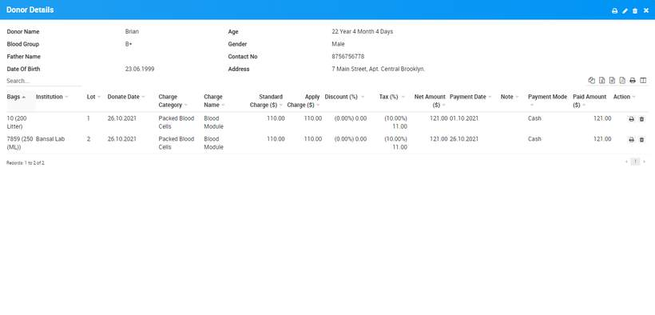
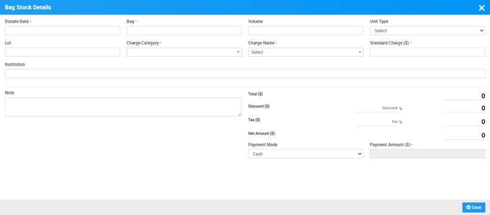

# How to add Donor details in Blood Bank?

_Mon, 08 Nov, 2021_ · [Blood Bank (6)](https://smart-hospital.in/category/blood-bank) · vendor article: https://smart-hospital.in/article/how-to-add-donor-details-in-blood-bank

### How to add Donor details in Blood Bank?

Mon, 08 Nov, 2021

[Articles](https://smart-hospital.in/articles)[Blood Bank](https://smart-hospital.in/category/blood-bank)

---

To add Donor details go to **Blood Bank > Donor Details > Add Blood Donor**, here enter **Donor Name, Date Of Birth, Blood Group, Gender, Father Name, Contact Number** and **Address** then click on **Save** button.  
  
  
  
You can Check this added record at Donor Details list page.  
  
  
  
To check Donor details click on Donor Blood **Show** button icon present at last column of Donor Details.  
  
  
  
To edit Donor details click on edit icon and to delete Donor record click on delete icon present at Donor details page.  
  
To print Donor details click on print icon present at top right corner at Donor details page  
  
**How to Add Bag Stock**To add Bag Stock click on **+** icon, show on mouse hover at last column of Donor Details. Here enter **Donor Date, Bag, Volume, Unit Type, Lot, Charge Category** ([click here](https://smart-hospital.in/article/hospital-charges) to understand how to add Charges), **Charge Name, Standard Charges, Note, Discount, Tax, Payment mode** and **Payment Amount** then click on **Save** button.   
  
  
  
To print Donor bill click on print button icon present at **Action** column at Donor Blood Show page and to delete bill details click on Delete icon present at **Action** column at Donor Blood Show page.
