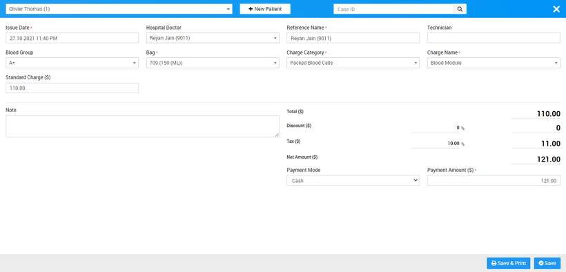
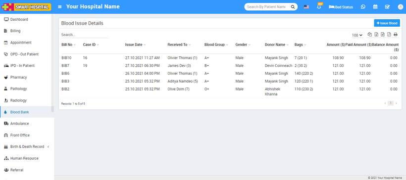
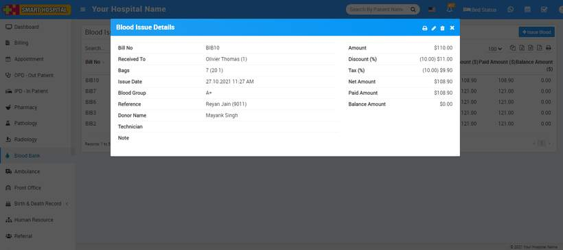
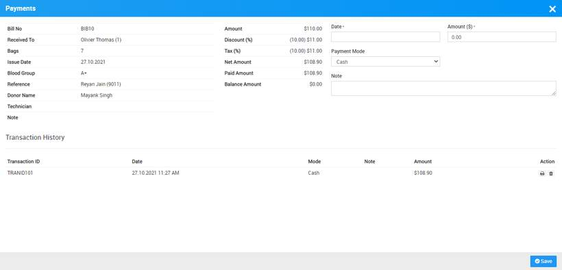

# How to Issue Blood?

_Wed, 27 Oct, 2021_ · [Blood Bank (6)](https://smart-hospital.in/category/blood-bank) · vendor article: https://smart-hospital.in/article/how-to-issue-blood

### How to Issue Blood?

Wed, 27 Oct, 2021

[Articles](https://smart-hospital.in/articles)[Blood Bank](https://smart-hospital.in/category/blood-bank)

---

There are two ways to issue Blood, first you can issue blood from Blood Bank Status page and other is go to **Blood Bank > Blood Issue Details > Issue Blood**.  
  
  
  
To issue blood click on Issue Blood button, here enter **Patient** from Select Patient (search for available patient) or create new patient from **+ New Patient** Button or add patient by entering **Case ID** (you can find Case Id from OPD or IPD detail of Patient) now enter **Issue Date, Hospital Doctor, Reference Name, Technician, Blood Group, Bag, Charge Category, Charge Name, Standard Charge, Note, Discount, Tax, Payment Mode** and **Payment Amount** (Payment Amount will automatically calculate) then click on **Save & Print** or **Save** button.   
  
You can check this added record at **Blood Issues Details** list Page.  
  
  
  
To check Blood Issue bill details click on show icon and to delete bill details click on delete icon present at **Action** column at **Blood Issues Details** list Page.  
  
  
  
To add payment click on Add Payment button icon present at **Action** column.  
  

