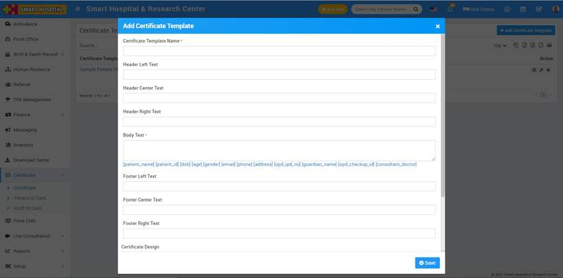

# About Certificate.

_Tue, 02 Nov, 2021_ · [Certificate (7)](https://smart-hospital.in/category/certificate) · vendor article: https://smart-hospital.in/article/about-certificate

### About Certificate.

Tue, 02 Nov, 2021

[Articles](https://smart-hospital.in/articles)[Certificate](https://smart-hospital.in/category/certificate)

---

In Smart Hospital Certificate is a document that is used to generate patient profile so you can take just printout of it and simply paste it into Patient file in which all patients records and their health related data is available.

**Certificate Module Workflow-** First we will design Patient certificate then we will generate/print them. If you will properly configure background, height, width etc. settings then you can design professional quality certificate very easily.

