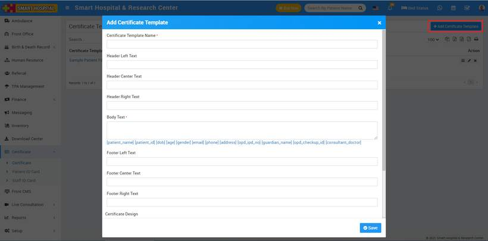
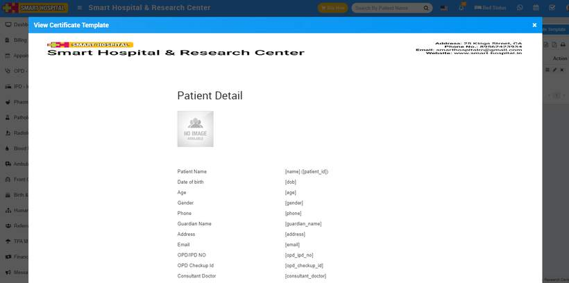

# How to add Certificate in Smart Hospital?

_Tue, 02 Nov, 2021_ · [Certificate (7)](https://smart-hospital.in/category/certificate) · vendor article: https://smart-hospital.in/article/how-to-add-certificate-in-smart-hospital

### How to add Certificate in Smart Hospital?

Tue, 02 Nov, 2021

[Articles](https://smart-hospital.in/articles)[Certificate](https://smart-hospital.in/category/certificate)

---

To add patient certificate, go to **Certificate > Certificate > Certificate Template** then click on the **+ Add Certificate Template** button, present at the top right corner of the page and then enter **Certificate Name** (certificate name is only for certificate design reference purpose it will not be print on actual certificate)**, Header Left Text, Header Center text, Header Right Text, Body Text** (enter specified keywords for replacing student data dynamically at time of certificate generation)**, Footer Left Text, Footer Center Text, Footer Right Text, Certificate Design – Header Height, Footer Height, Body Height, Body Width, Patient  Photo, Background Image** and then click on **Save** button. You can view this added record in the **Certificate List**  page.  
  
  
  

You can check this added Certificate Preview from **View** icon present at Action column.  
  

To edit certificate click on **Edit** and to delete certificate click on **Delete** Certificate icon.
