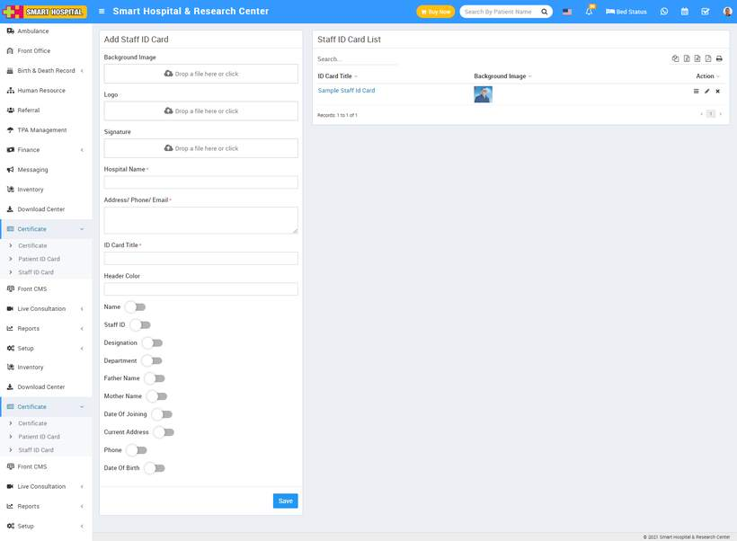
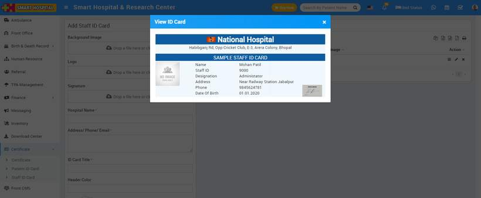

# How to add Staff ID card?

_Tue, 02 Nov, 2021_ · [Certificate (7)](https://smart-hospital.in/category/certificate) · vendor article: https://smart-hospital.in/article/how-to-add-staff-id-card

### How to add Staff ID card?

Tue, 02 Nov, 2021

[Articles](https://smart-hospital.in/articles)[Certificate](https://smart-hospital.in/category/certificate)

---

To add Staff ID card, go to **Certificate > Staff ID Card** then fill all entries **Background Image, Logo, Signature**(authorized person signature image)**, Hospital Name, Address/ Phone/Email, ID Card Title, Header Color, Name, Staff Id, Designation, Department, First Name, Mother Name, Date Of Joining, Current Address, Phone and Date Of** and then click on **Save** button. You can view this added record in the **Staff ID Card List** on the right side of the page.  
  

To view ID card click on **View** icon present at action column in the Patient ID card list page, at click of this icon ID card will be open.  
  
  

To edit ID card click on **Edit** icon and to delete ID card click on **Delete** icon present in the Staff ID card list.  
  
**Note:** In ID card design we will suggest you to try to edit ID card design parameters by edit as many time possible until you will get your perfect design. You have to adjust many time design parameters to get your perfect design. While adjusting design parameters take browser final print preview or print as pdf option from browser as final reference of print design from **Generate ID Card** link. Otherwise in final print you will get little bit deviation in design. All ID card designs can be see right side of this page.
