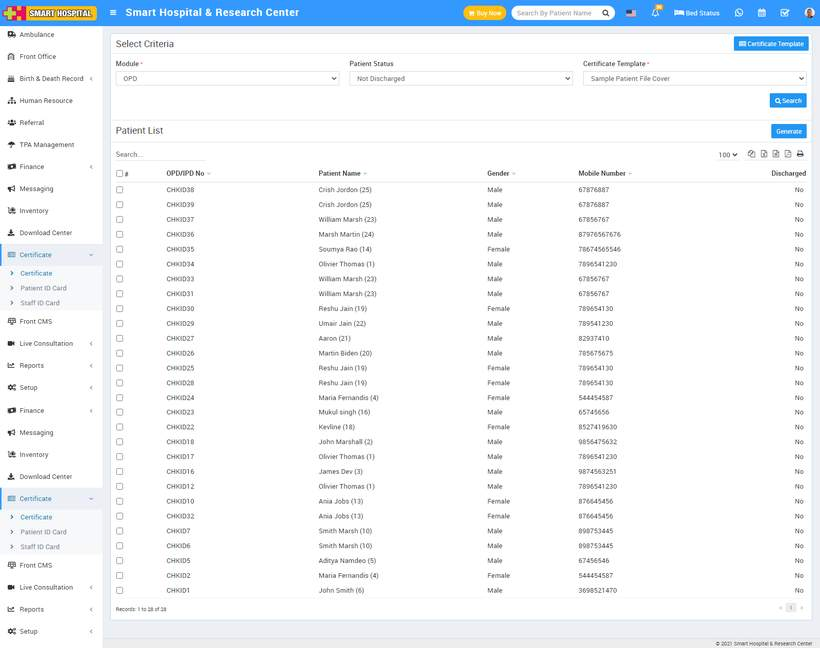

# How to generate certificate?

_Tue, 02 Nov, 2021_ · [Certificate (7)](https://smart-hospital.in/category/certificate) · vendor article: https://smart-hospital.in/article/how-to-generate-certificate

### How to generate certificate?

Tue, 02 Nov, 2021

[Articles](https://smart-hospital.in/articles)[Certificate](https://smart-hospital.in/category/certificate)

---

To generate certificate, go to **Certificate > Generate Certificate** then select **Module,** **Patient Status** and**Certificate** and then click on **Search** button. The list of patient will be shown in the below of the page.  
  

Now select patient for generate certificate and click on **Generate** button present at right side in the patient list, at click of this button certificate will be generate.

**Note -** Do not print the certificate directly, here select the **Destination** (save as pdf) and save pdf file and then print certificate using this pdf file.
