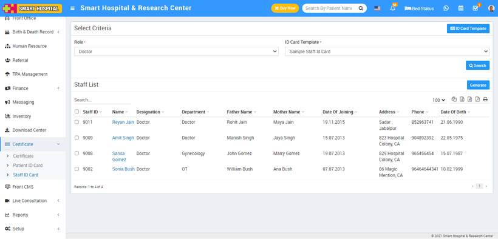
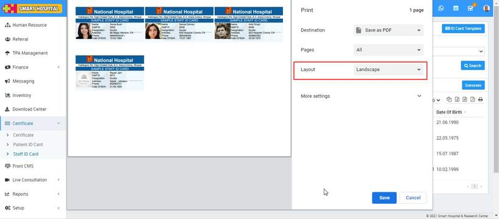

# How to generate Staff ID Card?

_Wed, 03 Nov, 2021_ · [Certificate (7)](https://smart-hospital.in/category/certificate) · vendor article: https://smart-hospital.in/article/how-to-generate-staff-id-card

### How to generate Staff ID Card?

Wed, 03 Nov, 2021

[Articles](https://smart-hospital.in/articles)[Certificate](https://smart-hospital.in/category/certificate)

---

To generate Staff ID card, go to **Certificate > Generate Staff ID Card** then select **Role** and **ID Card** **Template** and then click on **Search** button. The list of staff will be shown in the below of the page.  
  

Now select Staff for generate ID card and click on **Generate** button present at right side in the patient list, at click of this button Staff ID card will be open.  
  

Note: Do not print the ID card directly, here select the **Destination** (save as pdf) and save pdf file and then print ID card using this pdf file.
