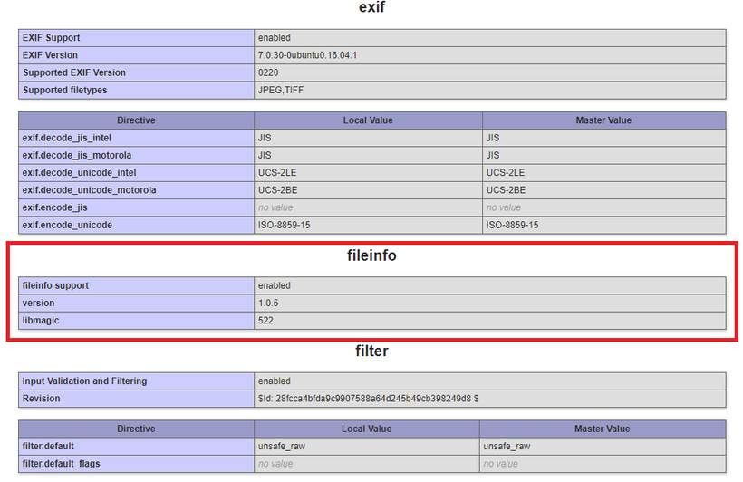

# Image Upload Not Working In Media Manager

_Mon, 18 Oct, 2021_ · [Common Issues & Troubleshooting (13)](https://smart-hospital.in/category/common-issues-troubleshooting) · vendor article: https://smart-hospital.in/article/image-upload-not-working-in-media-manager

### Image Upload Not Working In Media Manager

Mon, 18 Oct, 2021

[Articles](https://smart-hospital.in/articles)[Common Issues & Troubleshooting](https://smart-hospital.in/category/common-issues-troubleshooting)

---

If you are uploading image or any file in **Front CMS > Media Manager** and its not uploading and nothing happened then please check your hosting **phpinfo** details for **fileinfo** extension is enabled/installed on your hosting server. If **fileinfo**extension missing on your server then contact your hosting provider for enabling/installing **fileinfo** extension on your server.  
  
Due to missing **fileinfo** extension Smart Hospital media manager is unable to retrieve uploaded file extension hence images are not being uploaded. Fileinfo is very common extension and present almost all popular hosting.  
  

