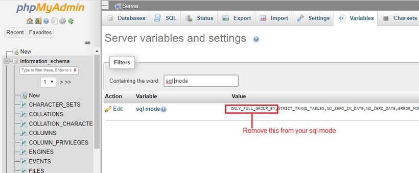

# ONLY_FULL_GROUP_BY Issue On Server

_Mon, 18 Oct, 2021_ · [Common Issues & Troubleshooting (13)](https://smart-hospital.in/category/common-issues-troubleshooting) · vendor article: https://smart-hospital.in/article/only_full_group_by-issue-on-server

### ONLY\_FULL\_GROUP\_BY Issue On Server

Mon, 18 Oct, 2021

[Articles](https://smart-hospital.in/articles)[Common Issues & Troubleshooting](https://smart-hospital.in/category/common-issues-troubleshooting)

---

If Smart Hospital showing **ONLY\_FULL\_GROUP\_BY** error message on your server that means on your hosting **ONLY\_FULL\_GROUP\_BY** is enabled in your mysql **SQL\_MODE**. This issue comes due to on some hosting server mysql is not configured properly. Please contact to your hosting provider to **disable/remove** **ONLY\_FULL\_GROUP\_BY** in your hosting mysql **SQL\_MODE** or follow the below instruction to fix this issue (it will require full **root access** of your mysql server) -  
  
Open **phpMyadmin** of your server then go to **Variables** tab then edit **sql mode** variable value and remove **ONLY\_FULL\_GROUP\_BY**.  
  
  
  

*Note: This fix is temporary and if your mysql server will be restart or update it will comes on default state. So ask your hosting admin to make it permanently in mysql config file.*  
  
Generally this issue occurred in cheap or non professional hosting. If you will go with hosting providers like **godaddy** or **hostgator** or any reputed hosting provider then you will not face this issue.
