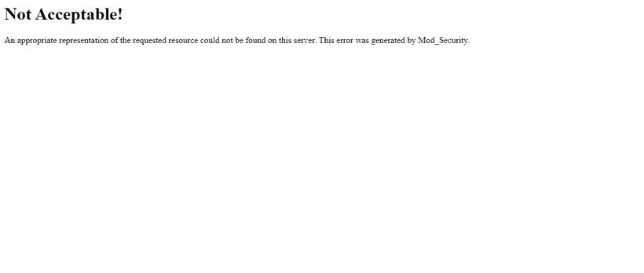

# Unable To Download Database SQL File

_Mon, 18 Oct, 2021_ · [Common Issues & Troubleshooting (13)](https://smart-hospital.in/category/common-issues-troubleshooting) · vendor article: https://smart-hospital.in/article/unable-to-download-database-sql-file

### Unable To Download Database SQL File

Mon, 18 Oct, 2021

[Articles](https://smart-hospital.in/articles)[Common Issues & Troubleshooting](https://smart-hospital.in/category/common-issues-troubleshooting)

---

Your getting this message because Mod\_Security is preventing download of sql file on your hosting server so you should disable Mod\_Security on your hosting or please contact your hosting support for this issue.  
  

