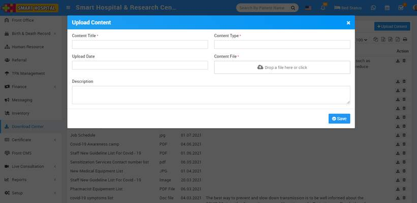
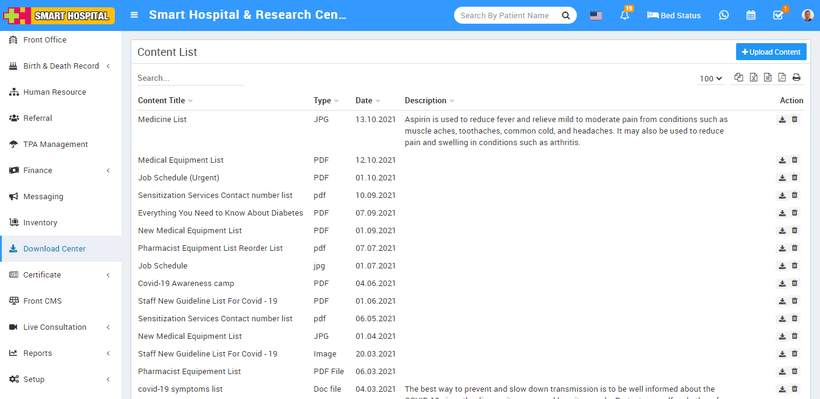

# How Download Center works in Smart Hospital?

_Thu, 30 May, 2024_ · [Download Center (3)](https://smart-hospital.in/category/download-center) · vendor article: https://smart-hospital.in/article/how-download-center-works-in-smart-hospital

### How Download Center works in Smart Hospital?

Thu, 30 May, 2024

[Articles](https://smart-hospital.in/articles)[Download Center](https://smart-hospital.in/category/download-center)

---

Download Center is for managing different documents which should be available for download to other staff members.

To upload document click on **+ Upload Content** button here enter **Content Title, Content Type, Upload Date, Content File** and **Description**.  
  
  
  
You can check this added record at Download Center list page.  
  

To download content click on**Download** icon and to delete content click on **Delete** icon present in the content list.
