# Overall working of download center module in smart hospital

_Sat, 31 Aug, 2024_ · [Download Center (3)](https://smart-hospital.in/category/download-center) · vendor article: https://smart-hospital.in/article/overall-working-of-download-center-module-in-smart-hospital

### Overall working of download center module in smart hospital

Sat, 31 Aug, 2024

[Articles](https://smart-hospital.in/articles)[Download Center](https://smart-hospital.in/category/download-center)

---

In a Smart Hospital, **Content Type** typically refers to the classification or categorization of digital educational resources. The different types of content can include things like:

* Documents (e.g. word processing files, PDFs)
* Images (e.g. photos, illustrations)
* Video files (e.g. video, animations)

By classifying the content into these different types, the "Smart Hospital" system can better organize and manage the resources, making it easier for Staff to find what they need.  
  
To add a content type, go to **Download Centre****> Content Type**. Now enter the name of the specific content as well as a description of the content type, then click the **Save** button, your newly added content type will now appear in the content type list.  
  
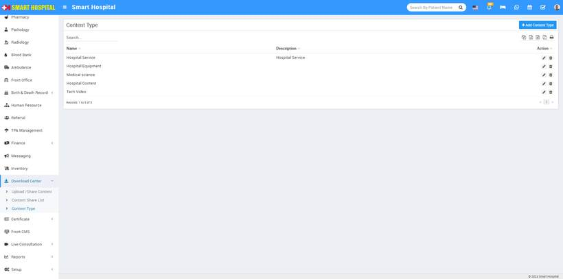  
  
You can also edit the content type by clicking on the **edit** icon, which is shown in the **action** column.  
  
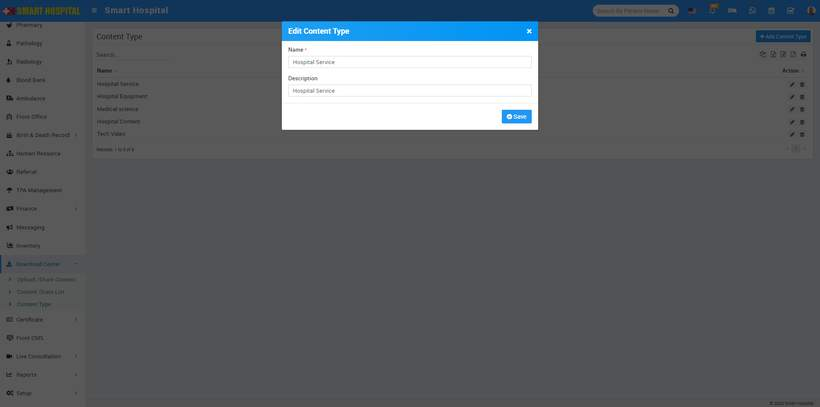  
  
 To delete the content type, you need to click on the **delete** icon, which is also shown in the **action** column.  
  
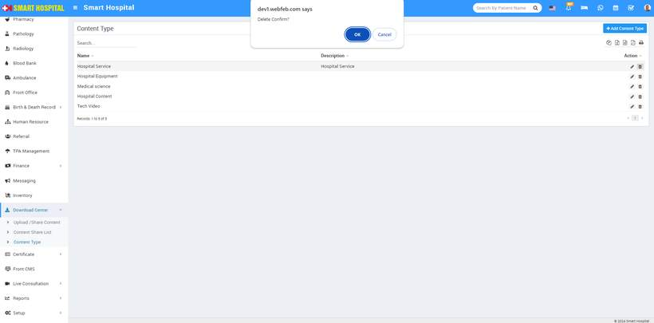  
  
click on **OK** button content type will be deleted successfully.  
  
  
To upload / share content, go to **Download Centre > Upload / Share Content**, **Content List** will be open, here you can see multiple content and you can search these content by using search tab.  
  
  
  
To **Upload Content,** click on the **Upload**button, showing at the top right corner, upload content model will be open, here.  
  
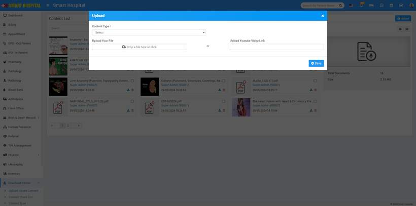  
  
select the **Content Type**. Now in below you can either **Upload Your File** or **Upload YouTube Video Link** then Click on the **Save** button, so that content upload successfully.  
  
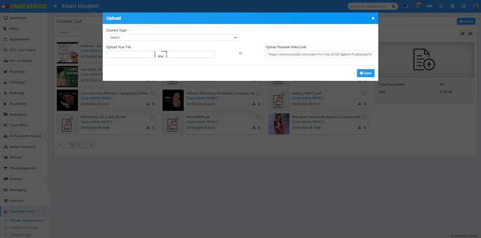  
  
You can view the content in the **content list** and if you want to search the particular content just click on **search** file, write the name of content and click on **search** button, your content will appear below in content list as well as you can also view this content by using the **list view** and **card view** options, which are shown in below of upload button.  
  
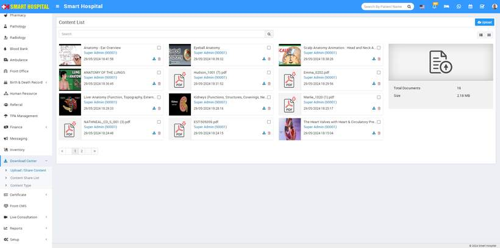  
  
To rename the file name and content type, follow these steps: Choose any file from the **content list** and click on its **content name**. This will open the file name and content type fields on the right. In the file name field, you can rename the file, and in the content type field, you can select the desired content type from the drop-down menu. Once you have made the changes, click the **save** button, and your file name and **content type** will be updated successfully.  
  
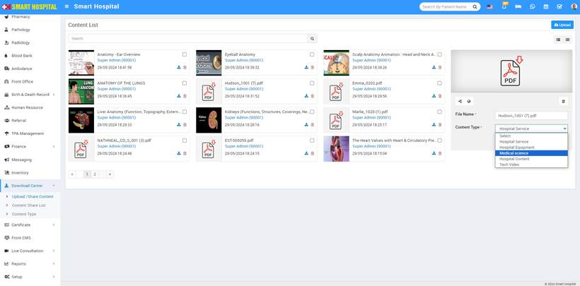  
  
To **share content**, simply check the checkbox of the content or you can check the multiple content, at the same time and at the right side, you can see the count of selected files.  
  
  
  
Now in file count below, you can see the content sharing option available, by this feature you can share the content. Simply click on **share** icon.  
  
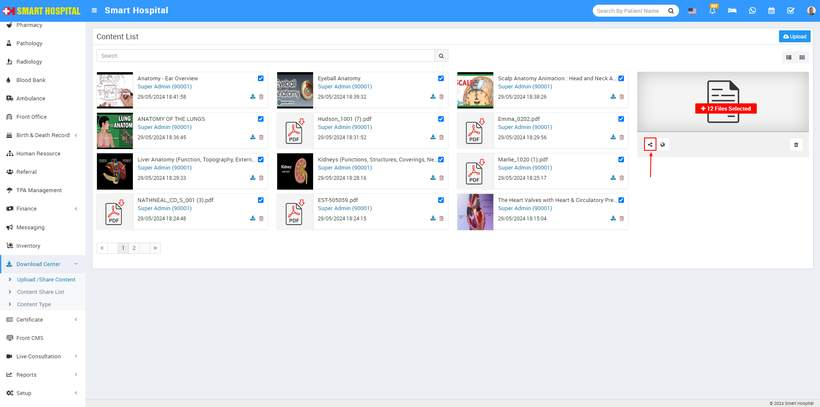  
  
Shared selected model will be open.  
  
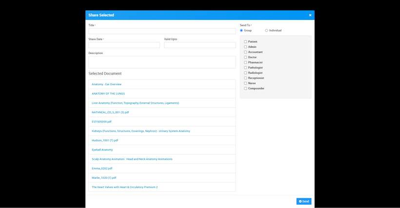  
  
In this model, there are multiple options available. First, you need to fill in the **title** of the shared content, then select the **share date** and the date until which the content will be **valid up to**. You should also provide a **description** about the shared content. After that, you can see a list of **selected documents** that you want to share. On the right side, you will find the **'send to'** option. You can use this feature to share the content with a **group**, **class**, or **individual**. Select the group and below that, you can see multiple roles to which you can share the selected content. Choose the relevant roles and click on the **'send'** button, which is located on the bottom right corner.  
  
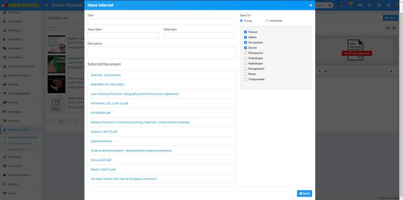  
  
And you’re content will be shared successfully.  
  
Now select the **individual** option, when you select the **individual** option select and **search** tab will be appear in below.  
  
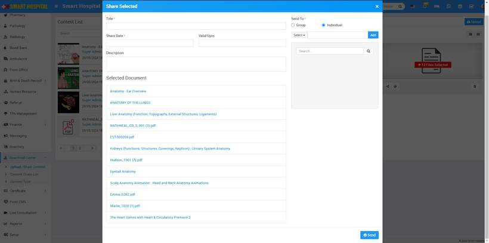  
  
In this tab, you will see the **'select'** option. Click on it and a drop-down menu will open. From here, select the **role** and search for the relevant **individual**,  
  
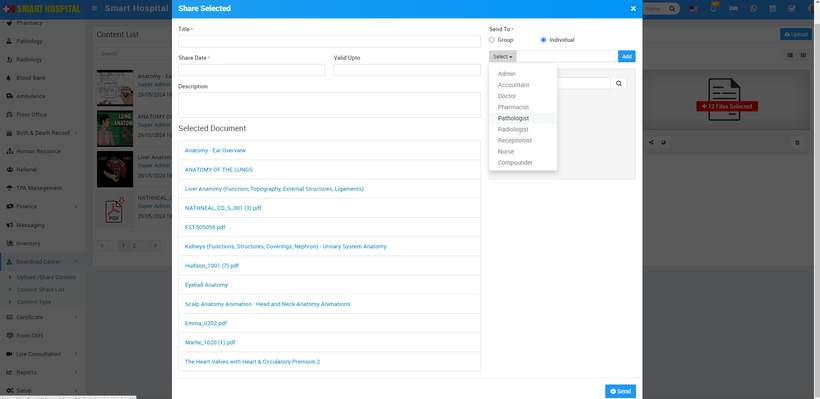  
  
here **search list** will be open in below, select the **person** and click on **add** button.  
  
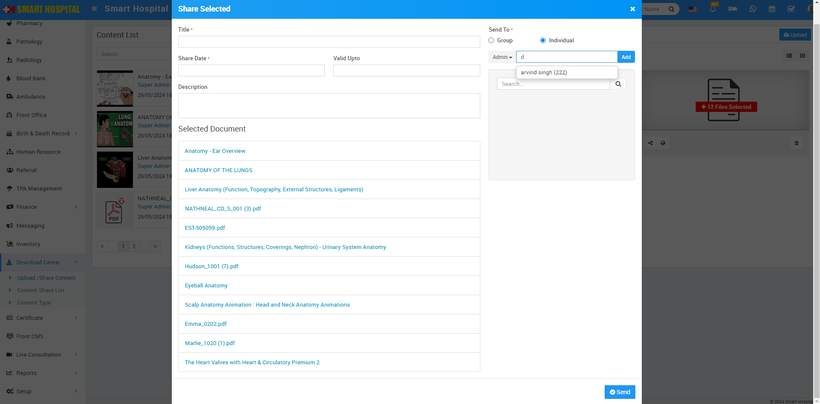  
  
Your selected person will be added in the list.  
  
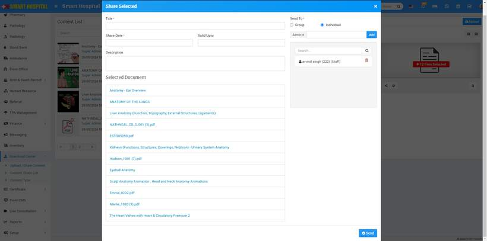  
  
You can also select the multiple person by using select drop menu, just select he another role and search the person then click on **add** button so that person will also show in below list.

If you add the multiple person and want to cross check to add this person or not, just fill the name on search box and click on **search** icon that person will appear from the list.

Or if you want to delete any one of them just click on **delete** icon showing in next to the name of person, your added person will be deleted successfully.  
  

Now click on **send** button and your selected content will **send** successfully.

**Generate URL**

You can also share the content with the help of URL, just need to click on **URL** icon which is showing next to the share icon.  
  
  
  
**Generate URL** model will be open. To generate a **URL** for the selected content in the model, you need to fill in the title of the **content, share date**, and the **valid up-to** date, and then click on the **'Generate URL'** button.  
  
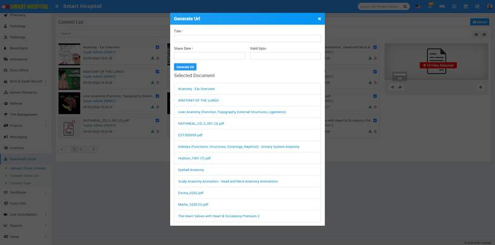  
  
**URL** will be generated successfully. Once the URL is generated, you can copy it by clicking on the **copy** icon below the link. Alternatively, you can click on the **link** directly to open it in a new page.  
  
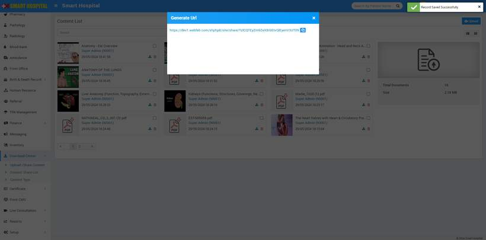  
  
On this page, you can view all the selected content along with their details. To open a content item, simply click on it. If you want to download the content, click on the **download** icon, and it will be downloaded to your system.  
  
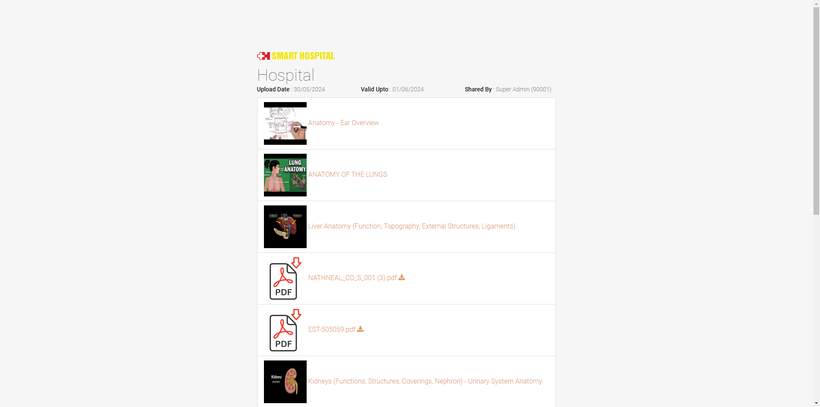  
  
To **Delete** the single content from the content list, simply click on **Delete** icon showing in over the content and **confirmation** model will appear.  
  
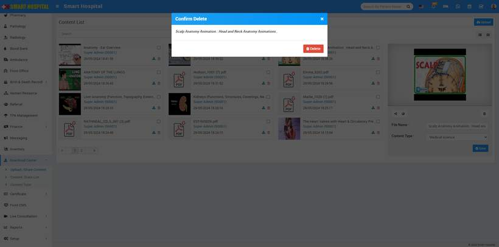

Now click on **delete** button which is showing in below, content will be delete successfully.

To **Delete** the multiple content from the **content list**, first you need to select the multiple content by checking the **checkboxes**, now click to **Delete** icon, showing at right of page, **Confirmation** window will be appear.  
  
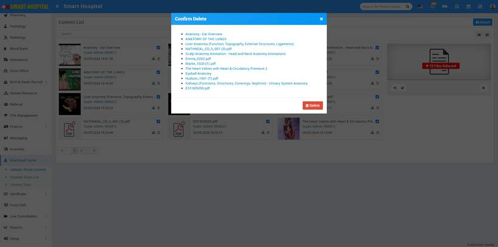  
  
In this **Confirmation** model, you can see the selected content along with its file name that you want to **delete**. To delete the content, simply click the **Delete** button, and your selected content will be deleted successfully.

**Content Share List** typically refers to a list of content that has been shared or made available for others to access or view. This list can include various types of content such as **documents, images, videos,**or**links to websites**. The **content share list** can be useful for organizing and tracking shared content, especially in collaborative work settings or for sharing information with a larger group of people.

To view the content share list, go to **Download Centre >** **Content Share List**. Content share list will be open, in this list you can see the content details as**Title**, **Send to**, **Share Date**, **Valid Upto**, **Shared By**, **and Description**of content. In the **action** column, here **link**, **view** and **delete** option available.  
  
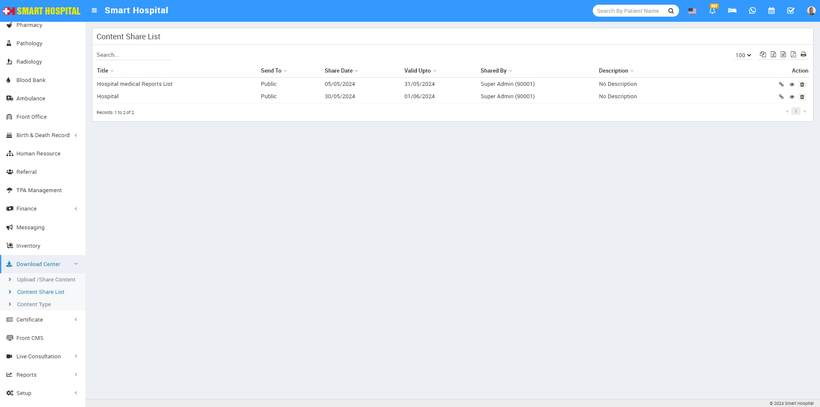  
  
Now click on **link** icon, link model will be open.  
  
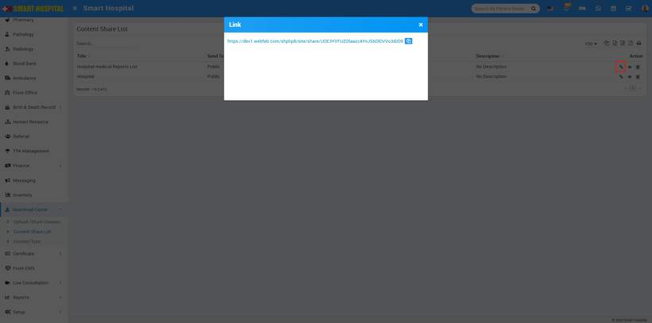  
  
Now click on **link** icon, link model will be open.  
  
You can see the **generated link** of the selected content here. To share the link, simply click the **copy** icon located below the link and then paste it wherever you want to share it. Alternatively, you can directly click on the **link**, and it will open in a new page.  
  
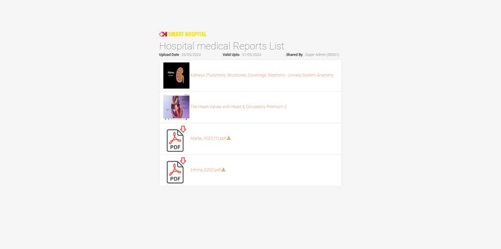  
  
On this page, you can view **content** details as well as the file.  
  
Clicking on the **View** icon will open the **Shared** **Contents** model. In this model, you can view details of the shared content such as the **Upload Date, Valid Upto, Share Date, Shared By, send to, Description, and Shared Group/Users**. In the **Attachments** section, you can view or download the attachment file by clicking on it, depending on the file type.  
  
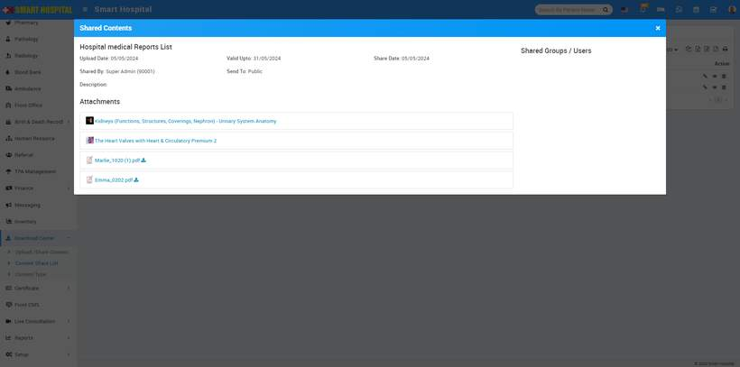  
  
To **Delete** a content detail from the shared **content list**, simply click on the **Delete** icon located in the **Action** column. This will open a **Confirmation** model. Click the "**OK**" button to confirm the delete of the content details from the content share list.  
  
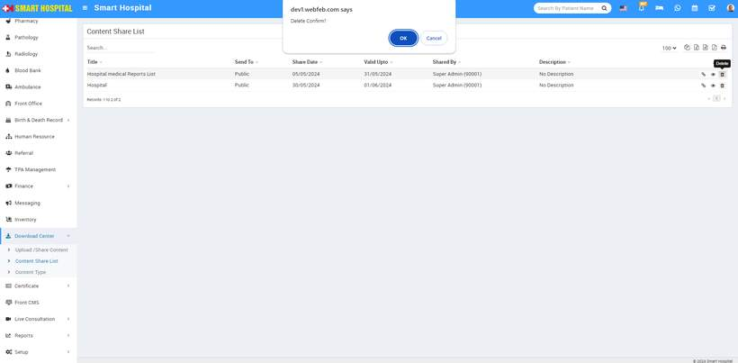

Once you click the "**OK**" button, the content detail will be **deleted** successfully.
