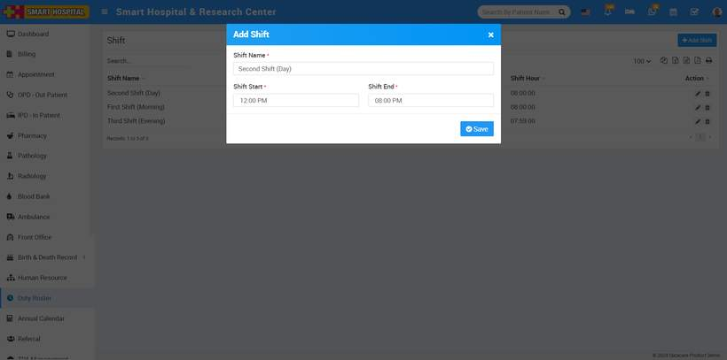
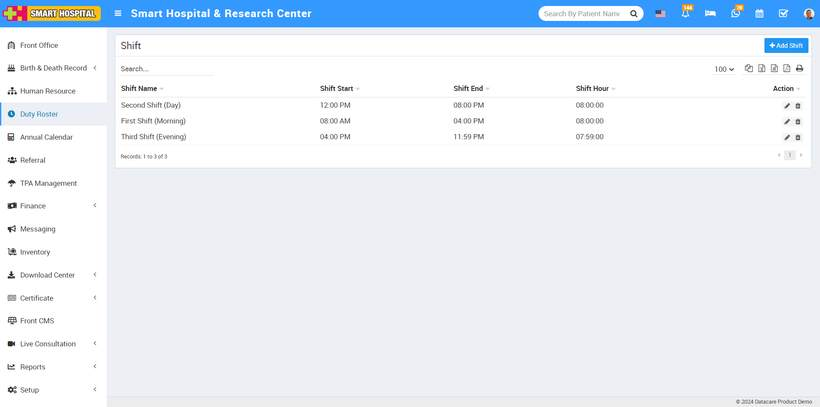
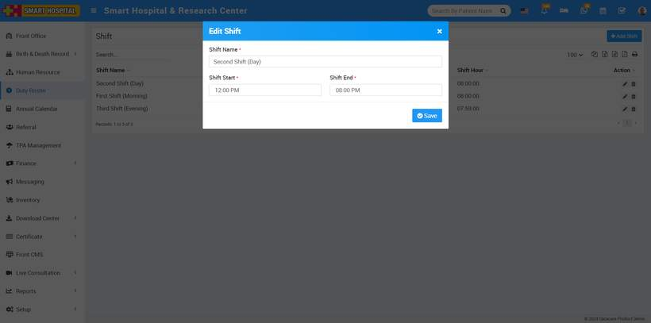
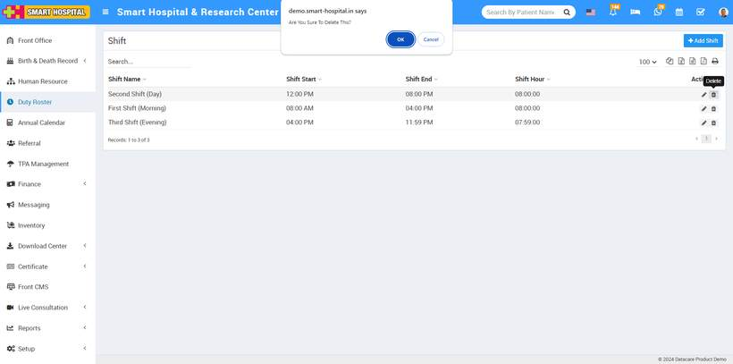

# How to add the shift in duty roster?

_Thu, 05 Sep, 2024_ · [Duty Roster (4)](https://smart-hospital.in/category/duty-roster) · vendor article: https://smart-hospital.in/article/how-to-add-the-shift-in-duty-roster

### How to add the shift in duty roster?

Thu, 05 Sep, 2024

[Articles](https://smart-hospital.in/articles)[Duty Roster](https://smart-hospital.in/category/duty-roster)

---

To add a shift, go to the top right corner of the page where you will see the **Shift** button, simply click on it,   
  
  
  
After click on the shift button, the **Shift** page will open   
  
  
  
  
On this page, the **Add Shift** button is available in the top right corner. Simply click on Add Staff, and a popup window will open.  
  
  
  
Enter the details such as shift name, shift start, and shift end, then click on the '**Save**' button. The shift will be added successfully.  
  
Now here you can see the shift details which you have recently added.  
  
  
  
On the right hand side, you will see the edit and delete buttons. If you want to edit the shift, click on the edit icon, the '**Edit Shift**' window will open. Make the necessary changes and click '**Save**.' Your shift will be updated successfully.  
  
  
  
To **delete** the shift, simply click on delete icon on the right side, delete option will be open then click on **OK**, your added shift will be deleted successfully  
  

