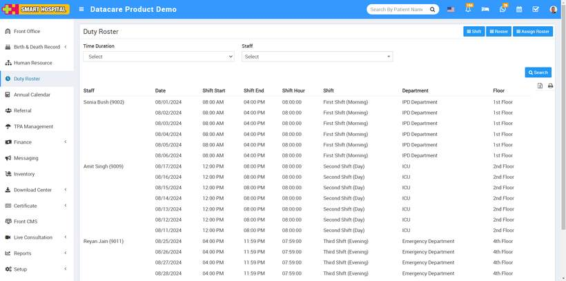
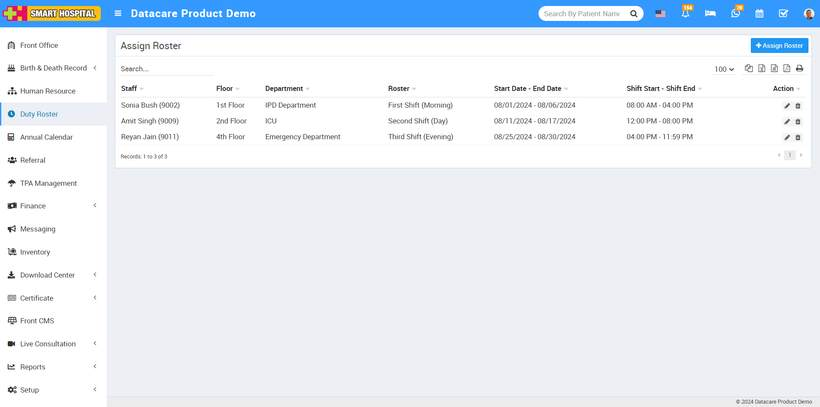
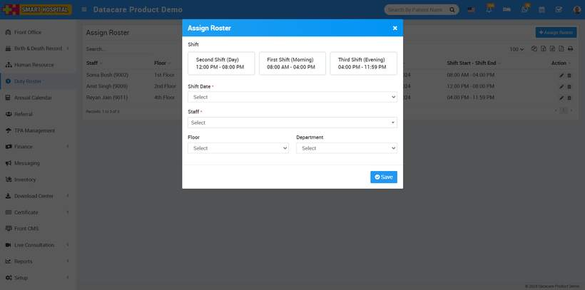
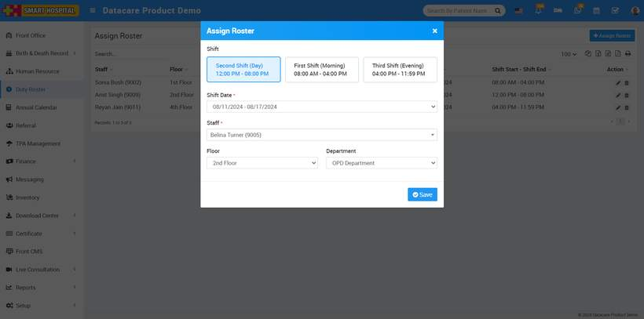
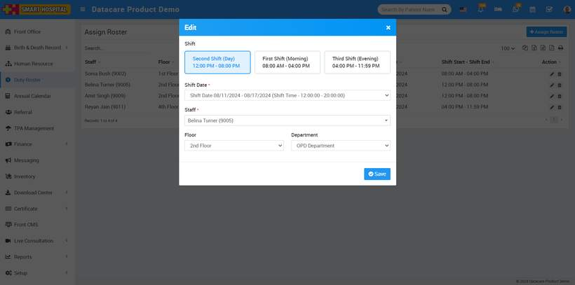
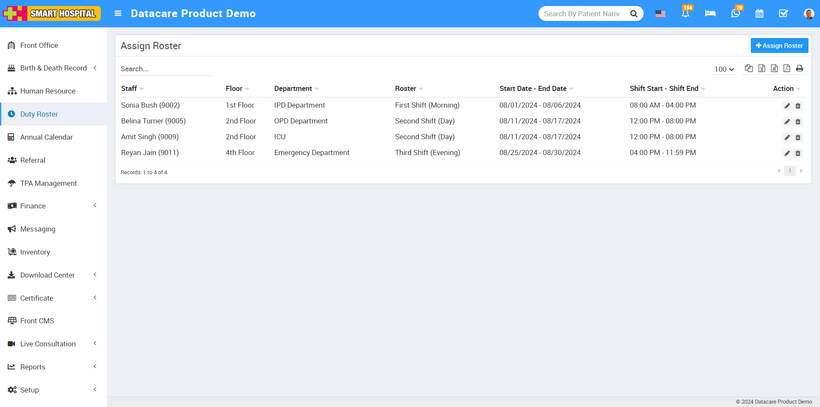
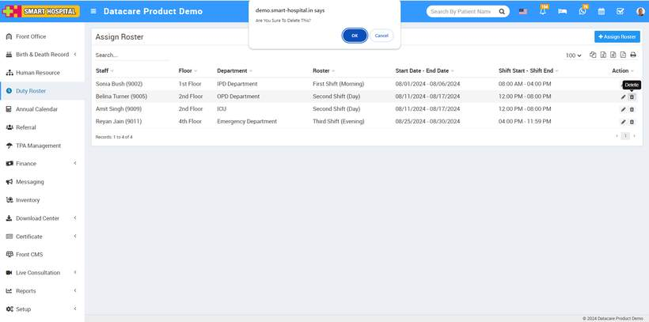

# How to assign the roster to the staff?

_Thu, 05 Sep, 2024_ · [Duty Roster (4)](https://smart-hospital.in/category/duty-roster) · vendor article: https://smart-hospital.in/article/how-to-assign-the-roster-to-the-staff

### How to assign the roster to the staff?

Thu, 05 Sep, 2024

[Articles](https://smart-hospital.in/articles)[Duty Roster](https://smart-hospital.in/category/duty-roster)

---

To assign the roster to staff, go to the **Duty Roster** module and click on it. The Duty Roster list page will open  
  
  
  
On the page, in the top right corner, the **Assign Roster** button is displayed. Simply click on the button, and the Assign Roster page will open  
  
  
  
Now in this page, at the top right corner **Add Assign Roster** button displaying, simply click on button, Add Assign roster window will be open  
  
  
  
In the Assign Roster page, select the desired shift, then choose the Shift Date. Next, select the staff member you want to assign to this roster, followed by the floor and department where the duty will be assigned.   
  
  
  
Finally, click the 'Save' button, and the roster will be successfully assigned to the selected staff member  
  
  
To edit the assigned roster, simply click on the pencil icon on the right side of the page. The edit window for the assigned roster will open  
  
  
  
Now here update the details of assigned roster then click on save button, details will be update successfully and will display on the Assign Roster page  
  
  
  
To delete the assign roster, simply click on **delete** icon showing at the right side of the page, delete window will be open, click on yes, assigned roster will be **delete** successfully  
  
  

