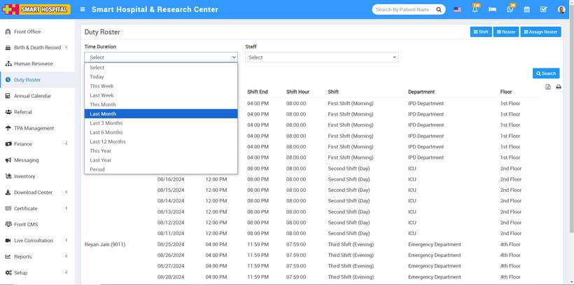
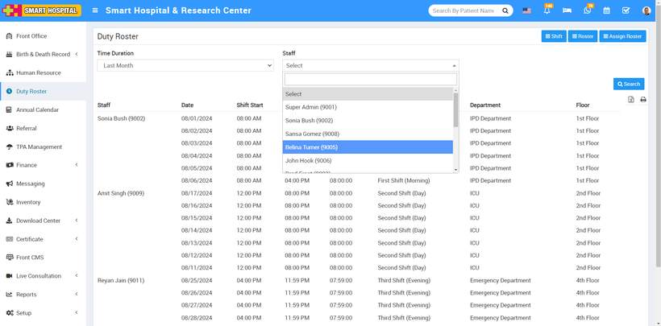
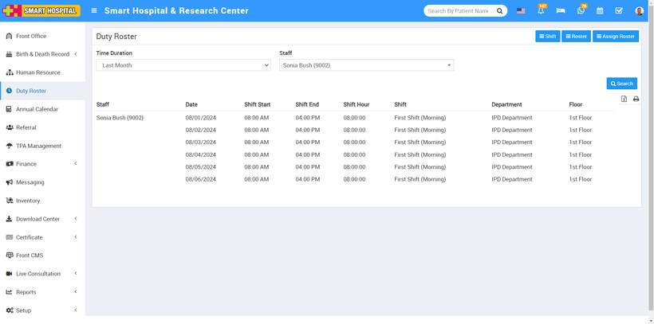

# How to search the duty roster?

_Thu, 05 Sep, 2024_ · [Duty Roster (4)](https://smart-hospital.in/category/duty-roster) · vendor article: https://smart-hospital.in/article/how-to-search-the-duty-roster

### How to search the duty roster?

Thu, 05 Sep, 2024

[Articles](https://smart-hospital.in/articles)[Duty Roster](https://smart-hospital.in/category/duty-roster)

---

To search duty roster using time duration and staff, log in to the Smart Hospital. After logging in, go to the **Duty Roster** module and click on it. The Duty Roster page will open on the right side  
  
  
  
In this list, you can view the details of the staff duty roster. At the top, there are options to select the **Time Duration** and **Staff**. Simply choose the desired Time Duration, which can be searched by day, month, year, or period  
  
  
  
Now select the staff name by clicking on the dropdown. A list of staff will appear, choose the staff whose roster details you want to see. Then, click on **Search  
  
**Now, the staff roster details will be displayed below, including the staff name, date, shift start, shift end, shift hours, shift, department, and floor  
  

