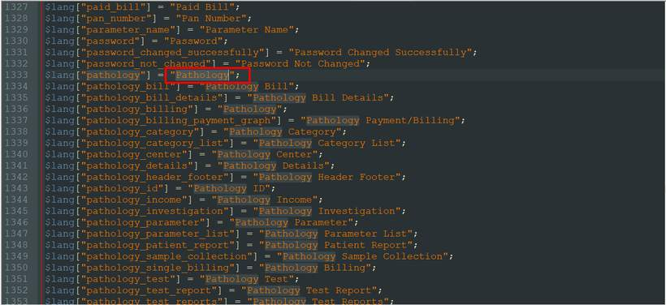
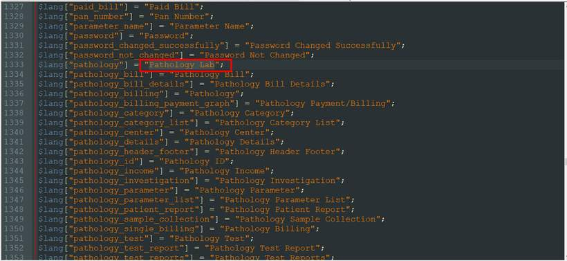
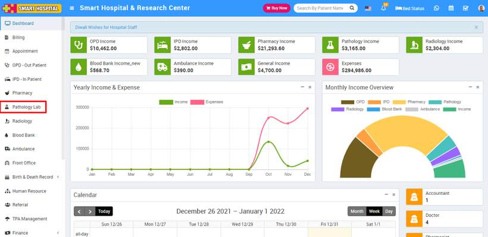

# How to change text label in Smart Hospital.

_Fri, 31 Dec, 2021_ · [FAQ (17)](https://smart-hospital.in/category/faq) · vendor article: https://smart-hospital.in/article/how-to-change-text-label-in-smart-hospital

### How to change text label in Smart Hospital.

Fri, 31 Dec, 2021

[Articles](https://smart-hospital.in/articles)[FAQ](https://smart-hospital.in/category/faq)

---

In Smart Hospital, if you want to change text labels like if you want to change text lebel of **"Pathology"** to **"Pathology Lab"** then for this you should go to the Language file location, here first you should select the Language file according to your country language and do changes in that language file.  
  
For e.g. if you want to change text lebel of **"Pathology"** to **"Pathology Lab"** in English language then go to the file path location \application\language\English\app\_files and open system\_lang.php file then serach for the keyword **"Pathology"  
  
**   
  
  
Now replace it with **"Pathology Lab"** then save it.  
  
  
  
  
After save changes it will look like below image at Smart Hospital site.  
  
  
  
**Note-** Please make sure you have done changes in proper format (like **Pathology Lab** must be under single inverted commas) otherwise code will cause an error.
