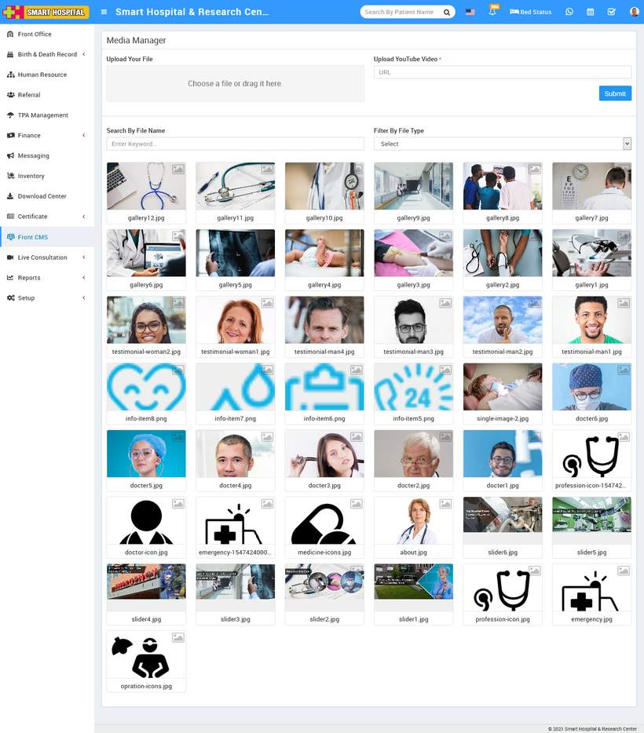

# How Media Manager works in Smart Hospital.

_Thu, 11 Nov, 2021_ · [Front CMS (8)](https://smart-hospital.in/category/front-cms) · vendor article: https://smart-hospital.in/article/how-media-manager-works-in-smart-hospital

### How Media Manager works in Smart Hospital.

Thu, 11 Nov, 2021

[Articles](https://smart-hospital.in/articles)[Front CMS](https://smart-hospital.in/category/front-cms)

---

To upload file (like images)  and YouTube videos , go to **Front CMS > Media Manager** then Choose or drag file in the **Upload Your File**option so selected file will be upload in your Smart hospital on Media Manager. Also to**upload youtube video enter youtube url at** **Upload Youtube Video URL** section and then click on **Submit** button. Uploaded file and youtube video will show at Media Manager list page.

You can search media by entering any keyword in **Search By File Name**textbox and you can also search any file by selecting file type ( like video, text,zip,Rar etc.).
