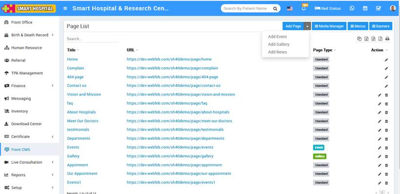
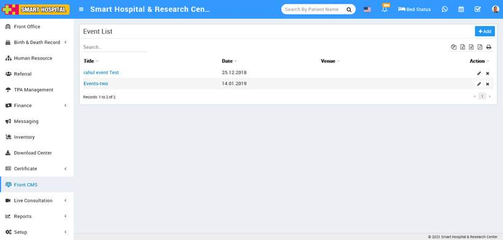

# How to add an Event?

_Thu, 11 Nov, 2021_ · [Front CMS (8)](https://smart-hospital.in/category/front-cms) · vendor article: https://smart-hospital.in/article/how-to-add-an-event

### How to add an Event?

Thu, 11 Nov, 2021

[Articles](https://smart-hospital.in/articles)[Front CMS](https://smart-hospital.in/category/front-cms)

---

To add event, go to **Front CMS** **then click Down Arrow icon and then click on** **Add Event** button present at top right corner in Page List page. Here you can add all events scheduled past/future in your hospital. To add new event click on **+ Add** button. Here enter **Event Title**, **Event Venue**, **Event Start Date**, **Event End Date**, **Description**, **SEO Detail Meta Title**, **Meta Keyword**, **Meta Description** then select Sidebar Setting, Featured Image then click on **Save** button.  
  

  
  
You can view this added event record at Event List page.  
  

To edit event click on **Edit** icon and to delete page click on**Delete** icon present in the Event list.
