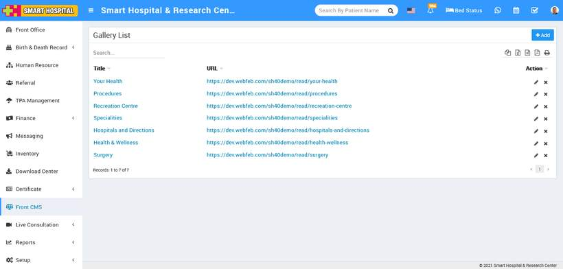

# How to add Gallery in Smart Hospital?

_Thu, 11 Nov, 2021_ · [Front CMS (8)](https://smart-hospital.in/category/front-cms) · vendor article: https://smart-hospital.in/article/how-to-add-gallery-in-smart-hospital

### How to add Gallery in Smart Hospital?

Thu, 11 Nov, 2021

[Articles](https://smart-hospital.in/articles)[Front CMS](https://smart-hospital.in/category/front-cms)

---

To add new gallery go to **Front CMS then click Down Arrow icon and then** click on Add Gallery button. Here you can add all image/video galleries of your hospital. To add new gallery click on + Add button. Here enter gallery Title, Description, Gallery Images, SEO Detail Meta Title, Meta Keyword, Meta Description then select Sidebar Setting, Featured Image then click on Save button.  
  

You can view this added Gallery record at Gallery List page.  
  

To edit Gallery click on **Edit** icon and to delete page click on**Delete** icon present in the Gallery list.
