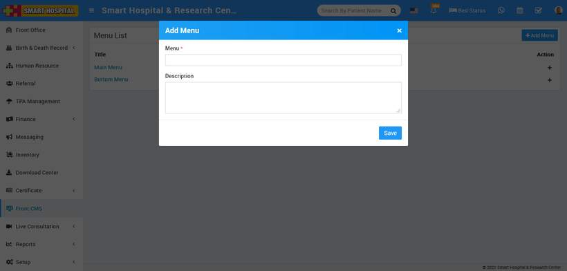
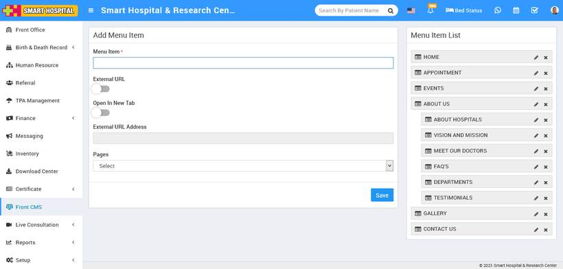

# How to add menus in Smart Hospital?

_Thu, 11 Nov, 2021_ · [Front CMS (8)](https://smart-hospital.in/category/front-cms) · vendor article: https://smart-hospital.in/article/how-to-add-menus-in-smart-hospital

### How to add menus in Smart Hospital?

Thu, 11 Nov, 2021

[Articles](https://smart-hospital.in/articles)[Front CMS](https://smart-hospital.in/category/front-cms)

---

Front CMS module for managing hospital front website. First we will upload different images or files used in front website in Media Manager then we will create front website menu in Menus then we will add different Pages, Events, Galleries, News and Banner images.

To add menu, go to **Front CMS > Menus**, Here by default you will get two menu **Main Menu** and **Bottom Menu**. Here you can add more menu but these other menu will be only display in front site if you will add them in front site theme additionally. To add more menus enter **Menu** and **Description** and then click on **Save** button. You can view this added menu record in the**Menu List** on the right of the page.  
  

To delete menu click on **Delete** icon present at **Action** column in the menu list.  
  
To add menu item click on **Add (+)** icon present at **Action** column in the menu list, at click of this icon **Add Menu Item** page will be open.  
  

Here enter **Menu Item, External URL, Open In New Tab, External URL Address, Pages** and then click on **Save** button. You can view this added record in the **Menu Item List** on the right side of the page. Here you can arrange menu order and add menu item up and down in menu item list.

To edit menu item click on **Edit** icon and to delete menu item click on **Delete** icon present in the menu item list.
