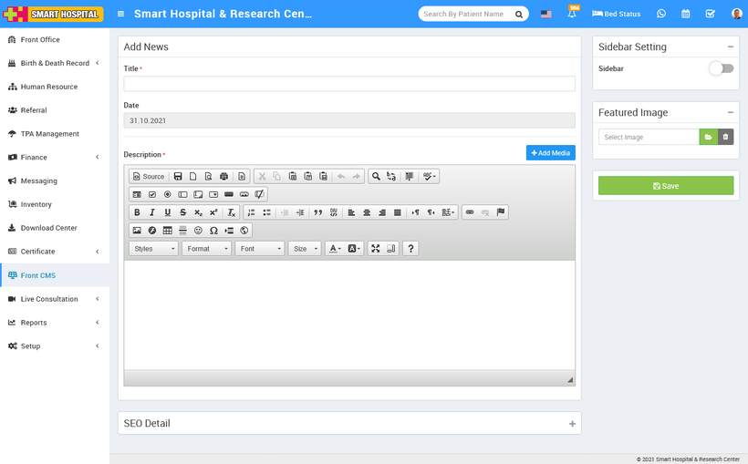
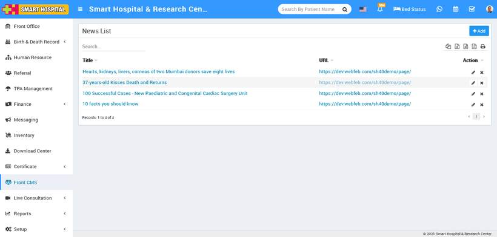

# How to add News in Smart Hospital?

_Thu, 11 Nov, 2021_ · [Front CMS (8)](https://smart-hospital.in/category/front-cms) · vendor article: https://smart-hospital.in/article/how-to-add-news-in-smart-hospital

### How to add News in Smart Hospital?

Thu, 11 Nov, 2021

[Articles](https://smart-hospital.in/articles)[Front CMS](https://smart-hospital.in/category/front-cms)

---

To add new news go to **Front CMS then click Down Arrow icon and then** click on Add News button. Here you can add all News/Notices of your hospital. To add new news click on + Add button. Here enter news Title, News Date, Description, SEO Detail Meta Title, Meta Keyword, Meta Description then select Sidebar Setting, Featured Image then click on **Save** button.  
  

You can view this added News record at **News** List page.  
  

To edit News click on **Edit** icon and to delete News click on**Delete** icon present in the News list.
