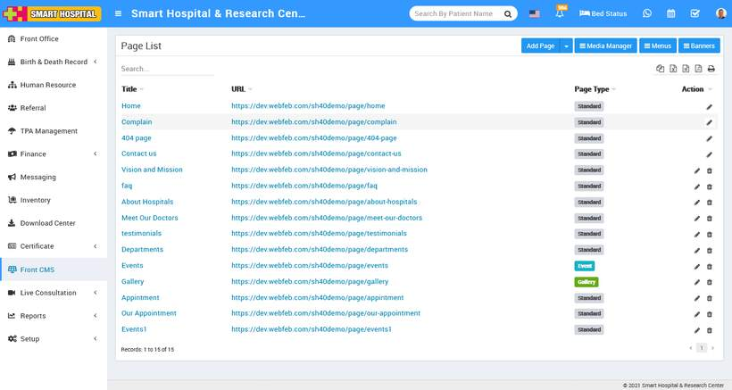

# How to add Pages in Smart Hospital?

_Thu, 11 Nov, 2021_ · [Front CMS (8)](https://smart-hospital.in/category/front-cms) · vendor article: https://smart-hospital.in/article/how-to-add-pages-in-smart-hospital

### How to add Pages in Smart Hospital?

Thu, 11 Nov, 2021

[Articles](https://smart-hospital.in/articles)[Front CMS](https://smart-hospital.in/category/front-cms)

---

To manage front website of Smart Hospital here by creating pages, menus, events, gallery, news.

To add pages, go to **Front CMS** then click on **Add Page** button present at top right corner in page list page, then enter the page **Title,** select **Page Type** (Standard, Events (page to show all Events), Notice (page to show all News/Notices) and Gallery (page to show all images/video Galleries) and **Description, Add Media, SEO Detail** click on **Add (+)** icon enter details here **Meta Title, Meta Keyword, Meta Description** and then select **Sidebar Setting** to show and hide sidebar and select **Featured Image** (featured image will be show only those themes or pages which have support for featured image) and then click on **Save** button.  
  

You can view this added record in the **Page List** page (Here you can see four by default page **Home, Complain, Contact and 404 page**).  
  

To edit page click on **Edit** icon and to delete page click on**Delete** icon present in the page list.
