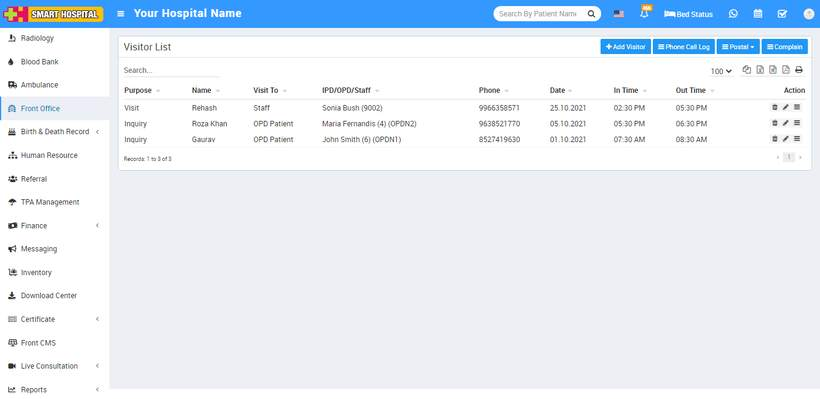

# About Front Office

_Thu, 28 Oct, 2021_ · [Front Office (7)](https://smart-hospital.in/category/front-office) · vendor article: https://smart-hospital.in/article/about-front-office

### About Front Office

Thu, 28 Oct, 2021

[Articles](https://smart-hospital.in/articles)[Front Office](https://smart-hospital.in/category/front-office)

---

This module has 4 sections -

1. Visitor List
2. Phone Call Log
3. Postal
4. Complain

Hospital Receptionists answer phone calls, greet visitors and provide information to patient and their family members and file a complaint or check filed complaints from visitors. They are able to provide information on a variety of topics, including rules, availability, disciplinary measures and day-to-day operations of the Hospital.  
  
  

