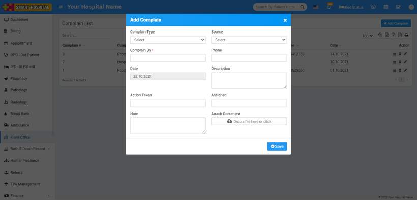
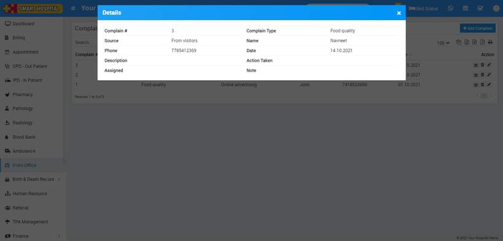

# How to add Complain in Smart Hospital?

_Thu, 28 Oct, 2021_ · [Front Office (7)](https://smart-hospital.in/category/front-office) · vendor article: https://smart-hospital.in/article/how-to-add-complain-in-smart-hospital

### How to add Complain in Smart Hospital?

Thu, 28 Oct, 2021

[Articles](https://smart-hospital.in/articles)[Front Office](https://smart-hospital.in/category/front-office)

---

Complain is for managing any complain raise by any person for this click on Complain button. To add complain click on **+ Add** **Complain** button now enter **Complain Type, Source, Complain By, Phone, Date, Description, Action Taken, Assigned, Note** and **Attach Document** if any.  
  
  

To view complain click on **View** icon present at **Action** column in the complain list, at click of this icon**Details** modal will be open. Here you can see details of the complain.  
  
  

To edit complain click on**Edit** icon and to delete complain click on **Delete** icon present in complain list.
