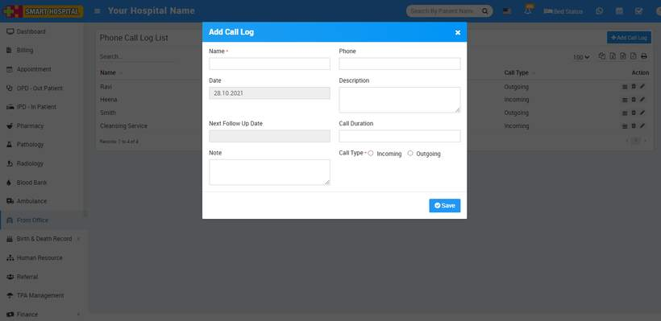
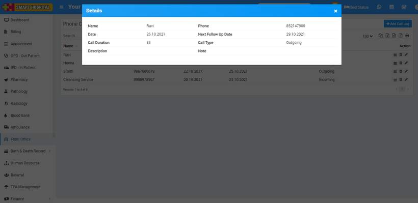

# How to add Phone Call Log in Smart Hospital?

_Thu, 28 Oct, 2021_ · [Front Office (7)](https://smart-hospital.in/category/front-office) · vendor article: https://smart-hospital.in/article/how-to-add-phone-call-log-in-smart-hospital

### How to add Phone Call Log in Smart Hospital?

Thu, 28 Oct, 2021

[Articles](https://smart-hospital.in/articles)[Front Office](https://smart-hospital.in/category/front-office)

---

Phone Call Log is for managing incoming or outgoing call details for this click on Phone Call Log button. To add Phone Call Log click on **+ Add Call Log** button, now enter **Person Name, Phone, Date, Description, Next Follow Up Date, Call Duration, Note** and **Call Type Incoming or Outgoing**.  
  
  

To view phone call log click on **View** icon present at **Action** column in the phone call log list, at click of this icon **Details** modal will be open. Here you can see the details of the phone call log.  
  

To edit phone call log click on **Edit** icon and to delete phone call log click on **Delete** icon present in the phone call log list
