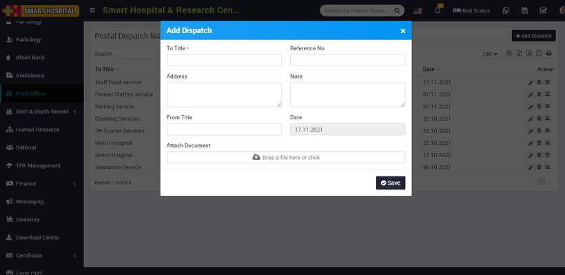
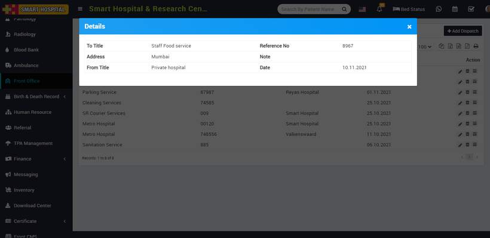

# How to add Postal Dispatch in Smart Hospital?

_Wed, 17 Nov, 2021_ · [Front Office (7)](https://smart-hospital.in/category/front-office) · vendor article: https://smart-hospital.in/article/how-to-add-postal-dispatch-in-smart-hospital

### How to add Postal Dispatch in Smart Hospital?

Wed, 17 Nov, 2021

[Articles](https://smart-hospital.in/articles)[Front Office](https://smart-hospital.in/category/front-office)

---

For managing Postal Dispatch click on **Postal Dispatch** button. To add Postal Dispatch click on **+ Add Dispatch** button now here enter To **Title, Reference Number, Address, Note, From Title, Date** and **Attach Document** if any.  
  
  
  
To view Postal Dispatch click on **Show** button present at **Action** column in the Postal Dispatch list, at click of this icon **Details** modal will be open. Here you can see the details of the Postal Dispatch.  
  
  
  
To edit Postal Dispatch click on **Edit** icon and to delete Postal Receive click on **Delete** icon present in the Postal Dispatch list.
