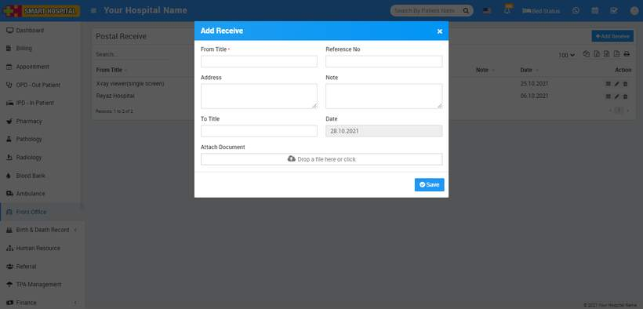
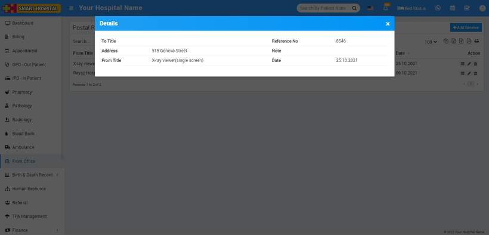

# How to add postal receive in Smart Hospital?

_Thu, 28 Oct, 2021_ · [Front Office (7)](https://smart-hospital.in/category/front-office) · vendor article: https://smart-hospital.in/article/how-to-add-postal-receive-in-smart-hospital

### How to add postal receive in Smart Hospital?

Thu, 28 Oct, 2021

[Articles](https://smart-hospital.in/articles)[Front Office](https://smart-hospital.in/category/front-office)

---

Postal Receive is for managing postal inward documents for managing postal receive click on Postal Receive button. To add Postal Receive click on **+ Add Receive** button now here enter From Title, Reference Number, Address, Note, To Title, Date, Attach Document if any.  
  
  
  
  
  
To view Postal Receive click on **View** icon present at **Action** column in the Postal Receive list, at click of this icon **Details** modal will be open. Here you can see the details of the Postal Receive.  
  
  
  
  
To edit Postal Receive click on **Edit** icon and to delete Postal Receive click on **Delete** icon present in the Postal Receive list.
