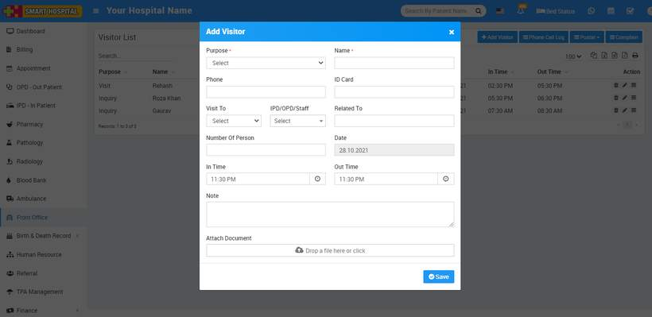
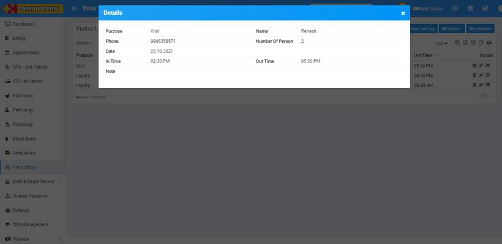

# How to add visitor book?

_Thu, 28 Oct, 2021_ · [Front Office (7)](https://smart-hospital.in/category/front-office) · vendor article: https://smart-hospital.in/article/how-to-add-visitor-book

### How to add visitor book?

Thu, 28 Oct, 2021

[Articles](https://smart-hospital.in/articles)[Front Office](https://smart-hospital.in/category/front-office)

---

Visitor Book is for managing visitor’s records coming in hospital. For this click on Visitor Book button. To add visitor details click on **+ Add Visitor** button, now enter **visitor person Purpose, Name, Phone, ID Card, Visit To, IPD/OPD/Staff, Number of Person, Date, In time, Out Time Note** and **Attached Document** if any.  
  

To view visitor click on **View** icon present at **Action** column in the visitor list, at click of this icon**Details** modal will be open. Here you can see the details of the visitor.  
  
  
  
To edit visitor click on **Edit** icon and to delete visitor click on**Delete** icon present in the visitor list.
